# MOS I/V Characteristics

In this section, we analyze the **generation** and **transport of charge** in MOSFETs as a function of the terminal voltages. Our objective is to derive equations for the I/V characteristics such that we can elevate our abstraction from device physics level to circuit level.

## Threshold Voltage

Consider an NFET connected to external voltages as shown in Fig. 2.6(a). What happens as the gate voltage, $$V_G$$, increases from zero? Since the gate, the dielectric, and the substrate form a capacitor, as $$V_G$$ becomes more positive, the **holes** in the p-substrate are repelled from the gate area, leaving negative ions behind so as to mirror the charge on the gate. In other words, a **depletion region** is created \[Fig. 2.6(b)]. Under this condition, no current flows because no charge carriers are available.

Why negative ions are left behind?

Remember that we have studied the chemical process for n/p type doping in [NUS CG2027](https://app.gitbook.com/s/6nPr3SObC3azazbFhfgF/lec/lec-01-the-devices#holes-and-electrons). In the p-substrate, the main charge carriers are **holes**. Thus, we can imagine that our **p-substrate** will look like as follows initially.

<figure>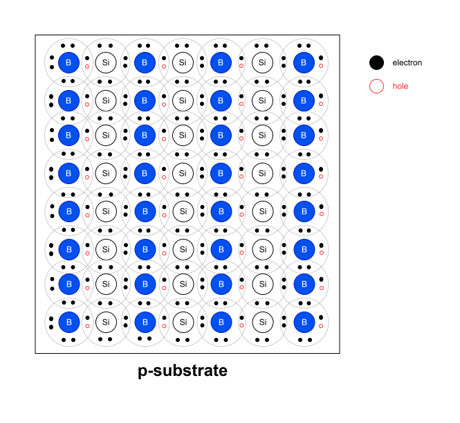<figcaption></figcaption></figure>


A fun fact or fast way to remember n-type and p-type free carriers: "N" stands for "negative" and "P" stands for "positive". Thus, in the n-type material, the free carrier is **electron** and in the p-type material, the free carrier is **hole**.


As we increase the gate voltage $$V_G$$ at the top, more holes are pushed away to the bottom, which is equivalent to more electrons are attracted to the top, thus making the top region's boron to become **negative ions**. This is also where the **depletion region** forms.

<figure>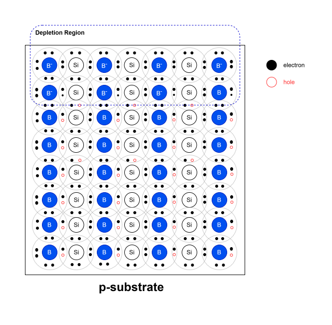<figcaption></figcaption></figure>


This explanation also aligns with what we have seen in [MOS capacitor in EE4415](https://app.gitbook.com/s/Sp0XaarBjbEX3JIMrRaR/part-2-lec-analog-design-flow/lec-1-mosfet-and-cmos-process#the-mos-capapictor-with-p-substrate), where **depletion region** is defined to be the region where the free-carrier's density is low. Indeed, we can see from the image above that in the depletion region of the p-substrate, there are very few holes! Thus, we can also say that in p-substrate, the depletion region is where the **negative boron ions** are.


<figure>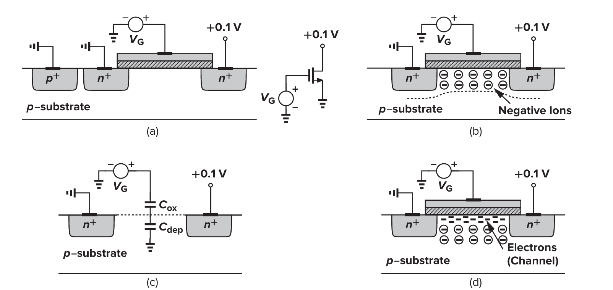<figcaption>
Figure 2.6: (a) A MOSFET driven by a gate voltage; (b) formation of depletion region; (c) onset of inversion; (d) formation of inversion layer
</figcaption></figure>

As $$V_G$$ increases, so does the width of the depletion region and the potential at the oxide-silicon interface. In a sense, the structure resembles a voltage divider consisting of two capacitors in series:

1. the gate-oxide capacitor $$C_{\text{ox}}$$ and
2. the depletion-region capacitor $$C_{\text{dep}}$$ \[Fig. 2.6(c)].

When the interface potential reaches a sufficiently positive value, electrons flow from the source to the interface and eventually to the drain.

Why can electrons start to flow from source to drain as we further increase the gate voltage?

As we increase the gate voltage further, using the idea of **voltage divider** mentioned above, the interface potential will become positive enough so that it will not only attract the electrons on the p-substrate itself, but it will also attract the **electrons from the source**. Thus, the inversion layer (similar to n-type region where there are free electrons) is formed.


The sentence above is very important and it definitely worths an "Eureka" moment in this section!&#x20;


<figure>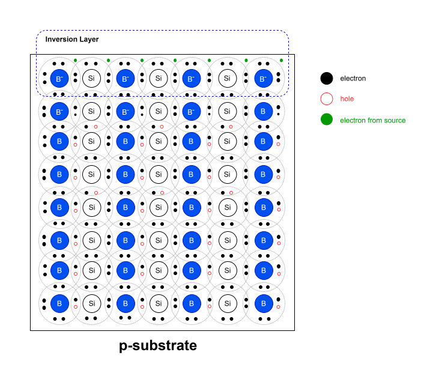<figcaption></figcaption></figure>

Thus, a "channel" of charge carriers (in this case is electrons as we are dealing with NMOS) is formed under the gate oxide between S and D, and the transistor is "turned on." We say the interface is "inverted." For this reason, the channel is also called the "inversion layer." The value of $$V_G$$ for which this occurs is called the "threshold voltage," $$V_{TH}$$. If $$V_G$$ rises further, the charge in the depletion region remains relatively constant while the [channel charge density](#user-content-fn-1)[^1] continues to increase, providing a greater current from S to D.


This is perhaps the most detailed explanation for the MOS capacitor at this point as we have successfuly combined the chemical stuff from CG2027, the MOS capacitor stuff in EE4415 and Razavi's textbook together!!!


In reality, the turn-on phenomenon is a gradual function of the gate voltage, making it difficult to define $$V_{TH}$$ unambiguously. In semiconductor physics, the $$V_{TH}$$ of an NFET is usually defined as

> the gate voltage for which the interface is "[**as much n-type as the substrate is p-type**](#user-content-fn-2)[^2]."

It can be proved that:

$$
V_{TH} = \Phi_{MS} + 2\Phi_F + \frac{Q_{dep}}{C_{ox}} \tag{2.1}
$$

where $$\Phi_{MS}$$ is the difference between the work functions of the polysilicon gate and the silicon substrate, $$\Phi_F$$ is the fermi potential which roughly tells how heavily doped the substrate is. $$\Phi_F = (kT/q)\ln(N_{sub}/n_i)$$, $$k$$ is Boltzmann's constant, $$q$$ is the electron charge, $$N_{sub}$$ is the doping density of the substrate, $$n_i$$ is the density of electrons in undoped silicon, $$Q_{dep}$$ is the charge in the depletion region, and $$C_{ox}$$ is the gate-oxide capacitance per unit area. From pn junction theory, $$Q_{dep} = \sqrt{4q\epsilon_{si}|\Phi_F|N_{sub}}$$, where $$\epsilon_{si}$$ denotes the dielectric constant of silicon. Since $$C_{ox}$$ appears very frequently in device and circuit calculations, it is helpful to remember that for $$t_{ox} \approx 20\text{Å}$$, $$C_{ox} \approx 17.25\text{fF}/\mu\text{m}^2$$. The value of $$C_{ox}$$ can then be scaled proportionally for other oxide thicknesses.


From this definition, we should at least know that the **threshold voltage** is in positive correlation with the charges[^3] in the **depletion region**.


In practice, the "native" threshold value obtained from the above equation may not be suited to circuit design, e.g., in theory our $$V_{TH} = 0$$, but in reality the device does not turn off for $$V_G = 0$$. For this reason, the threshold voltage is typically adjusted by implantation of dopants into the channel area during device fabrication, in essence altering the doping level of the substrate near the oxide interface. For example, as shown in Fig. 2.7, if a thin sheet of p+ is created, the gate voltage required to deplete this region increases.

<figure>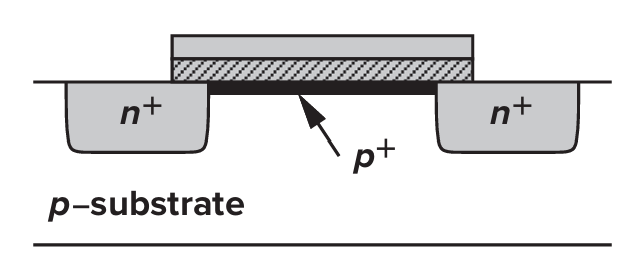<figcaption>
Figure 2.7: Implantation of p+ dopants too alter the threshold.
</figcaption></figure>


p+ simply means that there are more holes and thus the gate voltage should be **larger** to push these holes to the bottom of the substrate.


The above definition is not directly applicable to the **measurement** of $$V_{TH}$$. In Fig. 2.6(a), only the drain current can indicate whether the device is "on" or "off", failing to reveal at what $$V_{GS}$$ the interface is **as much n-type as the bulk is p-type**. As a result, the calculation of $$V_{TH}$$ from I/V measurements is somewhat ambiguous. We will return to this point later, but assume for now that the device turns on abruptly for $$V_{GS} \ge V_{TH}$$.

PMOS Threshold Voltage

The turn-on phenomenon in a PMOS device is similar to that of NFETs, but with all the polarities reversed. As shown in Fig. 2.8, if the gate-source voltage becomes sufficiently negative, an inversion layer consisting of holes is formed at the oxide-silicon interface, providing a conduction path between the source and the drain. That is, the threshold voltage of a PMOS device is typically **negative**.

<figure>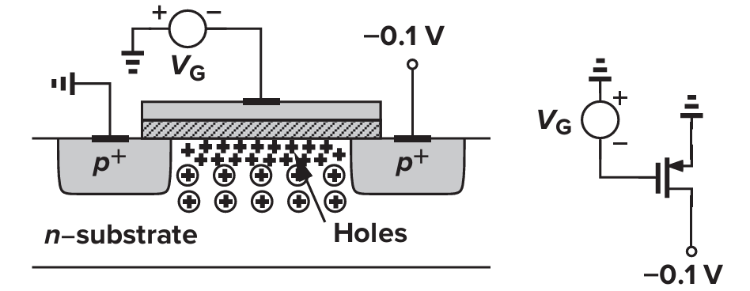<figcaption>
Figure 2.8: Formation of inversion layer in a PFET.
</figcaption></figure>

PN-Junction Re-explained

At this point of time, it's good for us to have a relook at the deeper working principle of PN-junction. Initially, the pn-junction is shown as follows.

<figure>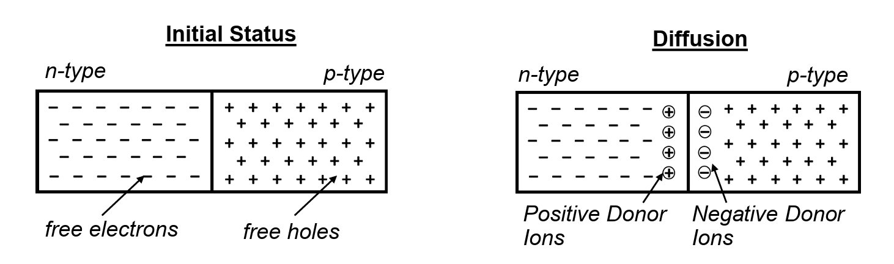<figcaption></figcaption></figure>

Both the n-type and p-type are **electrically neutral**. However, due to the **diffusion**, the electrons from the n-type (negative) material will flow to the p-type material, filling up the holes there and leaving holes at n-type material region. For this reason, we might see the positive Phosphorus ions at the n-type region and the negative Boron ions at the p-type region (And yeah, the depletion region is formed at each type of the region). After a certain period of time, we will see an equilibrium achieved.

<figure>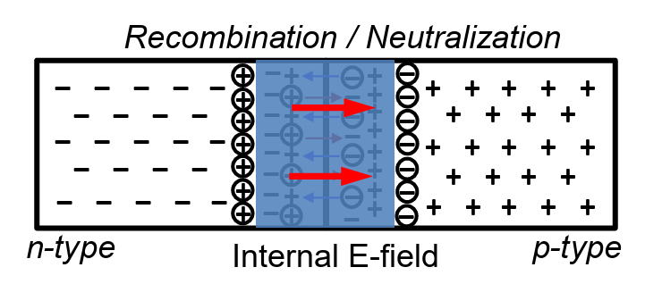<figcaption></figcaption></figure>

This is because the movement of the electrons creates a voltage difference (n-type region has higher voltage) and thus creating an electric field pointing towards right. This electric field will then **prevent** the electrons from n-type material to further move toward the p-type material.

This equilibrium can be strengthen or weaken by applying an external voltage across the pn-junction, which is known as the forward-bias and reverse-bias region.



#### Forward Bias

In the forward bias case, the external voltage is applied as follows.

<figure>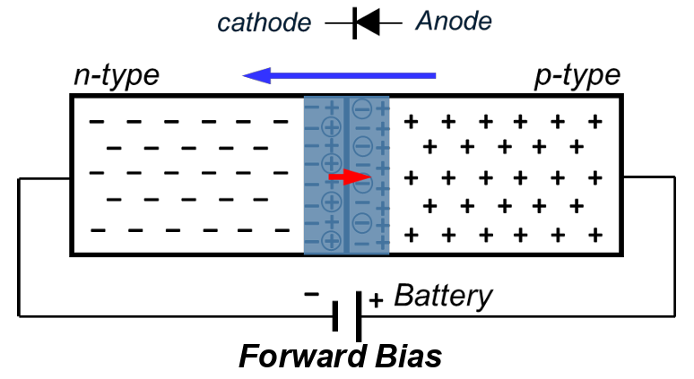<figcaption></figcaption></figure>

The reason that the equilibrium is weaken, or a.k.a, the depletion region gets shortened, is because there are **external electrons** coming from the voltage source and filling into the positive Phosphorus ions to make them become neutral Phosphorous atom again. And similarly, the electric field is pushing the extra electrons gained by the negative Boron ions away thus they become neutral Boron atoms! In that case, we can clearly see that the depletion region gets shortened!


Some of you (including me initially) might think from the perspective of the movement of the internal electrons, this will make things confusing as the external electric field will make more _internal electrons_ from n-type material to move to p-type. This is not true and we should think from the perspective of the external electrons!




#### Reverse Bias

Inversely, the external voltage's direction in the reverse bias case is shown as follows:

<figure>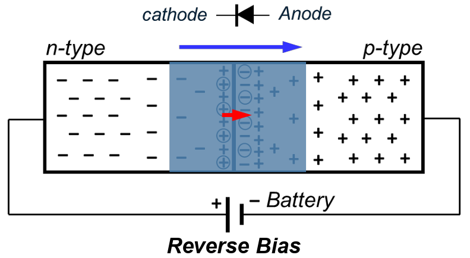<figcaption></figcaption></figure>

Similarly, in this case, because of the newly added electric field, more electrons are pushed away from the n-type region and more external electrons are coming into the p-type region, together making the depletion region bigger.



## Derivation of I/V Characteristics

In order to obtain the relationship between the drain current of a MOSFET and its terminal voltages, let's make two observations.


The **drain current**, often denoted as $$I_D$$, is the current that flows horizontally through the inversion layer (the channel).




#### The Lemma

In high school or secondary school, we have learned that the **current** is defined as the derivative of charge ($$Q$$) with respect to time ($$t$$):

$$
I=\frac{dQ}{dt}
$$

which is nothing but $$I=\frac{Q}{t}$$. Now, we will look from the other way around, which is also our first observation here. Consider a semiconductor bar carrying a current $$I$$ \[Fig. 2.9(a)].

<figure>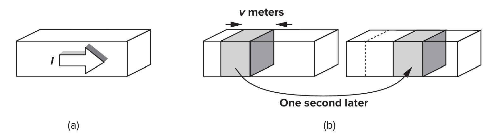<figcaption>
Figure 2.9: (a) A semiconductor bar carrying a current I; (b) snapshots of the carriers one second apart.
</figcaption></figure>

If the **mobile charge density** along the direction of current is $$Q_d$$ **coulombs per meter** and the velocity of the charge is $$v$$ meters per second, then

$$
I=Q_d\cdot v \tag{2.2}
$$

By doing the unit analysis, it's very easy to find out that $$Q_d\cdot v$$ is the same as $$Q\div t$$. To understand why, we measure the total charge that passes through a cross section of the bar in **unit time**. With a velocity $$v$$, all of the charge enclosed in $$v$$ meters of the bar must flow through the cross section in one second \[Fig. 2.9(b)]. Since the charge density is $$Q_d$$, the total charge in $$v$$ meters equals $$Q_d \cdot v$$. And this amount of charges pass through the cross section of the bar in unit time. This lemma proves useful in analyzing semiconductor devices.


The importance of rewriting $$I=Q_d\cdot v$$ is that it perfectly matches the two things a MOSFET allows us to control:

1. **We control the charge density (**$$Q_d$$**)**: As we've seen earlier, the gate voltage ($$V_G$$) attracts electrons to form the inversion layer. A higher **gate voltage** means a thicker (before $$V_G$$ reaches the threshold voltage), denser (after $$V_G$$ reaches the threshold voltage) channel of electrons. So, the gate controls  $$Q_d$$.
2. **We control the velocity (**$$v$$**)**: The drain voltage ($$V_D$$) creates a horizontal electric field that sweeps the electrons across the channel. A higher **drain voltage** makes the electrons move faster. So, the drain controls $$v$$.




#### Determine the $$Q_d$$

Second, to utilize the above lemma, we must determine the **mobile charge density** in a MOSFET. To this end, consider an NFET whose source and drain are connected to ground \[Fig. 2.10(a)].

<figure>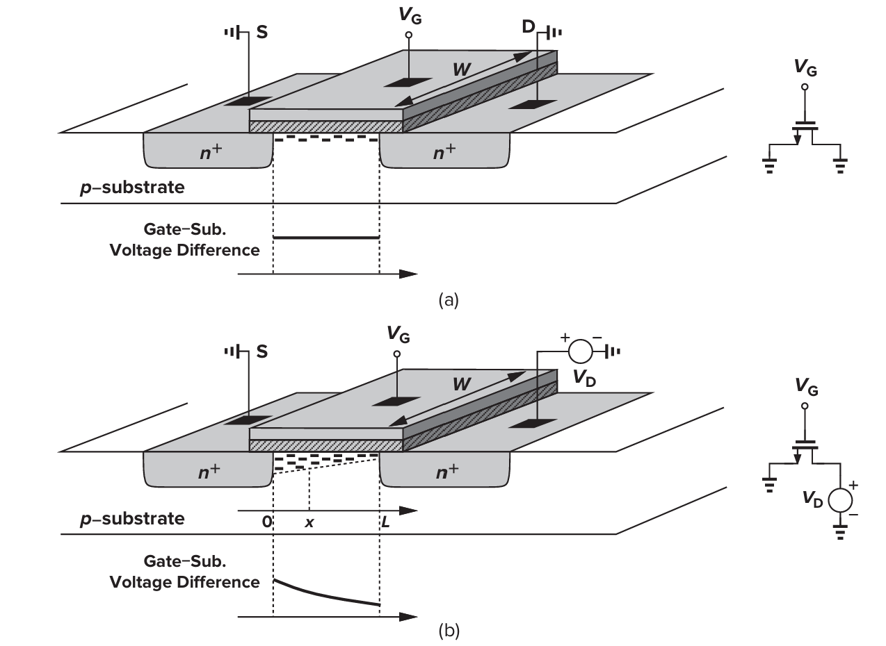<figcaption>
Figure 2.10: Channel charge with (a) equal source and drain voltages and (b) unequal source and drain voltages
</figcaption></figure>


In the figure, the plot name "Gate-Sub" is a bit confusing and it should better be named as "**Gate-Channel**" which plots the voltage difference directly across the oxide layer at every specific point along the channel. It starts from $$V_{GS}$$ and ends at some point depending on the drain voltage. This can be also reflected in [later part](mos-i-v-characteristics.md#saturation-region-1) from the same chapter!


What is the charge density in the inversion layer? Since we assume that the onset of inversion occurs at $$V_{GS} = V_{TH}$$, the inversion charge density produced by the gate-oxide capacitance is **proportional** to $$V_{GS} - V_{TH}$$.

How we jump from V_G to V_{GS}?

In the [#threshold-voltage](mos-i-v-characteristics.md#threshold-voltage "mention") section, we continuously use gate voltage alone when analyzing the formation of inversion layer. But now, how come we jump to $$V_{GS}$$ directly?

The answer is simple. Remember the ["Eureka" moment](mos-i-v-characteristics.md#why-can-electrons-start-to-flow-from-source-to-drain-as-we-further-increase-the-gate-voltage) from the above section? The electrons in the channel do not come from the $$p$$-type substrate; they are sucked horizontally out of the $$n^+$$ **source**.&#x20;

Because the newly formed channel is physically touching the source and is filled with electrons that just came from the source, the electrical potential of the channel at that exact boundary is dictated by the source voltage ($$V_S$$).

The oxide acts as a capacitor ($$C_{ox}$$).

* The top plate is the Gate (at voltage $$V_G$$).
* The bottom plate is the channel of electrons (at voltage $$V_S$$).
* Therefore, the actual voltage difference across that capacitor is $$V_G - V_S$$, which is $$V_{GS}$$.

Thus, $$V_{GS}$$ represents the raw voltage pulling electrons out of the source and across the oxide capacitor ($$C_{ox}$$).

For $$V_{GS} \ge V_{TH}$$, any charge placed on the gate must be mirrored by the charge in the channel, yielding a uniform channel charge density (charge per unit length along the source-drain path) equal to

$$
Q_d = W C_{ox} (V_{GS} - V_{TH}) \tag{2.3}
$$

where $$C_{ox}$$ is multiplied by $$W$$ to represent the total capacitance per unit length.


Here, $$C_{ox}$$ is treated as capacitance per unit area ($$F/m^2$$). And we are basically playing around this formula: $$Q=CV$$.



#### The idea of "Mirror"

The essence of "mirroring" is **charge neutrality**: any positive charge added to the gate must be perfectly balanced by an equal amount of negative charge below it. This negative charge is provided by **immobile negative ions** during depletion, and by **free electrons** once the channel forms.


Now suppose, as depicted in Fig. 2.10(b), that the drain voltage is greater than zero. Since the channel potential varies from zero at the source to $$V_D$$ at the drain, the local voltage difference between the gate and the channel varies from $$V_G$$ (near the source) to $$V_G - V_D$$ (near the drain). Thus, the charge density at a point $$x$$ along the channel can be written as&#x20;

$$
Q_d(x) = W C_{ox}[V_{GS} - V(x) - V_{TH}] \tag{2.4}
$$

where $$V(x)$$ is the channel potential at $$x$$.



With these two observations

* Current: $$I=Q_d\cdot v$$
* Mobile charge density $$Q_d$$
  * When the drain voltage is 0: $$Q_d = W C_{ox} (V_{GS} - V_{TH})$$
  * When the drain voltage is greater than 0: $$Q_d(x) = W C_{ox}[V_{GS} - V(x) - V_{TH}]$$

We can derive the current as follows:

$$
I_D = -W C_{ox}[V_{GS} - V(x) - V_{TH}]v \tag{2.5}
$$

where the negative sign is inserted because the charge carriers (electrons) are negative. Note that $$v$$ denotes the velocity of the electrons in the channel. For semiconductors, $$v = \mu E$$, where $$\mu$$ is the mobility of charge carriers and $$E$$ is the electric field. Noting that $$E(x) = -dV/dx$$ and representing the mobility of electrons by $$\mu_n$$, we have

$$
I_D = W C_{ox}[V_{GS} - V(x) - V_{TH}] \mu_n \frac{dV(x)}{dx} \tag{2.6}
$$

\
subject to boundary conditions $$V(0)=0$$ and $$V(L)=V_{DS}$$. While $$V(x)$$ can be easily found from this equation, the quantity of interest is in fact $$I_D$$. Multiplying both sides by $$dx$$ and performing integration, we obtain

$$
\int_{x=0}^{L} I_Ddx = \int_{V=0}^{V_{DS}} W C_{ox}\mu_n [V_{GS} - V(x) - V_{TH}]dV \tag{2.7}
$$

Since $$I_D$$ is constant along the channel,

$$
I_D = \mu_n C_{ox} \frac{W}{L}\left[(V_{GS} - V_{TH})V_{DS} - \frac{1}{2}V_{DS}^2\right] \tag{2.8}
$$

Note that $$L$$ is the **effective channel length**.


In NUS EE3408C, we are given that only $$\mu_n,C_{ox}$$ are constant and the rest 5 parameters can all be changed!


Figure 2.11 plots the parabolas given by (2.8) for different values of $$V_{GS}$$, indicating that the "current capability" of the device increases with $$V_{GS}$$.

<figure><figcaption>
Figrue 2.11: Drain current versus drain-source voltage in the triode region
</figcaption></figure>

Calculating $$\partial I_D / \partial V_{DS}$$ or using the high school maths, it is very easy to find out that the peak of each parabola occurs at $$V_{DS} = V_{GS} - V_{TH}$$ and the peak current is

$$
I_{D,\max} = \frac{1}{2}\mu_n C_{ox}\frac{W}{L}(V_{GS} - V_{TH})^2 \tag{2.9}
$$

We call $$V_{GS} - V_{TH}$$ the "**overdrive voltage**" and $$W/L$$ the "**aspect ratio**." If $$V_{DS} \le V_{GS} - V_{TH}$$, we say the device operates in the "**linear/triode region**."


Equations (2.8) and (2.9) serve as our first step toward CMOS circuit design, describing the dependence of $$I_D$$ upon the constant of the technology, $$\mu_n C_{ox}$$, the device dimensions, $$W$$ and $$L$$, and the gate and drain potentials with respect to the source. Note that the integration in (2.7) assumes that $$\mu_n$$ and $$V_{TH}$$ are independent of $$x$$ and the gate and drain voltages, an approximation that we will revisit in the later chapter.


### Triode Region

If in (2.8), $$V_{DS} \ll 2(V_{GS} - V_{TH})$$, we have

$$
I_D \approx \mu_n C_{ox} \frac{W}{L} (V_{GS} - V_{TH}) V_{DS} \tag{2.10}
$$


$$V_{DS} \ll 2(V_{GS} - V_{TH})$$ is exactly the same as $$\frac{1}{2}V_{DS}^2 \ll (V_{GS} - V_{TH})V_{DS}$$, which means we can ignore the quadratic term in (2.8).


that is, the drain current is a **linear** function of $$V_{DS}$$. This is also evident from the characteristics of Fig. 2.11 for small $$V_{DS}$$: as shown in Fig. 2.12, each parabola can be approximated by a straight line.

<figure>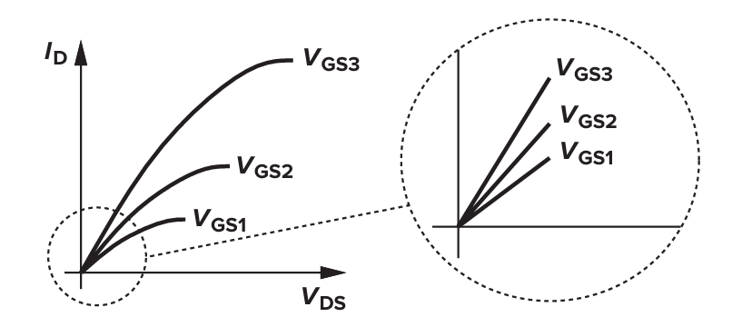<figcaption>
Figure 2.12: Linear operation in deep triode region
</figcaption></figure>

The linear relationship implies that the path from the source to the drain can be represented by a linear resistor equal to

$$
R_{on} = \frac{V_{DS}}{I_D} = \frac{1}{\mu_n C_{ox} \frac{W}{L} (V_{GS} - V_{TH})} \tag{2.11}
$$

A MOSFET can therefore operate as a resistor whose value is controlled by the overdrive voltage \[as long as $$V_{DS} \ll 2(V_{GS} - V_{TH})$$]. This is conceptually illustrated in Fig. 2.13.

<figure>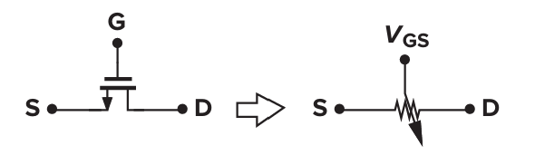<figcaption>
Figure 2.13: MOSFET as a controlled linear resistor.
</figcaption></figure>

Note that in contrast to bipolar transistors, a MOS device may be on even if it carries no current. With the condition $$V_{DS} \ll 2(V_{GS} - V_{TH})$$, we say the device operates in the deep triode region.


MOSFETs operating as controllable resistors play a crucial role in many analog circuits. For example, a voltage-controlled resistor can be used to adjust the frequency of the clock generator in a laptop computer if the system must go into a power saving mode.


### Saturation Region

What happens if the drain-source voltage in Fig. 2.11 exceeds $$V_{GS} - V_{TH}$$? In reality, the drain current does not follow the parabolic behavior for $$V_{DS} > V_{GS} - V_{TH}$$. In fact, as shown in Fig. 2.15, $$I_D$$ becomes relatively constant, and we say the device operates in the "saturation" region.

<figure>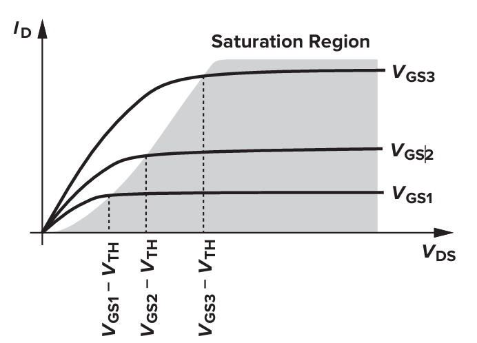<figcaption>
Figure 2.15: Saturation of drain current.
</figcaption></figure>

To understand this phenomenon, recall from (2.4) that the local density of the inversion-layer charge is proportional to $$V_{GS} - V(x) - V_{TH}$$. Thus, if $$V(x)$$ approaches $$V_{GS} - V_{TH}$$, then $$Q_d(x)$$ drops to zero. In other words, as depicted in Fig. 2.16, if $$V_{DS}$$ is slightly greater than $$V_{GS} - V_{TH}$$, then the inversion layer stops at $$x \le L$$, and we say the channel is "pinched off."

<figure>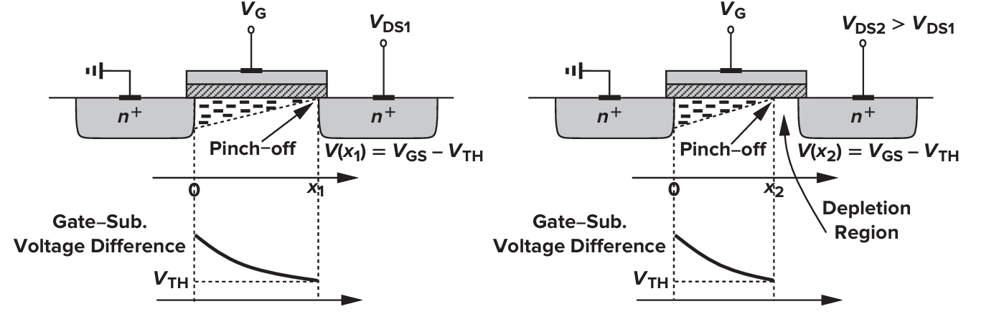<figcaption>
Figure 2.16: Pinch-off behavior
</figcaption></figure>

As $$V_{DS}$$ increases further, the point at which $$Q_d$$ equals zero gradually moves **toward the source**. Thus, at some point along the channel, the local potential difference between the gate and the oxide-silicon interface is not sufficient to support an inversion layer.

How does the device conduct current in the presence of pinch-off?

As the electrons approach the pinch-off point (where $$Q_d \to 0$$), their velocity rises tremendously ($$v = I/Q_d$$). Upon passing the pinch-off point, the electrons simply **shoot through** the depletion region near the drain junction and arrive at the drain terminal.


Here, the current is **constant** because it only depends on the width of the channel, in other words, the overdrive voltage.


With the above observations, we reexamine (2.7) for a saturated device. Since $$Q_d$$ is the density of mobile charge, the integral on the left-hand side of (2.7) must be taken from $$x = 0$$ to $$x = L'$$, where $$L'$$ is the point at which $$Q_d$$ drops to zero (e.g., $$x_2$$ in Fig. 2.16), and that on the right from $$V(x) = 0$$ to $$V(x) = V_{GS} - V_{TH}$$. As a result,

$$
I_D = \frac{1}{2}\mu_n C_{ox} \frac{W}{L'} (V_{GS} - V_{TH})^2 \tag{2.13}
$$

indicating that $$I_D$$ is relatively independent of $$V_{DS}$$ if $$L'$$ remains close to $$L$$. We say the device exhibits a "square-law" behavior. If $$I_D$$ is known, then $$V_{GS}$$ is obtained as

$$
V_{GS} = \sqrt{\frac{2 I_D}{\mu_n C_{ox} \frac{W}{L'}}} + V_{TH} \tag{2.14}
$$


According to Prof. Gao from NUS EE3408C, a good analog circuit design must always use the **formula** to calculate the value first and then starting using Cadence Virtuoso, otherwise he/she might fall into the "[spice monkey](https://app.gitbook.com/s/UBWYdYYwvkB8gDH5SdEC/lec/lec-1-module-introduction#logistics)" trap.


Most analog circuits operate in saturation mode

We must emphasize that for the transistor to remain in saturation (as is the case in many analog circuits), the drain-source voltage must be equal to or greater than the overdrive voltage. For this reason, some books write $$V_{D,sat} = V_{GS} - V_{TH}$$, where $$V_{D,sat}$$ denotes the minimum $$V_{DS}$$ necessary for operation in saturation. As seen later in this book, if the signal swings at the drain or the gate cause $$V_{DS}$$ to fall below $$V_{GS} - V_{TH}$$, then a number of undesirable effects occur. For this reason, the choice of the overdrive and hence $$V_{D,sat}$$ translates to a certain voltage "headroom" for the signal swings in the circuit:

the larger the V_{D,sat}, the less headroom is available for the signals.


#### The importance of "small signal" model

Equations (2.8) and (2.13) represent the "large-signal" behavior of NMOS devices; i.e., they can predict the drain current for arbitrary voltages applied to the gate, source, and drain (but only if the device is on). Since the **nonlinear** nature of these equations makes the analysis difficult, we often resort to **linear approximations** ("small-signal" models) so as to develop some understanding of a given circuit. This point becomes clear in later sections.


For PMOS devices, Eqs. (2.8) and (2.13) are respectively written as

$$
I_D = -\mu_p C_{ox} \frac{W}{L} \left[(V_{GS} - V_{TH})V_{DS} - \frac{1}{2}V_{DS}^2\right] \tag{2.15}
$$

\
and

$$
I_D = -\frac{1}{2}\mu_p C_{ox} \frac{W}{L'} (V_{GS} - V_{TH})^2 \tag{2.16}
$$

The **negative** sign appears here because we assume that $$I_D$$ flows from the drain to the source, whereas in PMOS, holes flow in the reverse direction (current flowing from source to drain).


Note that $$V_{GS}$$, $$V_{DS}$$, $$V_{TH}$$, and $$V_{GS} - V_{TH}$$ are negative for a PMOS transistor that is turned on. Since the mobility of holes is about one-half the mobility of electrons, PMOS devices suffer from lower "current drive" capability.


FYI: Derive the PMOS I/V characteristics by hand

To derive the PMOS I/V characteristics by hand, the following are several rules which might help you:

1. The body voltage is 0, source voltage is $$V_{DD}$$ and gate voltage starts decreasing from $$V_{DD}$$.
2. The voltage right above the channel is $$V_{SG}-|V_{THP}|$$ to make the voltage **positive**.

In the end, you will find out that the I/V characteristics for PMOS is just to replace $$V_{GS}, V_{DS}, V_{THN}$$ in NMOS with $$V_{SG}, V_{SD}, |V_{THP}|$$.

Saturated MOSFETs as current source

With $$L$$ assumed constant, a saturated MOSFET can be used as a **current source** connected between the drain and the source (Fig. 2.17), an important component in analog design. Note that

* the NMOS current source injects current into ground and
* the PMOS current source draws current from $$V_{DD}$$.

In other words, only **one terminal** of each current source is "floating." (It is difficult to design a current source that flows between two arbitrary nodes of a circuit.)

<figure>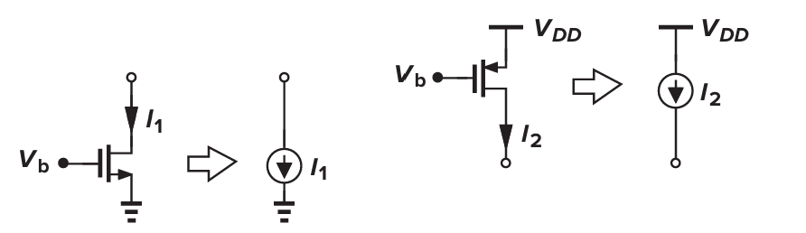<figcaption>
Figure 2.17: Saturated MOSFETs operating as current sources.
</figcaption></figure>


Recall that in [NUS CG1111A](../../../../../../Y1S1/CG1111A), we've learned that a **current source** is an electronic circuit or device that delivers or absorbs a **constant electric current**, regardless of the voltage across its terminals


The distinction between saturation and triode regions can be confusing, especially for PMOS devices. Intuitively, we note that the channel is **pinched off** if the difference between the gate and drain voltages is not sufficient to create an inversion layer.


Remember the **intuition** above!


As depicted conceptually in Fig. 2.19, as $$V_G - V_D$$ of an NFET **drops below** $$V_{TH}$$, [pinch-off occurs](#user-content-fn-4)[^4]. Similarly, if $$V_D - V_G$$ of a PFET is not large enough (< $$|V_{THP}|$$), the device is saturated. Note that this view does not require knowledge of the source voltage. This means that we must know a priori which terminal operates as the **drain**.

> The **drain** is defined as the terminal with a higher (lower) voltage than the source for an NFET (PFET).


The purpose of this paragraph is to tell us that instead of doing tedious node voltage calculations to find $$V_S$$ (as in analog circuits, the source terminal is usually connected to some weird, fluctuating nodes), we can just look at the schematic, compare the gate and the drain directly, and instantly know if the transistor is **saturated** or not!


<figure>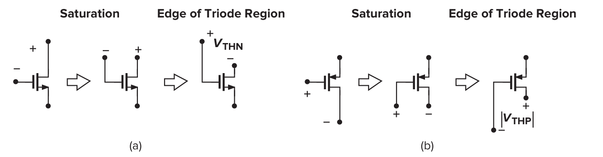<figcaption>
Figure 2.19: Conceptual visualization of saturation and triode regions.
</figcaption></figure>


In NUS EE3408C, we need to always make sure that our transistor works in **saturation region**, this is always the first thing checked by the graders. And to ensure this thing, we usually run an analysis called **DC analysis** on Cadence Virtuoso, and it will give us some very important information on $$V_{GS}, V_{DS}$$ and $$V_{TH}$$ which we can easily rely on to determine whether our transistors work in saturation region or not.


### Summary

For the sake of exam needs, the follow two tables summarize the N/PMOS I/V characteristics.

<figure>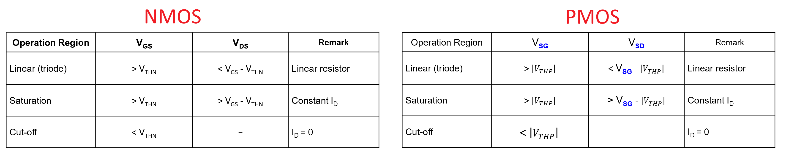<figcaption></figcaption></figure>

## MOS Transconductance

Since a MOSFET operating in **saturation** produces a current in response to its [**gate-source overdrive voltage**](#user-content-fn-5)[^5], we may define a figure of merit that indicates how well a device **converts a voltage to a current**. More specifically, since in processing signals, we deal with the changes in voltages and currents, we define the figure of merit as the change in the drain current divided by the change in the gate-source voltage. Called the "transconductance" (and usually defined in the saturation region) and denoted by $$g_m$$, this quantity is expressed as

$$
g_m = \left. \frac{\partial I_D}{\partial V_{GS}} \right|_{V_{DS,\text{const.}}} \tag{2.17}
$$


Note that Eq. 2.17. holds in both **triode** and **saturation region**!&#x20;


### Transconductance in Saturation Region

To get the equation for the transconductance in saturation region from Eq. 2.17, we just need to do the partial differentiation on Eq. 2.13 (treat only $$V_{GS}$$ as a variable and $$V_{TH}$$ as a constant), which is the equation of the drain current when the NFET operates in the saturation region. This will give us:

$$
g_m=\mu_n C_{ox} \frac{W}{L} (V_{GS} - V_{TH}) \tag{2.18}
$$

In a sense, $$g_m$$ represents the **sensitivity** of the device:

> for a high $$g_m$$, a small change in $$V_{GS}$$ results in a large change in $$I_D$$.

We express $$g_m$$ in $$1/\Omega$$ or in siemens (S); e.g., $$g_m = 1/(100\Omega) = 0.01S$$. In analog design, we sometimes say a MOSFET operates as a "transconductor" or a "V/I converter" to indicate that it converts a voltage change to a current change.


Interestingly, $$g_m$$ in the saturation region is equal to the inverse of $$R_{on}$$ in the [deep triode region](mos-i-v-characteristics.md#triode-region).


We can prove that $$g_m$$ can also be expressed as follows by using Eq. 2.13 to replace either $$V_{GS}-V_{TH}$$ with $$\mu_nC_{ox}\frac{W}{L}$$ or vice versa.

$$
\begin{align*}
g_m &= \sqrt{2 \mu_n C_{ox} \frac{W}{L} I_D} \tag{2.19} \\
&= \frac{2 I_D}{V_{GS} - V_{TH}} \tag{2.20}
\end{align*}
$$


Note that Eq. 2.18, 2.19 and 2.20 only applies when MOSFETs operate in **saturation region!!!**


Plotted in Fig. 2.20, each of the above expressions proves useful in studying the behavior of $$g_m$$ as a function of one parameter while other parameters remain constant. (The plots correspond to Eq. 2.18, 2.19, 2.20 from left to right respectively)

<figure>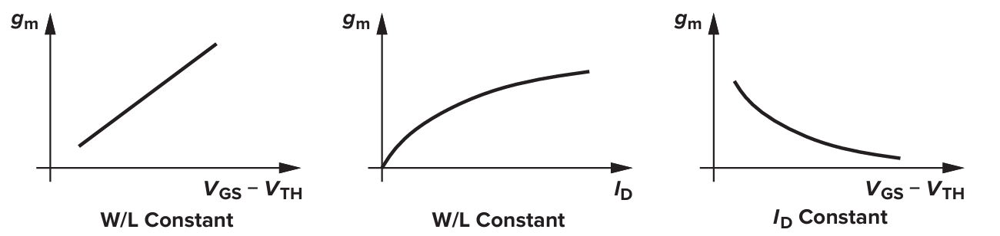<figcaption>
Figure 2.20: Approximate MOS transconductance as a function of overdrive and drain current.
</figcaption></figure>

For example,

1. Equation (2.18) suggests that $$g_m$$ increases with the overdrive voltage if $$W/L$$ is constant,
2. whereas Equation (2.20) implies that $$g_m$$ decreases with the overdrive voltage if $$I_D$$ is constant.
3. Equation (2.19) implies that the transconductance can be raised arbitrarily if we increase $$W/L$$ and keep $$I_D$$ constant. (This is true because there are two understanding of Equatino 2.19, so don't be affected by the middle graph in Figure 2.20). This result is **incorrect** and will be revised in the later section.

The $$I_D$$ and $$V_{GS} - V_{TH}$$ terms in the above $$g_m$$ equations are [**bias** values](../single-stage-amplifiers/#static-operating-point). For example, a transistor with $$W/L = 5\mu m / 0.1\mu m$$ and biased at $$I_D = 0.5mA$$ may exhibit a transconductance of $$1/(200\Omega)$$. If a signal is applied to the device, then $$I_D$$ and $$V_{GS} - V_{TH}$$ and hence $$g_m$$ vary, but in small-signal analysis, we assume that the signal amplitude is small enough that this variation is negligible.


In NUS EE3408C, according to Prof. Gao,  for Equations 2.18, 2.19, and 2.20, we are not required to draw the three plots similar to Fig. 2.20, but to know **which one to use based on what is given and what we are asked to find**. For example, if $$g_m$$ and $$I_D$$ are given and we are asked to determine the required $$W/L$$, use **Equation 2.19**. So, my tip is to always identify the **knowns and the unknown** first, then choose the equation that directly relates them.


### Transconductance in Triode Region

The concept of transconductance can also be applied to a device operating in the [triode region](mos-i-v-characteristics.md#triode-region), as illustrated in the following example. For the arrangement shown in Fig. 2.21, plot the transconductance as a function of $$V_{DS}$$.

<figure>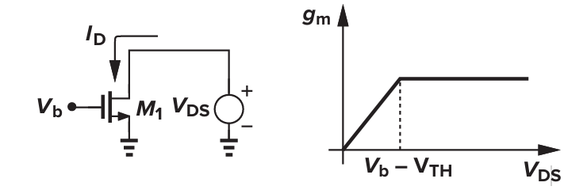<figcaption>
Figure 2.21
</figcaption></figure>

**Sol.** It is simpler to study $$g_m$$ as $$V_{DS}$$ decreases from infinity. So long as $$V_{DS} \ge V_b - V_{TH}$$, $$M_1$$ is in saturation, $$I_D$$ is relatively constant, and, from (2.19), so is $$g_m$$. If the drain voltage falls below the gate voltage by more than one threshold, $$M_1$$ enters the triode region, and

\begin{align*} g_m &#x26;= \frac{\partial}{\partial V_{GS}} \left\{ \frac{1}{2} \mu_n C_{ox} \frac{W}{L} \left[ 2(V_{GS} - V_{TH})V_{DS} - V_{DS}^2 \right] \right\} \tag{2.21} \\ &#x26;= \mu_n C_{ox} \frac{W}{L} V_{DS} \tag{2.22} \end{align*}

Thus, as plotted in Fig. 2.21, the transconductance drops in the triode region. For amplification, therefore, we usually employ MOSFETs in [saturation](mos-i-v-characteristics.md#saturation-region).

PFET Transconductance

For a PFET, the transconductance in the saturation region is expressed as

g_m = -\mu_p C_{ox}\frac{W}{L}(V_{GS} - V_{TH}) = -\frac{2I_D}{(V_{GS} - V_{TH})} = 2\mu_p C_{ox}\frac{W}{L}I_D

[^1]: This is nothing but the density of the **electrons** drawn from the source.

[^2]: In other words, this is when the density of **electrons** pulled to the surface _perfectly matches_ the original density of **holes** in the substrate.

[^3]: More specifically, these charges are either positive/negative ions.

[^4]: This is the same as saying NFET is **saturated**!

[^5]: This is nothing but **V****GS****-V****TH**
