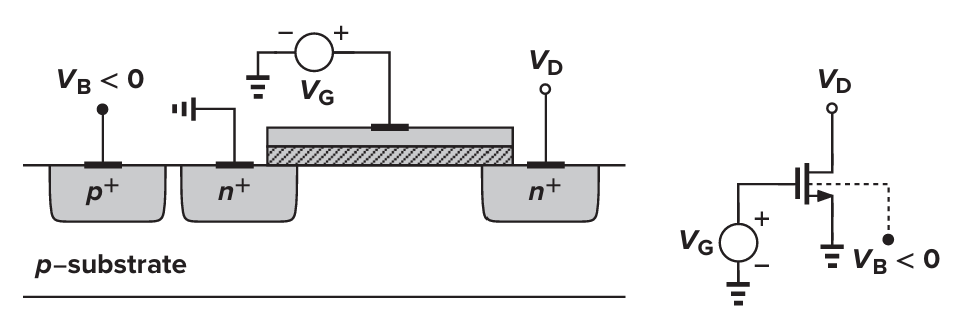
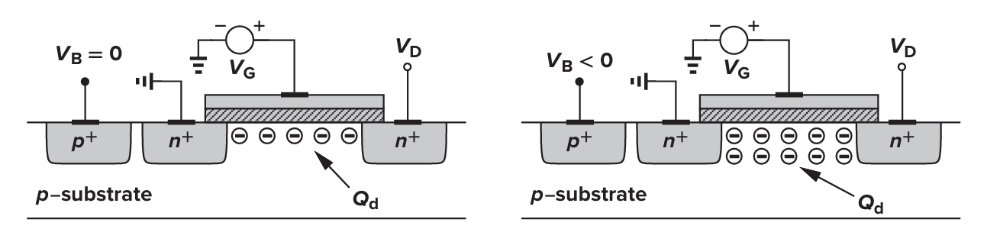
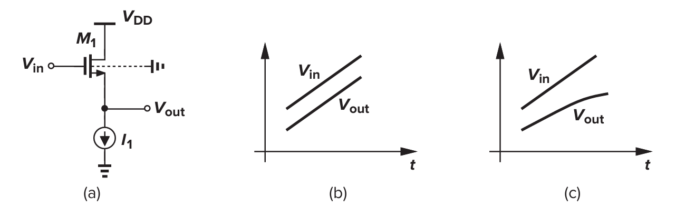
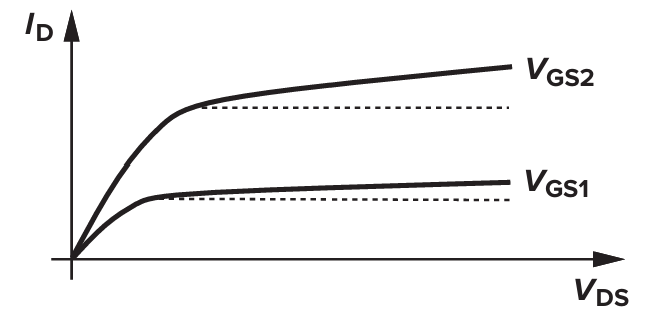
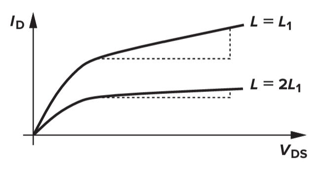
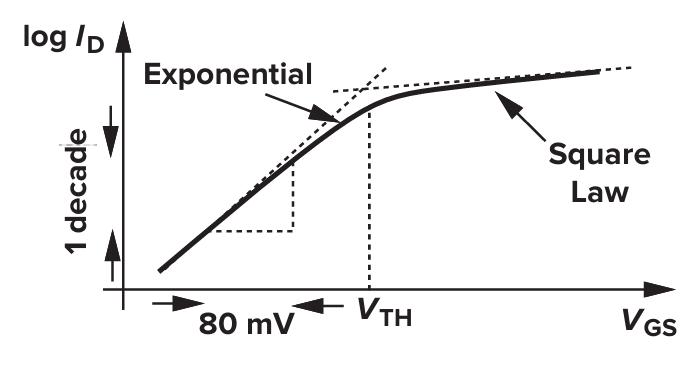

# Second-Order Effects

Our analysis of the MOS structure has thus far entailed various simplifying assumptions, some of which are not valid in many analog circuits. In this section, we describe three second-order effects that are essential in our subsequent circuit analyses.

* Body Effect
* Channel-Length Modulation
* Subthreshold Conudction

Other phenomena that appear in nanometer devices are studied in much later chapter.


In [NUS EE4415](https://app.gitbook.com/s/Sp0XaarBjbEX3JIMrRaR/part-2-lec-analog-design-flow/lec-1-mosfet-and-cmos-process#secondary-effects), we've also had a glimpse of what these three effects are, feel free to go back and have a quick recap. However, I will also try to connect and compare the knowledge there and here!


## Body Effect

In the analysis of Fig. 2.10, we tacitly assumed that the bulk and the source of the transistor were tied to ground. What happens if the bulk voltage of an NFET drops below the source voltage (Fig. 2.22)?

<figure><figcaption>
Figure 2.22: NMOS device with negative bulk voltage.
</figcaption></figure>

Since the S and D junctions remain reverse-biased, we surmise that the device continues to operate properly, but some of its characteristics may change. To understand the effect, suppose $$V_S = V_D = 0$$, and $$V_G$$ is somewhat less than $$V_{TH}$$, so that a depletion region is formed under the gate but no inversion layer exists. As $$V_B$$ becomes more negative, **more holes** are attracted to the substrate connection, leaving a larger [negative charge](#user-content-fn-1)[^1] behind; i.e., as depicted in Fig. 2.23, the depletion region becomes wider.

<figure><figcaption>
Figure 2.23: Variation of depletion region charge with bulk voltage.
</figcaption></figure>

Now recall from Eq. (2.1) that the threshold voltage is a function of the total charge in the depletion region because the **gate charge** must mirror $$Q_d$$ before an inversion layer is formed. Thus, as $$V_B$$ drops and $$Q_d$$ increases, $$V_{TH}$$ also increases. This phenomenon is called the "body effect" or the "back-gate effect."


The paragraph above is perhaps the most important take-away from this body effect section!


It can be proved that with body effect,

$$
\begin{align*}
V_{TH} = V_{TH0} + \gamma \left( \sqrt{2\Phi_F + V_{SB}} - \sqrt{|2\Phi_F|} \right) \tag{2.23}
\end{align*}
$$

where $$V_{TH0}$$ is given by (2.1), $$\gamma = \sqrt{2q\epsilon_{si}N_{sub}}/C_{ox}$$ denotes the body-effect coefficient, and $$V_{SB}$$ is the source-bulk potential difference. The value of $$\gamma$$ typically lies in the range of $$0.3$$ to $$0.4V$$.


#### PMOS Body Effect

For PMOS, the formula is: $$\vert{}V_{THp}\vert{} = \vert{}V_{TH0p}\vert{} + \gamma (\sqrt{\vert{}2\Phi_F\vert{} + V_{BS}} - \sqrt{\vert{}2\Phi_F\vert{}})$$


For body effect to manifest itself, the bulk potential, $$V_{sub}$$, need not change: if the source voltage varies with respect to $$V_{sub}$$, the same phenomenon occurs. For example, consider the circuit in Fig. 2.25(a), first ignoring body effect. We note that as $$V_{in}$$ varies, $$V_{out}$$ closely follows the input because the drain current remains equal to $$I_1$$. In fact, we can write

$$
I_1 = \frac{1}{2}\mu_n C_{ox}\frac{W}{L}(V_{in} - V_{out} - V_{TH})^2 \tag{2.26}
$$

concluding that $$V_{in} - V_{out}$$ is constant if $$I_1$$ is constant \[Fig. 2.25(b)].


In Eq. 2.26, $$V_{in}-V_{out}$$ is nothing but $$V_{GS}$$ and $$I_1$$ is constant because it is an ideal **current source**.


<figure><figcaption>
Figure 2.25: (a) A circuit in which the source-bulk voltage varies with input level; (b) input and output voltages with no body effect; (c) input and output voltages with body effect
</figcaption></figure>

Body effect is usually undesirable. The change in the threshold voltage, e.g., as in Fig. 2.25(a), often complicates the design of analog (and even digital) circuits. Device technologists balance $$N_{sub}$$ and $$C_{ox}$$ to obtain a reasonable value for $$\gamma$$.


In NUS EE3408C, according to Prof. Gao, we do not need to memorize the body-effect formulas; what matters is understanding **how** $$V_{BS}$$ **(or** $$V_{SB}$$**) affects the threshold voltage** and thus the **drain current** for NMOS and PMOS. The trends can be summarized as:

* **NMOS:** $$V_{SB}\uparrow \Rightarrow V_{TH}\uparrow\Rightarrow I_D\downarrow$$
* **PMOS:** $$V_{BS}\uparrow \Rightarrow |V_{THP}|\uparrow\Rightarrow I_D\downarrow$$

This can be understood intuitively using the knowledge from the beginning of this [section](second-order-effects.md#body-effect).


Eq. 2.23 suggests that if V_{SB} decreases, then V_{TH} will decrease? Is that correct?

Yes, it is. If the bulk voltage of an NMOS device rises above its source voltage, $$V_{TH}$$ falls below $$V_{TH0}$$. This observation proves useful in low-voltage design, where the performance of a circuit may suffer due to a high threshold voltage; one can bias the bulk to reduce $$V_{TH}$$. Unfortunately, this is not straightforward for NFETs because they typically share one substrate, but it can readily be applied to individual PFETs.


In practice, we allow the **PN junction** formed between the source/drain terminals and the body to become **slightly forward-biased**. A small amount of forward bias is generally acceptable, as significant current only begins to flow through the PN junction when the forward bias becomes sufficiently large. Therefore, a **small forward bias is tolerable** in normal operation.


## Channel-Length Modulation

In the analysis of channel pinch-off [earlier](second-order-effects.md#saturation-region), we noted that the actual length of the channel gradually decreases as the potential difference between the gate and the drain decreases. In other words, in (2.13), $$L'$$ is in fact a function of $$V_{DS}$$. This effect is called "**channel-length modulation.**" Writing $$L' = L - \Delta L$$, we can derive that $$1/L' \approx (1 + \Delta L/L)/L$$.

How to derive such approximation?

We start from $$L' = L - \Delta L$$, then in the current equation for $$I_D$$, the channel length is in the denominator. So, we need to find an expression for $$1/L'$$:

\frac{1}{L'} = \frac{1}{L - \Delta L}

To make this easier to work with, we can factor out $$L$$ from the denominator:

\frac{1}{L'} = \frac{1}{L(1 - \frac{\Delta L}{L})}=\frac{1}{L} \left(1 - \frac{\Delta L}{L}\right)^{-1}

By using the [**binomial approximation**](https://en.wikipedia.org/wiki/Binomial_approximation), we have

\left(1 - \frac{\Delta L}{L}\right)^{-1} \approx 1 - (-1)\left(\frac{\Delta L}{L}\right) = 1 + \frac{\Delta L}{L}

Thus, we have reached our final result, which is

\frac{1}{L'} \approx \frac{1}{L} \left(1 + \frac{\Delta L}{L}\right)

Using this reulst and assuming a first-order relationship between $$\Delta L/L$$ and $$V_{DS}$$, such as $$\Delta L/L = \lambda V_{DS}$$, according to Eq. 2.13, we have, in **saturation**,

$$
I_D \approx \frac{1}{2}\mu_n C_{ox}\frac{W}{L}(V_{GS}-V_{TH})^2(1+\lambda V_{DS}) \tag{2.27}
$$

where $$\lambda$$ is the "channel-length modulation coefficient."


We should remember that $$\lambda\propto\frac{1}{L}$$!


What is a first-order relationship?

The first-order relationship is nothing but **linear** relationship. It actually comes from the idea of "[order of approximation](https://en.wikipedia.org/wiki/Order_of_approximation)" from mathmetics which is used very often in science and engineering.

In science and engineering, it is common to approximate a function by applying a **series expansion** such as a **Taylor series**, and then discarding terms with higher powers of the variable. The order of the approximation is the highest power term that is kept. For example, one can refer to a _zeroth-order approximation_, a _first-order approximation_, a _second-order approximation_, etc.

In the case of a smooth function, the _&#x6E;_&#x74;h-order approximation is a polynomial of degree _n_, which is obtained by truncating the Taylor series to this degree.

Illustrated in Fig. 2.26, this phenomenon results in a nonzero slope in the $$I_D/V_{DS}$$ characteristic and hence an nonideal current source between D and S in saturation. The parameter $$\lambda$$ represents the relative variation in length for a given increment in $$V_{DS}$$. Thus, for longer channels, $$\lambda$$ is smaller.

<figure><figcaption>
Figure 2.26: Finite saturation region slope resulting from channel-length modulation.
</figcaption></figure>

Is there channel-length modulation in the triode region?

**Solution**. No, there is not. In the [triode region](second-order-effects.md#triode-region), the channel **continuously** stretches from the source to the drain, experiencing no pinch-off. Thus, the drain voltage does not modulate the length of the channel.

With channel-length modulation, some of the expressions derived for $$g_m$$ must be modified. Equations 2.18 and 2.19 are respectively rewritten as:

$$
\begin{align*}
g_m &= \mu_n C_{ox} \frac{W}{L} (V_{GS} - V_{TH})(1 + \lambda V_{DS}) \tag{2.30} \\[6pt]
&= \sqrt{2 \mu_n C_{ox} (W/L) I_D (1 + \lambda V_{DS})} \tag{2.31}
\end{align*}
$$


In NUS EE3408C, we neglect the effect of **channel-length modulation** when calculating the transistor's **transconductance**.


while Eq. 2.20 remains unchanged. If we double the **length** of a MOSFET, we might get the following $$I_D/V_{DS}$$ plot.

<figure><figcaption>
Figure 2.27: Effect of doubling channel length.
</figcaption></figure>


The linear approximation $$\Delta L/L \propto V_{DS}$$ becomes **less accurate** in **short-channel** transistors, resulting in a variable slope in the saturated $$I_D/V_{DS}$$ characteristics.


The dependence of $$I_D$$ upon $$V_{DS}$$ in saturation may suggest that the bias current of a MOSFET can be defined by the proper choice of the drain-source voltage, allowing freedom in the choice of $$V_{GS} - V_{TH}$$. **However**, since the dependence on $$V_{DS}$$ is much weaker, the drain-source voltage is not used to set the current. That is, we always consider $$V_{GS} - V_{TH}$$ as the current-defining parameter. The effect of $$V_{DS}$$ on $$I_D$$ is usually considered an _error_, and it is studied in the later section.


In NUS EE3408C, especially during the exam, whether we should consider channel length modulation will be given **explicitly** in the exam. In other words, if the question gives us the $$\lambda$$, then we should consider the channel length modulation. Otherwise, no need to consider it.


## Subthreshold Conduction


In NUS EE3408C, the subthreshold conduction is not a key point and thus we only need to know that the transistor might not actually be turned off when $$V_{GS}<V_{TH}$$. And Prof. Gao said there is no need to memorize the formula here as well. Thus, this part is just FYI LOL.


In our analysis of the MOSFET, we have assumed that the device turns off abruptly as $$V_{GS}$$ drops below $$V_{TH}$$. In reality, for $$V_{GS} \approx V_{TH}$$, a "weak" inversion layer still exists and some current flows from D to S. Even for $$V_{GS} < V_{TH}$$, $$I_D$$ is finite, but it exhibits an exponential dependence on $$V_{GS}$$. Called "**subthreshold conduction**," this effect can be formulated for $$V_{DS}$$ greater than roughly 100 mV as

$$
I_D = I_0 \exp\left(\frac{V_{GS}}{\xi V_T}\right) \tag{2.33}
$$

where $$I_0$$ is proportional to $$W/L$$, $$\xi > 1$$ is a nonideality factor, and $$V_T = kT/q$$. We also say the device operates in "weak inversion." (Similarly, for $$V_{GS} > V_{TH}$$, we say the device operates in "strong inversion."). The **key point here** is that

> as $$V_{GS}$$ falls below $$V_{TH}$$, the drain current drops at a finite rate which is **exponential**.

With typical values of $$\xi$$, at room temperature, $$V_{GS}$$ must decrease by approximately 80 mV for $$I_D$$ to decrease by one decade (Fig. 2.28).

<figure><figcaption>
Figure 2.28: MOS subthreshold characterisitcs
</figcaption></figure>

For example, if a threshold of 0.3 V is chosen in a process to allow low-voltage operation, then when $$V_{GS}$$ is reduced to zero, the drain current decreases by only a factor of $$100^{0.3V/80mV} = 10^{3.75} \approx 5.62 \times 10^3$$. For example, if the transistor carries about 1$$\mu\text{A}$$ for $$V_{GS} = V_{TH}$$ and we have 100 million such devices, then they draw $$1\mu A\div5.63\div10^3\times100\times10^6\approx18 \text{mA}$$ when they are nominally off. Especially problematic in large circuits such as memories, subthreshold conduction can result in significant power dissipation (or loss of analog information).

How to define the "real" threshold voltage?

If a MOS device conducts for $$V_{GS} < V_{TH}$$, then how do we define the threshold voltage? Indeed, numerous definitions have been proposed. One possibility is to **extrapolate**, on a logarithmic vertical scale, the weak inversion and strong inversion characteristics and consider their intercept voltage as the threshold (Fig. 2.28).

We now reexamine Eq. (2.19) for the transconductance of a MOS device operating in the **subthreshold region**. Is it possible to achieve an arbitrarily high transconductance by increasing $$W$$ while maintaining $$I_D$$ constant? Is it possible to obtain a higher transconductance than that of a bipolar transistor ($$I_C/V_T$$) biased at the same current? Equation (2.19) was derived from the square-law characteristic $$I_D = \frac{1}{2}\mu_n C_{ox}\frac{W}{L}(V_{GS} - V_{TH})^2$$. However, if $$W$$ increases while $$I_D$$ remains constant, then $$V_{GS} \to V_{TH}$$ and the device enters the **subthreshold region**. As a result, the transconductance is calculated from (2.33) to be $$g_m = \frac{I_D}{\xi V_T}$$, revealing that MOSFETs are still inferior to bipolar transistors in this respect.

How do we calculate the g_m when in subthreshold region?

We've already seen Eq. 2.33 and Eq. 2.17 (The definition of [transconductance](second-order-effects.md#mos-transconductance)). We just plug Eq. 2.33 into Eq. 2.17, so we can get:

g_m = \frac{\partial}{\partial V_{GS}} \left[ I_0 \exp\left(\frac{V_{GS}}{\xi V_T}\right) \right] = I_0 \exp\left(\frac{V_{GS}}{\xi V_T}\right) \cdot \frac{1}{\xi V_T}

Then, we can easily find out that by using Eq. 2.33 again,

g_m = \frac{I_D}{\xi V_T}

At what overdrive voltage can we say the transistor goes from strong inversion to weak inversion? While somewhat arbitrary, this transition point can be defined as the overdrive voltage, $$(V_{GS} - V_{TH})_1$$_,_ at which the corresponding transconductances would become equal for the same drain current:

$$
\frac{I_D}{\xi V_T} = \frac{2I_D}{(V_{GS} - V_{TH})_1} \tag{2.34}
$$

and hence

$$
(V_{GS} - V_{TH})_1 = 2\xi V_T \tag{2.35}
$$

For $$\xi \approx 1.5$$, this amounts to about 80 mV.

> TODO: Study why higher gain here and what is the gain in analog design, compare with the gain in the digital design.

The exponential dependence of $$I_D$$ upon $$V_{GS}$$ in subthreshold operation may suggest the use of MOS devices in this regime so as to achieve a **higher gain**. However, since such conditions are met only by a large device width or low drain current, the speed of subthreshold circuits is severely limited.

## Voltage Limitations

A MOSFET experiences various undesirable effects if its terminal voltage differences exceed certain limits (if the device is "stressed").

1. At **high gate-source** **voltages**, the gate oxide breaks down irreversibly, damaging the transistor.
2. In short-channel devices, an excessively **large drain-source voltage** widens the depletion region around the drain so much that it touches that around the source, creating a very large drain current. (This effect is called "punchthrough.")

Even without breakdown, MOSFETs' characteristics can change permanently if the terminal voltage differences exceed a specified value.

[^1]: To be more specific, leaving more **negative ions** behind.
