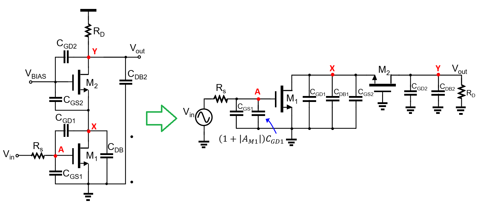

# Cascode Amplifier

Using the **pole-association-by-node technique**, we can quickly estimate the **pole frequencies** of a cascode amplifier and hence its frequency response. The circuit is shown below.

<figure><figcaption></figcaption></figure>



#### Input Node A

For the equivalent resistance, set $$V_{in}=0$$ and open-circuit all capacitors.

Looking from node $$A$$:

* **Left branch:** $$R_S$$
* **Right branch:** looking into the gate of $$M_1$$, which is approximately open-circuit.

Therefore,

$$
R_{\mathrm{eq},A} = R_S\parallel\infty \approx R_S
$$

For the capacitance, $$C_{GS1}$$ is directly connected to AC ground, while $$C_{GD1}$$ connects nodes $$A$$ and $$X$$. We therefore apply the **Miller theorem**:

$$
C_{\mathrm{eq},A} = C_{GS1}+(1+|A_{M1}|)C_{GD1}
$$

where the gain from $$A$$ to $$X$$ is approximately

$$
A_{M1}\approx-\frac{g_{m1}}{g_{m2}+g_{mb2}}
$$


#### Why is the gain small?

Node $$X$$ sees the low input resistance of the common-gate transistor $$M_2$$, approximately $$1/(g_{m2}+g_{mb2})$$, so the voltage swing at $$X$$ is small.


Hence,

$$
\omega_{p1} \approx \frac{1}{ R_S \left[ C_{GS1} + \left( 1+\frac{g_{m1}}{g_{m2}+g_{mb2}} \right)C_{GD1} \right] }
$$

The small $$A_{M1}$$ means that the **Miller multiplication of** $$C_{GD1}$$ **is greatly reduced**, which is an important reason why a cascode amplifier has a wider bandwidth than a simple CS amplifier.



#### Internal Node X

For $$R_{\mathrm{eq},X}$$, again look at the two branches from node $$X$$:

* **Downward/left branch:** looking into the drain of $$M_1$$, which has a large resistance.
* **Upward/right branch:** looking into the source of the common-gate $$M_2,$$ $$R_{\mathrm{right}}\approx\frac{1}{g_{m2}+g_{mb2}}$$.

Thus,

$$
R_{\mathrm{eq},X} = R_{\mathrm{left}}\parallel R_{\mathrm{right}} \approx \frac{1}{g_{m2}+g_{mb2}}
$$


This approximation is because the parallel combination is dominated by the much smaller resistance looking into the source of $$M_2$$.


The capacitances connected to node $$X$$ are

$$
C_{\mathrm{eq},X} = C_{GS2}+C_{GD1}+C_{DB1}
$$

and therefore

$$
\omega_{p2} \approx \frac{g_{m2}+g_{mb2}} {C_{GS2}+C_{GD1}+C_{DB1}}
$$



#### Output Node Y

Looking from the output node:

* **Right branch:** $$_D$$
* **Left branch:** looking into the drain of the cascode transistor $$M_2$$, which has a very large resistance.

Thus,

$$
R_{\mathrm{eq},Y} = R_{\mathrm{left}}\parallel R_D \approx R_D
$$

The capacitances connected between $$Y$$ and AC ground are

$$
C_{\mathrm{eq},Y}=C_{GD2}+C_{DB2}
$$

since the gate of $$M_2$$ is biased by an ideal voltage source and is therefore **AC ground**. Hence,

$$
\omega_{p3} \approx \frac{1}{R_D(C_{GD2}+C_{DB2})}
$$



Also remember that applying Miller approximation to $$C_{GD1}$$ does not capture the CS-stage zero:

$$
\omega_z=\frac{g_{m1}}{C_{GD1}}
$$

So for a quick Bode-plot analysis, identify the **three poles from** $$A,X,Y$$ and separately account for this **zero**.
