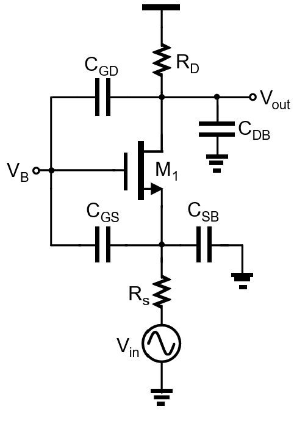
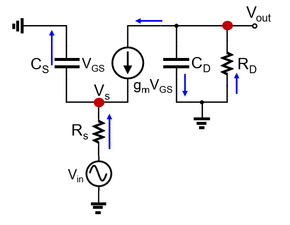
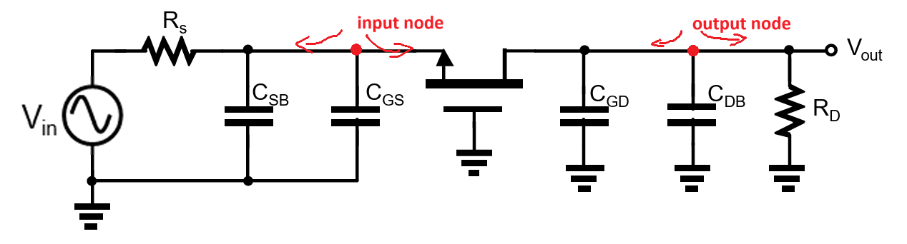
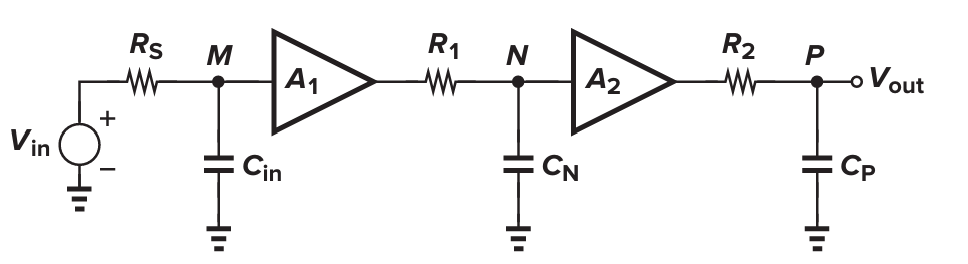
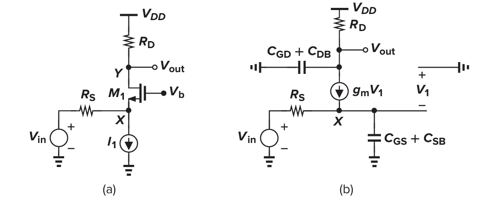

# CG Amplifier

For the CG amplifier, the **gate and body are both at AC ground**. Therefore, the parasitic capacitances connected to the same nodes can be combined:

$$
C_S=C_{GS}+C_{SB},C_D=C_{GD}+C_{DB}
$$

where $$C_S$$ is the total capacitance at the **source node** and $$C_D$$ is the total capacitance at the **drain/output node**.

<figure><figcaption></figcaption></figure>


Since $$C_{GD}$$ is connected between the drain and the AC-grounded gate, there is **no capacitor directly connecting the input and output nodes**. Hence, unlike the CS amplifier, we do not need Miller's theorem here.


Now, we construct the small-signal model of the CG amplifier. Since both gate and body are at AC ground,

$$
V_g=V_B=0
$$

Thus,

$$
V_{gs}=V_g-V_S=-V_S, V_{BS}=V_B-V_S=-V_S
$$

Including body effect, the small-signal drain current is

$$
i_d=g_mV_{gs}+g_{mb}V_{BS} =-(g_m+g_{mb})V_S
$$

Therefore, we can **lump** $$g_m$$ **and** $$g_{mb}$$ **together** and use an effective transconductance

$$
g_{m,\text{eff}}=g_m+g_{mb}
$$


We neglect the CLM, a.k.a, $$r_o$$ in our small-signal analysis.


Thus, our small-signal model may look as follows:

<figure><figcaption></figcaption></figure>

Now, we use KCL at the source node $$V_S$$, the current supplied through $$R_S$$ is $$\frac{V_{in}-V_s}{R_S}$$.

$$
\frac{V_{in}-V_s}{R_S} + (g_m+g_{mb})(-V_s)= sC_SV_s \tag{1}
$$

Rearranging,

$$
V_{in} = V_s\left[ 1+(g_m+g_{mb})R_S+sR_SC_S \right]
$$

Therefore,

$$
\frac{V_s}{V_{in}} = \frac{1} {1+(g_m+g_{mb})R_S+sR_SC_S}\tag{1a}
$$

Now, we use KCL again at the output note $$V_{\text{out}}$$, we have

$$
0 = \frac{V_{out}}{R_D}+(g_m+g_{mb}(-V_s)+sC_DV_{out} \tag{2}
$$

Hence,

$$
\frac{V_{out}}{V_s} = \frac{(g_m+g_{mb})R_D} {1+sR_DC_D}\tag{2a}
$$

Now we combine 1(a) and 2(a) through $$\frac{V_{out}}{V_{in}} = \frac{V_{out}}{V_s} \frac{V_s}{V_{in}}$$. Substituting (1a) and (2a),

$$
\frac{V_{out}}{V_{in}} = \frac{(g_m+g_{mb})R_D} {(1+sR_DC_D) \left[ 1+(g_m+g_{mb})R_S+sR_SC_S \right]}
$$

Factor $$1+(g_m+g_{mb})R_S$$ from the second term:

$$
\frac{V_{out}(s)}{V_{in}(s)} = \frac{ \dfrac{(g_m+g_{mb})R_D} {1+(g_m+g_{mb})R_S} }{ (1+sR_DC_D) \left( 1+s\dfrac{R_SC_S} {1+(g_m+g_{mb})R_S} \right) }
$$

This gives us the information about the poles and zeros in the CG amplifier. Obviously, there is **no zero** in this simplified model. From the two denominator factors,

$$
\omega_{p1}=\frac{1}{R_DC_D}
$$

and

$$
\omega_{p2} = \frac{1+(g_m+g_{mb})R_S}{R_SC_S}
$$

which can also be written as

$$
\omega_{p2} = \frac{1} {\left( R_S\parallel\frac{1}{g_m+g_{mb}} \right)C_S}
$$

This gives a useful physical interpretation:

$$
\omega_p\approx \frac{1} {(\text{resistance seen at node})(\text{capacitance at node})}
$$

Here, the drain sees approximately $$R_D$$, while the source sees $$R_S\parallel\frac{1}{g_m+g_{mb}}$$. This observation naturally leads into the **association of poles with nodes**, which is the next result in your slides.

## Association of Poles with Nodes

From the previous derivation, notice that each pole can be written in the familiar form

$$
\omega_p \approx \frac{1}{R_{\mathrm{eq}}C_{\mathrm{eq}}}
$$

where $$R_{\mathrm{eq}}$$ and $$C_{\mathrm{eq}}$$ are the equivalent resistance and capacitance **seen at a particular node**. This motivates the **association of poles with nodes**:

> when the capacitors are connected from individual nodes to AC ground, each node can be associated with a pole determined by its local $$RC$$ time constant.

For each node:

1. Find $$R_{\mathrm{eq}}$$: the equivalent resistance seen looking into the node, with **independent sources set to zero** and **capacitors open-circuited**. When the node has two branches, the equivalent resistance is: $$R_{\mathrm{eq}}=R_{\mathrm{eq,left}}\parallel R_{\mathrm{eq,right}}$$.
2. Find $$C_{\mathrm{eq}}$$: the total capacitance connected between that node and [**AC ground**](#user-content-fn-1)[^1]. (Treat the MOS as an open circuit!)
3. Estimate the associated pole using $$\omega_p\approx\frac{1}{R_{\mathrm{eq}}C_{\mathrm{eq}}}$$.


For **NUS EE3408C**, this method provides a quick way to **estimate the poles of an amplifier** and hence **sketch its Bode plot** without doing a full small-signal analysis.


Use our previous circuit as an example again,

<figure><figcaption></figcaption></figure>



#### Output Node

At the output node, the right equivalent resistance $$R_{\text{eq,right}}=R_D$$, while the left equivalent resistance $$R_{\text{eq,left}}$$ is a very large number (the derivation can be found in [tutorial 1 Q2.a](https://app.gitbook.com/s/UBWYdYYwvkB8gDH5SdEC/tut/tut-1-mosfet-and-single-stage-amplifier#id-2.-equivalent-resistance)!). Thus the total equivalent resistance at the output node is:

$$
R_{\mathrm{eq},D}\approx R_D
$$

and the equivalent capacitance at the output node is:

$$
C_{\mathrm{eq},D}=C_{GD}+C_{DB}=C_D
$$

Therefore,

$$
\omega_{p1} \approx \frac{1}{R_D(C_{GD}+C_{DB})} = \frac{1}{R_DC_D}
$$

which is exactly the first pole obtained from the full transfer-function derivation.



#### Input Node

Now, **looking into the MOSFET source/input node** (with gate and body at AC ground and $$r_o$$ neglected), the transistor presents an equivalent resistance $$1/(g_m+g_{mb})$$ (The derivation can be found in [tutorial 1 Q2.c](https://app.gitbook.com/s/UBWYdYYwvkB8gDH5SdEC/tut/tut-1-mosfet-and-single-stage-amplifier#id-2.-equivalent-resistance)!). Therefore, after setting $$V_{in}=0$$, the total resistance seen by $$C_S$$ is

$$
R_{\mathrm{eq},S} \approx R_S\parallel\frac{1}{g_m+g_{mb}}
$$

The capacitance at this node is

$$
C_{\mathrm{eq},S}=C_{GS}+C_{SB}=C_S
$$

Hence,

$$
\omega_{p2} \approx \frac{1}{ \left( R_S\parallel\frac{1}{g_m+g_{mb}} \right)C_S }
$$

again matching the pole obtained from the full derivation.



### Determine the Nominator

Remember that in the [transfer function](general-considerations.md#poles-zeros-and-s-plane), we don't only have the poles at the denominators and zeros at the nominators, we also have a **real term** $$K$$. This term can also be found using intuitive analysis and this is nothing but the **voltage gain** of the circuit! For example, in the following circuit,

<figure><figcaption></figcaption></figure>

Our transfer function can be easily and quickly written as:

$$
\frac{V_{out}}{V_{in}}(s) = \frac{A_1}{1 + R_S C_{in} s} \cdot \frac{A_2}{1 + R_1 C_N s} \cdot \frac{1}{1 + R_2 C_P s}
$$

Another example is the following circuit,

<figure><figcaption>
Figure 6.12: Common-gate stage with parasitic capacitances.
</figcaption></figure>

By using the association of poles to find the poles, as well as the quick method to determine that there is no zero in this circuit and use the intuitive analysis find the voltage gain of this amplifier, we can write out the transfer function of this circuit as:

$$
\frac{V_{out}}{V_{in}}(s) = \frac{(g_m + g_{mb})R_D}{1 + (g_m + g_{mb})R_S} \cdot \frac{1}{\left(1 + \frac{s}{\omega_{in}}\right)\left(1 + \frac{s}{\omega_{out}}\right)}
$$

where,

$$
\begin{align*}
\omega_{in} &= \left[ (C_{GS} + C_{SB}) \left( R_S \parallel \frac{1}{g_m + g_{mb}} \right) \right]^{-1} \\
\omega_{out} &= [(C_{DG} + C_{DB}) R_D]^{-1}
\end{align*}
$$

[^1]: By saying AC ground, it is not hard to find out that it is equivalent to ignore all the resistors!
