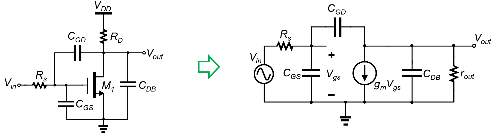
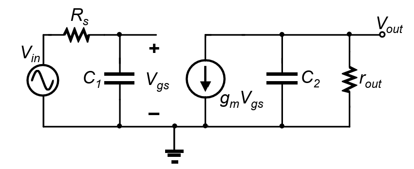
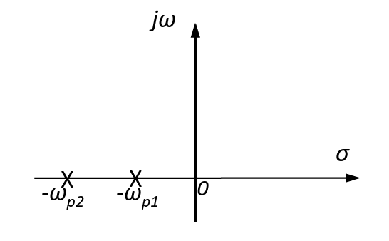
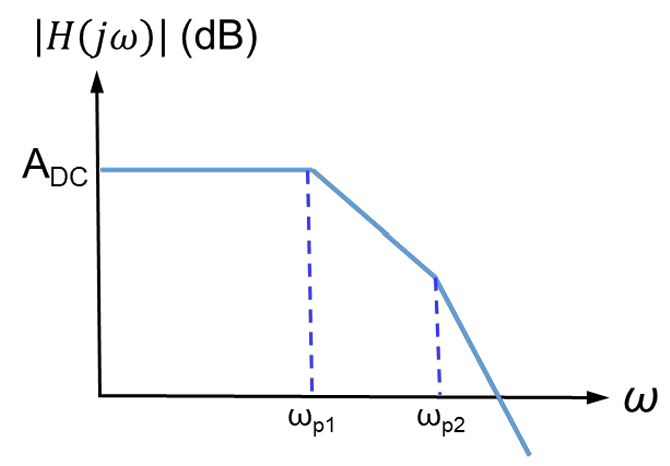
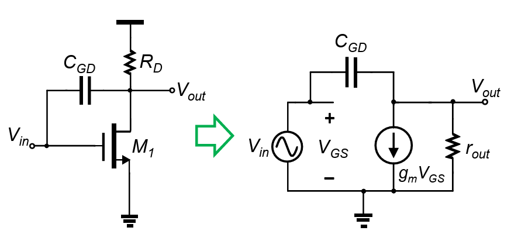
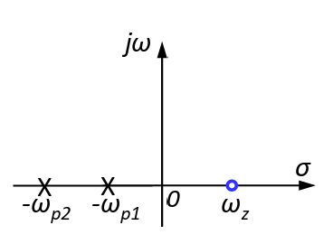
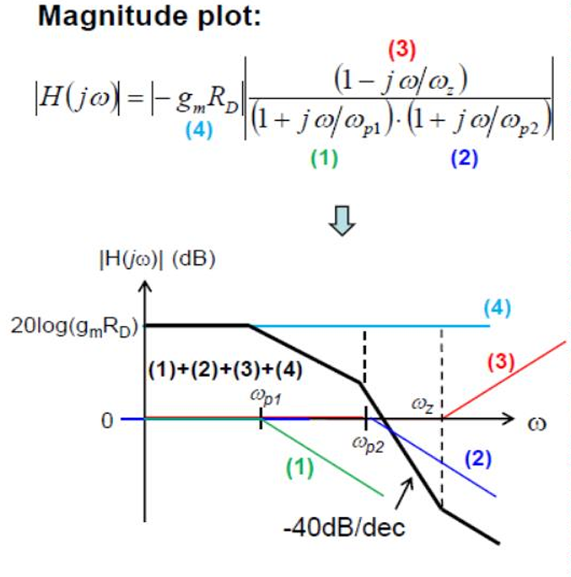
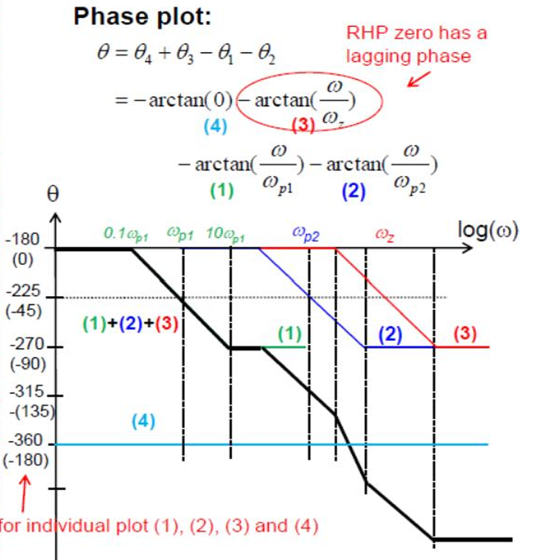
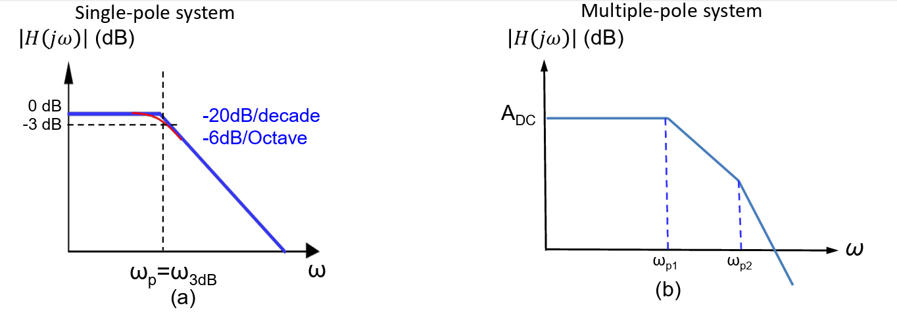

# CS Amplifier

In this section, we will study the **frequency response of a** [**CS amplifier**](../single-stage-amplifiers/common-source-stage.md). In particular, we will learn how to derive the Bode plot obtained from [**AC analysis in Cadence**](https://app.gitbook.com/s/UBWYdYYwvkB8gDH5SdEC/cadence/workshop-2-amplifier-design#ac-simulation). Using the **poles and zeros** of the amplifier, we will draw the Bode plot ourselves and verify it against the Cadence simulation. Cool right?

## Frequency Response

Suppose we have the **circuit shown below** and its corresponding **small-signal model**.

<figure><figcaption></figcaption></figure>


$$r_{out}$$ is the equivalent small-signal resistance looking into the **output node of the entire amplifier**. For a CS amplifier with a resistive load, $$r_{out}=R_D\parallel r_{o1}$$, where $$r_{o1}$$ is the NMOS's intrinsic output resistance and $$R_D$$ is the **drain resistor** connected from the NMOS drain to $$V_{DD}$$.


By applying the **Miller theorem**, we can transform the circuit into the following equivalent circuit.

<figure><figcaption></figcaption></figure>

$$
\begin{align*}
C_1 &= C_{GS} + (1 + g_m r_{out})C_{GD} \\
C_2 &\approx C_{DB} + C_{GD}
\end{align*}
$$


Here, the second approximation holds because we assume that $$g_m r_{out} \gg 1$$. Therefore, $$\frac{1}{g_m r_{out}} \approx 0$$.


From the input side,

$$
V_{gs}(s)=\frac{1}{1+sR_sC_1}V_{in}(s)
$$

where $$C_1$$ is the equivalent input capacitance after applying Miller's theorem. At the output,

$$
V_{out}(s) =-g_mV_{gs}\left(r_{out}\parallel\frac{1}{sC_2}\right)
$$

Since

$$
r_{out}\parallel\frac{1}{sC_2} = \frac{r_{out}}{1+s r_{out}C_2}
$$

we obtain

$$
V_{out}(s) = -g_mV_{in}(s) \left[\frac{1}{1+sR_sC_1}\right] \left[\frac{r_{out}}{1+s r_{out}C_2}\right]
$$

Therefore, the transfer function is

$$
H(s)=\frac{V_{out}(s)}{V_{in}(s)} = -g_mr_{out} \left[\frac{1}{1+s/\omega_{p1}}\right] \left[\frac{1}{1+s/\omega_{p2}}\right]
$$

where the two poles are

$$
\omega_{p1}=\frac{1}{R_sC_1},\omega_{p2}=\frac{1}{r_{out}C_2}
$$

If $$r_{out}=R_D\parallel r_{o1}$$ and $$R_D\ll r_{o1}$$, then $$r_{out}\approx R_D$$, hence

$$
\omega_{p2}\approx\frac{1}{R_DC_2}
$$

Usually, $$\omega_{p1}<\omega_{p2}$$ because the **Miller effect significantly increases the effective input capacitance** $$C_1$$, pushing the first pole to a lower frequency.

<figure><figcaption></figcaption></figure>

Both poles lie on the **negative real axis** at

$$
s=-\omega_{p1},s=-\omega_{p2}
$$

These two poles determine the high-frequency Bode plot:

<figure><figcaption></figcaption></figure>

* For $$\omega<\omega_{p1}$$: the gain is approximately constant at $$A_{DC}=|g_mr_{out}|$$.
* After $$\omega_{p1}$$: the slope becomes $$-20\text{ dB/dec}$$.
* After $$\omega_{p2}$$: the slope becomes $$-40\text{ dB/dec}$$.

Therefore, the CS amplifier behaves as a **low-pass amplifier**: its gain remains approximately constant at low frequencies and is increasingly attenuated at high frequencies.

### Limitation of Miller Approximation

In the previous analysis, Miller's theorem gave the approximate transfer function

$$
H(s)\approx -g_mr_{out} \frac{1}{1+s/\omega_{p1}} \frac{1}{1+s/\omega_{p2}}
$$

which predicts **two poles**. However, Miller's theorem removes the direct connection between the input and output through $$C_{GD}$$. To see what Miller's theorem misses, consider the CS amplifier **without** $$R_S$$. In this case,

$$
V_{GS}=V_{in}
$$

<figure><figcaption>
A CS amplifier without RS and its equivalent small-signal model
</figcaption></figure>

Applying KCL at the output node,

$$
sC_{GD}(V_{GS}-V_{out}) -g_mV_{GS} -\frac{V_{out}}{r_{out}} =0
$$


Attention, in the complex domain, we treat the capacitor as a resistance and then use the ohm's law with its impedance to calculate the current flowing through the capacitor!


Substituting $$V_{GS}=V_{in}$$,

$$
(sC_{GD}-g_m)V_{in} - \left(sC_{GD}+\frac{1}{r_{out}}\right)V_{out}=0
$$

Hence,

$$
H(s)=\frac{V_{out}}{V_{in}} = \frac{sC_{GD}-g_m} {sC_{GD}+1/r_{out}} = -g_mr_{out} \frac{1-sC_{GD}/g_m} {1+sr_{out}C_{GD}}
$$

Rewriting in pole-zero form,

$$
H(s)= -g_mr_{out} \frac{1-s/\omega_z} {1+s/\omega_p}
$$

where $$\omega_p=\frac{1}{r_{out}C_{GD}}$$ and $$\omega_z=\frac{g_m}{C_{GD}}$$. The pole is located at $$s=-\omega_p$$ while the zero is located at $$s=+\omega_z$$. Therefore, the zero is a **right-half-plane (RHP) zero**.


The zero comes from the direct **feedforward path through** $$C_{GD}$$. Miller's theorem replaces $$C_{GD}$$ with grounded equivalent capacitors, so this feedforward path is no longer represented and the zero is missed.


For this simple case, Miller's theorem gives only

$$
H(s)\approx \frac{-g_mr_{out}} {1+s r_{out}C_{GD}}
$$

which contains **one pole but no zero**.


Since $$R_S=0$$, the first pole doesn't exist anymore.


### A More Rigorous Frequency Response Analysis

A more rigorous analysis gives the general form

$$
H(s)\approx -A_{DC} \frac{1-s/\omega_z} {(1+s/\omega_{p1})(1+s/\omega_{p2})}
$$

where

$$
A_{DC}\approx g_mr_{out}, \omega_z=\frac{g_m}{C_{GD}}
$$


A more detailed derivation can be found in Razavi's textbook.


Since the numerator is $$1-s/\omega_z$$, the zero occurs at $$s=+\omega_z$$, so it is a **right-half-plane (RHP) zero**.


The Miller approximation gives a good estimate of the **two poles**, but a rigorous analysis reveals an additional **RHP zero** caused by the feedforward path through $$C_{GD}$$.


If $$\omega_z\gg\omega_{p1},\omega_{p2}$$, the zero occurs at a sufficiently high frequency that its effect can often be neglected.

<figure><figcaption></figcaption></figure>

So now, we draw the updated magnitude bode plot. Each pole decreases the magnitude slope by $$20\,\mathrm{dB/dec}$$, while the zero increases it by $$20\,\mathrm{dB/dec}$$. Therefore,

<figure><figcaption></figcaption></figure>

Since $$\omega_z$$ is an **RHP zero**, it has an unusual effect:

$$
\text{RHP zero: }+20\text{ dB/dec in magnitude, but }-90^\circ\text{ in phase}.
$$

Thus, the RHP zero increases the magnitude slope but introduces additional **phase lag**. For the CS amplifier,

$$
H(j\omega) = \underbrace{-g_mr_{out}}_{\text{DC gain}} \frac{ \overbrace{(1-j\omega/\omega_z)}^{\text{RHP zero}} }{ \underbrace{(1+j\omega/\omega_{p1})}_{\text{1st pole}} \underbrace{(1+j\omega/\omega_{p2})}_{\text{2nd pole}} }
$$

Each term contributes to the phase as follows:

$$
\underbrace{-g_mr_{out}}_{-180^\circ} \qquad \underbrace{1-j\omega/\omega_z}_{-\arctan(\omega/\omega_z)} \\
$$

$$
\underbrace{\frac{1}{1+j\omega/\omega_{p1}}}_{-\arctan(\omega/\omega_{p1})} \qquad \underbrace{\frac{1}{1+j\omega/\omega_{p2}}}_{-\arctan(\omega/\omega_{p2})}
$$

Therefore,

$$
\angle H(j\omega) = -180^\circ -\arctan\left(\frac{\omega}{\omega_z}\right) -\arctan\left(\frac{\omega}{\omega_{p1}}\right) -\arctan\left(\frac{\omega}{\omega_{p2}}\right)
$$

Thus, the **negative DC gain contributes** $$-180^\circ$$, while each pole and the **RHP zero** contributes up to an additional $$-90^\circ$$ **phase lag**. The phase bode plot is shown as follows:

<figure><figcaption></figcaption></figure>

## Dominant Pole and 3-dB Frequency

The **3-dB frequency** determines the amplifier bandwidth. For a single-pole system,

$$
\omega_{3\mathrm{dB}}=\omega_p
$$

For a system with **multiple** poles and zeros, this equality does not generally hold. However, if the lowest-frequency pole is sufficiently separated from the other poles and zeros,

$$
\omega_{p1}\ll\omega_{p2},\omega_z
$$

then $$\omega_{p1}$$ is called the **dominant pole**, and

$$
\omega_{3\mathrm{dB}}\approx\omega_{p1}
$$

<figure><figcaption></figcaption></figure>
