# General Considerations

In this section, we will mainly cover two topics:

1. A crash course on Signals and Systems, with a focus on systems.
2. A short introduction to the Miller effect.

## Signal and Systems


At the time of writing these notes, I have not yet taken **CG/EE2023 (Signals and Systems)** at NUS. Therefore, this section provides a beginner-friendly crash course on the essential concepts, assuming **no prior knowledge of Signals and Systems**.


This section begins with the fundamentals of **Signals and Systems**, starting from the time-domain limitations of circuits with reactive components and introducing the **Laplace transform,** $$s$$**-domain, impedance, and transfer functions**.

We then move to **frequency response**, covering the $$s=j\omega+\sigma$$ representation, **magnitude and phase**, and the use of **Bode plots** to understand poles, zeros, and the frequency behavior of single- and multi-pole systems.

### Time-Domain Analysis

In elementary DC circuit analysis, resistors follow Ohm's Law: $$V = I \cdot R$$. Resistors provide constant resistance regardless of how rapidly signals vary. However, reactive components like capacitors ($$C$$) and inductors ($$L$$) behave **dynamically** based on time rates of change:

$$
i(t) = C \frac{dv(t)}{dt}, v(t) = L \frac{di(t)}{dt}
$$

Analyzing circuits with resistors, capacitors, and inductors in the **time domain** ($$t$$-domain) requires solving complex systems of differential equations. To bypass calculus, electrical engineers transform circuits into the complex frequency domain ($$s$$-domain) using the **Laplace Transform**.


In NUS EE3408C, we will not use **inductors** in our circuit designs, as inductors are more commonly encountered in **radio-frequency (RF) circuit design**.


#### Laplace Transform

The Laplace variable $$s$$ is defined as:

$$
s = \sigma + j\omega
$$

Here, $$\sigma$$ represents damping or exponential decay/growth, while $$j\omega$$ represents steady sinusoidal angular oscillation ($$j = \sqrt{-1}$$, $$\omega = 2\pi f$$). The Laplace transform replaces differential operators ($$\frac{d}{dt}$$) with algebraic multiplication by $$s$$.


The **Laplace transform** serves as a bridge from the **time domain** to the **complex-frequency domain (**$$s$$**-domain)**. Therefore, by solving for $$s$$, we can obtain important information about a system's **frequency response**, such as the locations of its **poles and zeros**.


#### Impedance

By transforming differential equations into algebraic relationships, reactive components are assigned generalized "resistances" known as **Impedances** ($$Z$$). For example, the impedance for a capacitor and inductor is defined as follows:

$$
Z_C(s) = \frac{1}{sC}, Z_L(s) = sL
$$

With impedances, reactive components are treated like **ordinary resistors** using voltage dividers, series/parallel combinations, and Kirchhoff's laws — eliminating the need for calculus.


**Impedance** can be negative in certain circuits. However, in NUS EE3408C, we assume that all impedances encountered in our analysis are **positive**.


### Transfer Functions and Frequency Response

#### Transfer Functions

A Transfer Function, denoted as $$H(s)$$, characterizes a linear time-invariant system as a ratio of its output to its input in the $$s$$-domain:

$$
H(s) = \frac{V_{out}(s)}{V_{in}(s)}
$$

When a circuit is driven by continuous sinusoidal signals (steady-state AC), there is **no exponential** decay or growth ($$\sigma = 0$$). Evaluating the system along the imaginary axis yields:

$$
s = j\omega \implies H(j\omega) = \frac{V_{out}(j\omega)}{V_{in}(j\omega)}
$$

#### Frequency Response

To avoid trigonometric calculations with sines and cosines, sinusoidal signals are represented via Euler's formula in polar form:

$$
V = \vert{}V\vert{} e^{j\theta}
$$

In this notation,

* the **magnitude** $$\vert{}V\vert{}$$ encodes amplitude,
* the **angle** $$\theta$$ encodes phase shift (time delay).

Because complex division subtracts angles and divides magnitudes, the **transfer function** evaluates directly to:

$$
H(j\omega) = \frac{\vert{}V_{out}(j\omega)\vert{} e^{j\theta_2(\omega)}}{\vert{}V_{in}(j\omega)\vert{} e^{j\theta_1(\omega)}} = \vert{}H(j\omega)\vert{} e^{j\theta(\omega)}
$$

* **Magnitude Response** $$\vert{}H(j\omega)\vert{}$$: $$\frac{\vert{}V_{out}(j\omega)\vert{}}{\vert{}V_{in}(j\omega)\vert{}}$$ dictates how much the signal amplitude is scaled.
* **Phase Response** $$\angle H(j\omega) = \theta(\omega)$$: $$\theta_2(\omega) - \theta_1(\omega)$$ dictates how much the output leads or lags behind the input.

In a simple first-order RC low-pass filter, the voltage divider equation with capacitor impedance $$Z_C = \frac{1}{sC}$$ yields:

$$
H(s) = \frac{\frac{1}{sC}}{R + \frac{1}{sC}} = \frac{1}{1 + sRC} = \frac{1}{RC} \cdot \frac{1}{s + \frac{1}{RC}}
$$

<figure>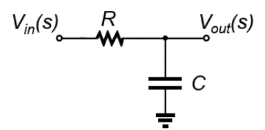<figcaption>
First-order RC low-pass filter
</figcaption></figure>

### Poles, Zeros and s-plane

Any linear transfer function can be factored into its roots:

$$
H(s) = K \frac{(s - z_1)(s - z_2)\cdots(s - z_m)}{(s - p_1)(s - p_2)\cdots(s - p_n)}
$$

* **Zeros** ($$z_i$$): Roots of the numerator polynomial. At $$s = z_i$$, $$H(s) = 0$$, and hence $$V_{out}=0$$ at zeros.
* **Poles** ($$p_i$$): Roots of the denominator polynomial. At $$s = p_i$$, the denominator vanishes and $$\vert{}H(s)\vert{} \to \infty$$.


Usually, **zeros** can be identified quickly by examining **feedforward paths from the input to the output** and **series coupling capacitors at the input**. In contrast, **poles** can often be estimated efficiently using the **association-of-poles method**.


We can plot these roots (including zeros and poles) on the complex $$s$$-plane ($$\sigma$$ on the horizontal axis, $$j\omega$$ on the vertical axis) as shown below.

<figure>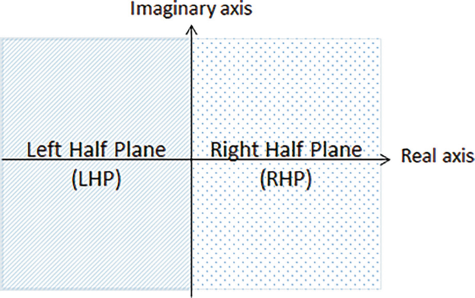<figcaption></figcaption></figure>


Poles located in the Left Half-Plane (LHP, where $$\sigma < 0$$) correspond to decaying exponentials ($$e^{-\vert{}\sigma\vert{}t}$$), guaranteeing bounded, stable behavior.


For the simple RC network, setting $$s + \frac{1}{RC} = 0$$ yields a single **pole** at $$s = -\frac{1}{RC}$$ on the negative real axis, classifying it as a stable single-pole system.

<figure>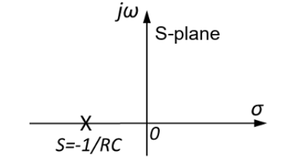<figcaption></figcaption></figure>

### Bode Plots


In **NUS EE3408C**, we will be tested on **drawing Bode plots**, so it is important to identify the **turning (corner) frequencies** and understand how each pole or zero changes the **shape and slope** of the plot.


A Bode Plot **visualizes** the steady-state frequency response $$H(j\omega)$$ on a logarithmic horizontal frequency axis ($$\log_{10}\omega$$). It splits into two plots:

* magnitude in decibels ($$20\log_{10}\vert{}H(j\omega)\vert{}$$) and
* phase shift in degrees.


Usually, the **magnitude** and **phase** Bode plots have **gain (dB)** and **phase (degrees)** on the $$y$$-axis, respectively. The $$x$$-axis represents the **input-signal frequency**, which may be plotted as either $$\omega$$ or $$\log_{10}\omega$$. Using a logarithmic frequency axis changes only the **scale**, not the underlying frequency-response behavior (a.k.a, the shape of the bode plot).


Now, we will look at **three examples** to build an intuitive understanding of how to **draw and interpret Bode plots**.

* Single Pole Low-Pass Filter
* First-Order High-Pass Filter
* Multi-Pole Systems

After that, we will introduce some general rules to draw the bode plots.


#### Pole Frequency

A circuit may have **multiple poles**, each associated with a **pole frequency** $$\omega_{p,i}=|p_i|$$.  However, for a typical **low-pass amplifier**, there is only **one overall 3-dB frequency** $$\omega_{3\text{dB}}$$, where the gain drops by 3 dB from its low-frequency value.


#### Single Pole Low-Pass Filter

Just a quick recap, the circuit in this case is:

<figure><figcaption></figcaption></figure>

Use the definition of **pole frequency**, we have $$\omega_p = \frac{1}{RC}$$. The first-order low-pass transfer function is written in standardized Bode form:

$$
H(j\omega) = \frac{1}{1+sRC}= \frac{1}{1+j\omega RC}=\frac{1}{1 + j\frac{\omega}{\omega_p}}
$$

Thus, we can draw its magnitude and phase bode plot:



#### Magnitude Bode Plot

The magnitude response in decibels is

$$
20\log_{10}|H(j\omega)| = -20\log_{10}\sqrt{1+\left(\frac{\omega}{\omega_p}\right)^2}
$$


The implicit rule that applies here is that whenever we see $$H=\frac{A}{B}$$, we can haev $$|H|=\frac{|A|}{|B|}$$, where $$A$$ and $$B$$ are any complex expression.


To understand and sketch the Bode plot, we can divide the frequency range into **three cases**:

1. **Low frequency (**$$\omega\ll\omega_p$$**)**: The gain is approximately 1, or $$0\,\text{dB}$$.
2. **At the pole frequency (**$$\omega=\omega_p$$): The gain drops to $$-3\,\text{dB}$$.
3. **High frequency (**$$\omega\gg\omega_p$$**)**: The gain decreases with a slope of $$-20\,\text{dB/decade}$$.

These three regions give us a simple **straight-line approximation** of the magnitude Bode plot, which can be shown as follows.

<figure>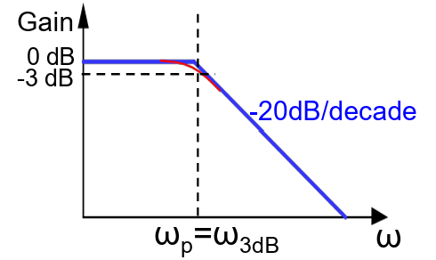<figcaption></figcaption></figure>



#### Phase Bode Plot

The phase response is

$$
\angle H(j\omega) = -\arctan\left(\frac{\omega}{\omega_p}\right)
$$

We can divide the phase response into **three regions**:

1. **Low frequency (**$$\omega<0.1\omega_p$$**)**: $$\angle H(j\omega)\approx 0^\circ$$
2. **At the pole frequency (**$$\omega=\omega_p$$**)**: $$\angle H(j\omega)=-45^\circ$$
3. **High frequency (**$$\omega>10\omega_p$$**)**: $$\angle H(j\omega)\approx -90^\circ$$

Between $$0.1\omega_p$$ and $$10\omega_p$$, the phase is approximated by a straight line with a slope of $$-45^\circ/\text{decade}$$.


The three bullet points above are very important for us to draw the phase bode plots!


<figure>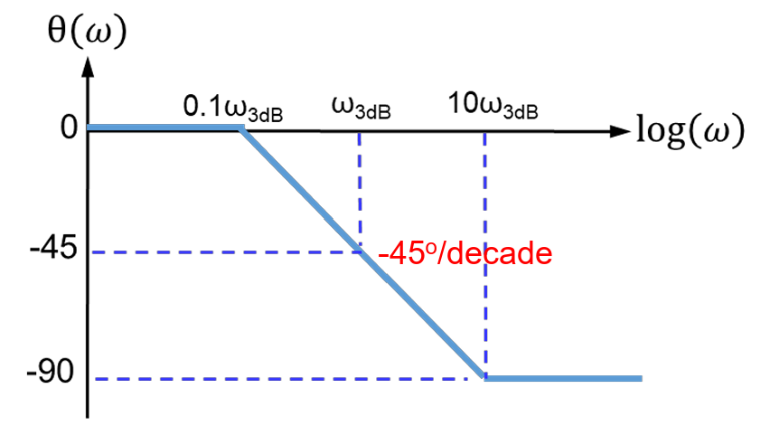<figcaption></figcaption></figure>


#### Polar Form for a Complex Number

For a complex number $$z=a+jb=|z|e^{j\theta}$$, the polar representation is determined by:

* $$|z|=\sqrt{a^2+b^2}$$
* $$\theta=\arctan\left(\frac{b}{a}\right)$$

where $$a$$ is the **real part** and $$b$$ is the **imaginary part**.




#### First-Order High-Pass Filter

In this case, our circuit is shown as follows:

<figure>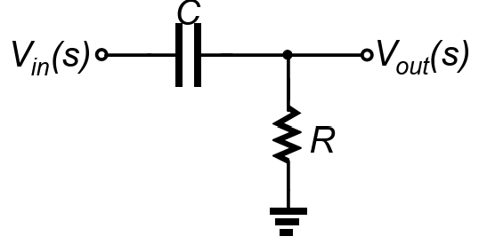<figcaption></figcaption></figure>

In this case, our transfer function is

$$
H(s) = \frac{R}{R +\frac{1}{sC}} = \frac{s}{s + \omega_p} \implies H(j\omega) = \frac{j\frac{\omega}{\omega_p}}{1 + j\frac{\omega}{\omega_p}}
$$

This creates a zero at the origin ($$s = 0$$, or DC) and a pole at $$\omega_p = \frac{1}{RC}$$. Thus, this circuit has one zero and one pole.



#### Magnitude Bode Plot

In this case, the magnitude can be written as:

$$
20\log |H(j\omega)| = 20\log(\omega/\omega_p) + \left[-20log\sqrt{1+(\omega/\omega_p)^2}\right]
$$

Thus, the overal magnitude response is plotted as follows:

<figure>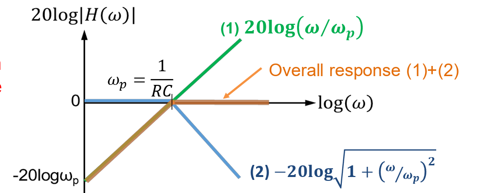<figcaption></figcaption></figure>


The $$y$$-axis here is nothing but **gain**!




#### Phase Bode Plot

The phase response can be derived as follows:

$$
\begin{aligned}
\theta(\omega) = \theta_{num}(\omega) +[- \theta_{dem}(\omega)] &= \arctan(\infty) + [-\arctan(\omega/\omega_p)] \\
&= 90^\circ + [-\arctan(\omega/\omega_p)]
\end{aligned}
$$


When drawing the **phase Bode plot**, we can always use the rule $$\theta_{\text{total}}=\theta_{\text{num}}+(-\theta_{\text{dem}})$$. This will help us draw the final phase bode plot by combining the numerator and denominator together!


Thus, the overal phase response can be plotted as follows:

<figure>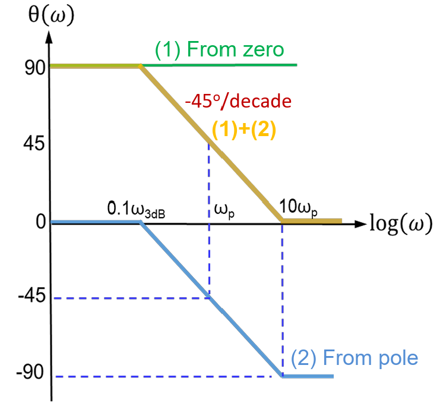<figcaption></figcaption></figure>



#### Multi-Pole Systems

Suppose now we have the following circuit,

<figure>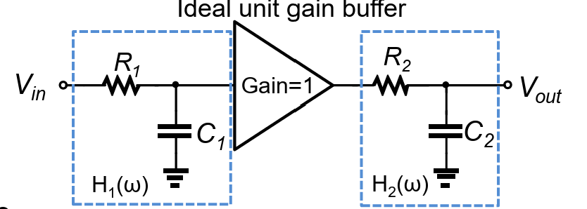<figcaption></figcaption></figure>

When two low-pass stages are cascaded via an ideal unit-gain buffer as shown above, the buffer isolates the stages and multiplies their transfer functions: $$H(j\omega) = H_1(j\omega) \cdot H_2(j\omega)$$.


In **magnitude** and **phase** bode plot, this multiplication translates to direct **summation**.




#### Magnitude Bode Plot

The magnitude response can be written as follows:

$$
\begin{aligned}
20\log|H(j\omega)| &= 20\log|H_1(j\omega)| + 20\log|H_2(j\omega)| \\
&= -20\log\left(\sqrt{1 + (\omega/\omega_{p1})^2}\right) - 20\log\left(\sqrt{1 + (\omega/\omega_{p2})^2}\right)
\end{aligned}
$$

Assume $$\omega_{p1}<\omega_{p2}$$, we can get our magnitude bode plot as follows:

<figure>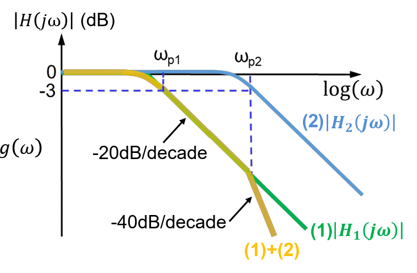<figcaption></figcaption></figure>


In NUS EE3408C, the exam questions will specify the **assumptions about the two pole frequencies** that we should use when drawing both the magnitude and phase bode plots.




#### Phase Bode Plot

The phase response can be derived as follows:

$$
\theta = \angle H_1(\omega) + \angle H_2(\omega) = \theta_1 + \theta_2 = -\arctan\left(\frac{\omega}{\omega_{p1}}\right) - \arctan\left(\frac{\omega}{\omega_{p2}}\right)
$$

Assume $$10\omega_{p1} < 0.1\omega_{p2}$$, we can easily get our phase plot as follows:

<figure>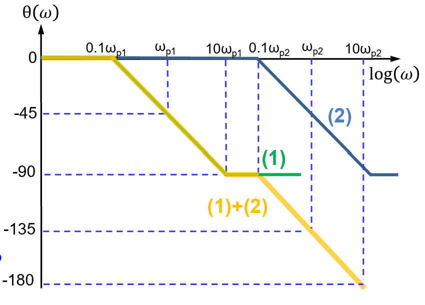<figcaption></figcaption></figure>


In practice, the **phase difference between** $$V_{\text{out}}$$ **and** $$V_{\text{in}}$$ can propagate through the feedback path between the **gate and drain** (because of the capacitance), potentially causing **oscillation**. We will soon see how the [**Miller effect**](general-considerations.md#miller-effect) can be used to analyze and manage this feedback path.




#### General Rules for drawing Bode Plots

For a transfer function with poles and zeros, draw the **magnitude** and **phase** contributions of each pole/zero separately, then **add** them together. In a nutshell, the impact of poles and zeros can be summarized into the following table very well:

<figure>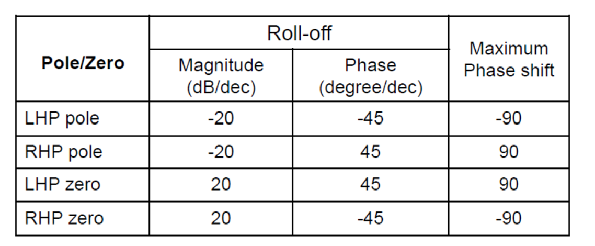<figcaption></figcaption></figure>


For a **normal pole or zero** at $$\omega_0$$, the phase change occurs gradually from approximately $$0.1\omega_0$$ to $$10\omega_0$$. At $$\omega_0$$, the phase shift is approximately $$\pm45^\circ$$, and it approaches its full $$\pm90^\circ$$ shift by $$10\omega_0$$. Outside this range, there is no phase change.


For the two special cases with pole and zero are actually 0

| Pole/Zero                                |               Magnitude slope |                Phase | Comment       |
| ---------------------------------------- | ----------------------------: | -------------------: | ------------- |
| **Zero at origin** $$s=0$$ **(DC Zero)** | $$+20$$ **dB/dec everywhere** | always $$+90^\circ$$ | **No corner** |
| **Pole at origin** $$s=0$$               | $$-20$$ **dB/dec everywhere** | always $$-90^\circ$$ | **No corner** |


* For magnitude bode plots, **normal poles and zeros** start at the **DC gain** (or 0 dB if it is not amplifier) and change slope at their corner frequency. In contrast, a **zero at the origin** (or DC zero) starts from $$-\infty$$ dB and has a $$+20$$ dB/dec slope for all frequencies (however, usually we just ignore it in the magnitude bode plot drawing because the DC zero is usually introduced by a coupling capacitor and there is usually a low-frequency pole accompanying it), while a **pole at the origin** starts from $$+\infty$$ dB and has a $$-20$$ dB/dec slope for all frequencies. Neither origin case has a finite corner frequency.
* For phase bode plot, the case is a bit tricky:
  * If the circuit is not an amplifier, normal zeros/poles start at $$0^\circ$$ and transition toward $$+90^\circ/-90^\circ$$ around their corner frequency. A zero/pole at the origin contributes $$+90^\circ/-90^\circ$$ at all frequencies, thus the starting point becomes $$+90^\circ/-90^\circ$$.
  * If the circuit is an **inverting amplifier**, the phase plot will start at $$180^\circ$$. Otherwise, if it is a **non-inverting amplifier**, then the phase plot will start at $$0^\circ$$. If the amplifier has a DC zero, will add $$+90^\circ$$ to the starting point.


## Miller Effect

In amplifier stages, feedback impedances bridging the input and output nodes complicate circuit equations. The **Miller Theorem** decouples this feedback path by splitting a bridging impedance $$Z$$ into two independent, ground-referenced components:

> The Miller Theorem states that: An impedance $$Z$$ connected between the **input and output** can be replaced by two equivalent impedances: $$Z_1$$ at the input and $$Z_2$$ at the output.

<figure>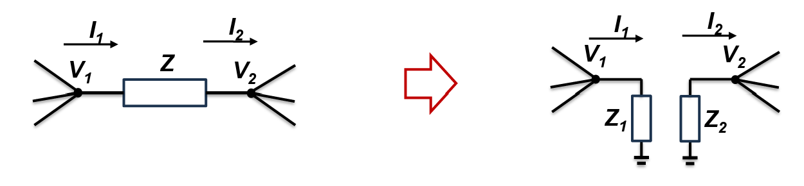<figcaption></figcaption></figure>

The miller theorem can be easily proved using the basic techniques of circuit analysis:

$$
\begin{align*}
I_1 &= \frac{V_1 - V_2}{Z} = \frac{V_1}{Z_1} \rightarrow Z_1 = \frac{ZV_1}{V_1 - V_2} = \frac{Z}{1 - \frac{V_2}{V_1}} = \frac{Z}{1 - A_V} \quad A_V = \frac{V_2}{V_1} \\[6pt]
I_2 &= \frac{V_1 - V_2}{Z} = \frac{-V_2}{Z_2} \rightarrow Z_2 = \frac{-ZV_2}{V_1 - V_2} = \frac{Z}{1 - \frac{V_1}{V_2}} = \frac{Z}{1 - \frac{1}{A_V}}
\end{align*}
$$

Although Miller's Theorem may seem unintuitive because it **replaces a connecting impedance with two separate impedances**, it can only be applied under certain conditions:

> The impedance that we want to split using Miller's Theorem should be connected in **parallel** with an active path, such as an amplifier.


#### Motivation for using Miller Theorem in the amplifier design

In our amplifier analysis, the **gate-to-drain capacitance** $$C_{GD}$$ creates a feedback path between the input and output. The **Miller effect/theorem** allows us to decouple this path into equivalent input and output capacitances, greatly simplifying the frequency-response analysis.&#x20;


Here, we will also introduce some **tips for quickly applying the Miller effect to common circuit configurations**.



#### Positivity and Negativity

As we assumed earlier, the impedances we encounter in this course are generally **positive**. For the Miller equivalent impedances,

* $$A_V<0$$: both $$Z_1$$ and $$Z_2$$ are **positive**.
* $$A_V>0$$: one of $$Z_1$$ and $$Z_2$$ is **negative**.
* $$A_V=1$$: both $$Z_1$$ and $$Z_2$$ become **infinite**.

<figure>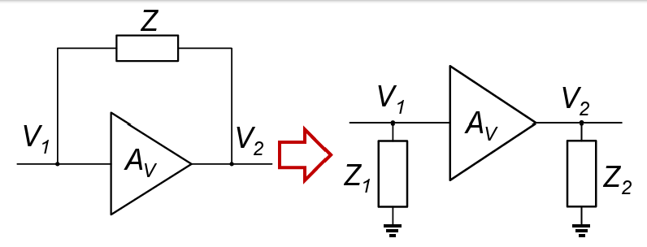<figcaption></figcaption></figure>



#### Resistor as Impedance

<figure>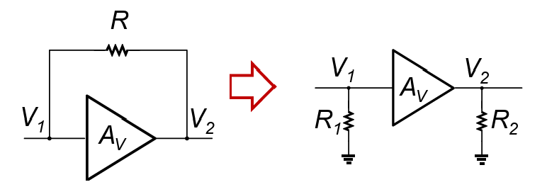<figcaption></figcaption></figure>

In this case, $$Z=R$$. Thus, we have

$$
\begin{align*}
R_1 &= \frac{R}{1 - A_V} & R_2 &= \frac{R}{1 - \frac{1}{A_V}}
\end{align*}
$$



#### Capacitor as Impedance

<figure>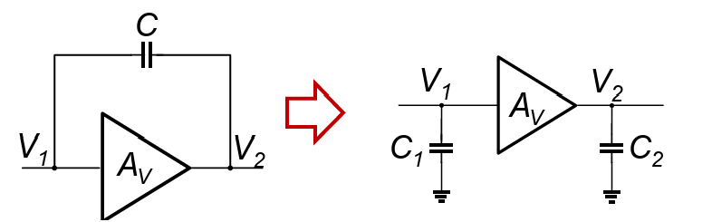<figcaption></figcaption></figure>

In this case, $$Z=\frac{1}{sC}$$. Thus, we have

$$
\begin{align*}
C_1 &= C(1 - A_V) & C_2 &= C\left(1 - \frac{1}{A_V}\right)
\end{align*}
$$



### Amplifer Capacitance Relook

As introduced [earlier](../basic-mos-device-physics/mos-device-models.md#mos-device-capacitances), a MOSFET amplifier contains several **parasitic capacitances**. These can be divided into three categories:

1. **Shunt to ground:** $$C_{GS}$$, $$C_{GB}$$, and $$C_{DB}$$
2. **Between input and output:** $$C_{GD}$$
3. **Along the signal path:** coupling capacitor $$C_{in}$$ and source bypass capacitor $$C_s$$

In this course, we will focus on the **first two categories**.

<figure>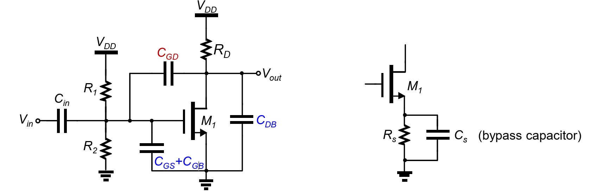<figcaption></figcaption></figure>

We have already seen a glimpse of the amplifier's **frequency response** by performing the AC analysis in the [workshop](https://app.gitbook.com/s/UBWYdYYwvkB8gDH5SdEC/cadence/workshop-2-amplifier-design#ac-simulation). In practice, the response can be divided into three frequency regions:

* **Low-frequency band:** The AC coupling capacitor $$C_{\text{in}}$$ and bypass capacitor $$C_\text{s}$$ attenuate low-frequency signals (High-pass filter forms between $$C_{\text{in}}$$ and $$R_2$$).
* **Mid-frequency band:** The amplifier gain is approximately constant.
* **High-frequency band:** Parasitic and shunt capacitances attenuate high-frequency signals.

<figure>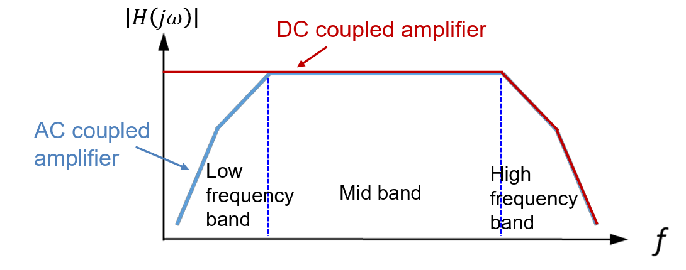<figcaption></figcaption></figure>


With these concepts in place, we are now ready to analyze the **frequency response of the different amplifier configurations** we have learned.


## Summary

In a nutshell, the most valueable takeaway from this chapter should be the ability to use **intuitive analysis** to quickly gauge the frequency response of any given analog circuit, and this intuitive analysis is as follows:

1. **Finding Pole: Use the Association of Poles**
   1. Number of poles: The number of poles is approximately the number of high-impedance nodes in the circuit.
      1. An input node with no resistance associated with it is not counted as a high-impedance node.
   2. Pole frequency: For each high-impedance node, use the association of poles method to find the equivalent resistance and capacitance seen from that node: $$\omega_p \approx \frac{1}{R_{\mathrm{eq}}C_{\mathrm{eq}}}$$. The node with the lowest pole frequency is the dominant pole.
   3. In EE3408C, as we always assume the impedance is positive, all the poles we found using association of poles are **LHP poles**.
2. Finding Zeros
   1. Where zeros come from: Zeros typically arise from input capacitances and feedback/feedforward paths that create an additional path from input to output.
   2. DC zero: An input coupling capacitor introduces a zero at DC: $$\omega_z = 0$$
   3. High-frequency zero: For a zero caused by a feedback/feedforward path, it can often be found quickly by setting $$V_{\mathrm{out}}=0$$ and solving for the frequency (a.k.a, $$s$$ and since $$s=j\omega$$, so it's okay to say frequency here) at which the transfer function becomes zero.
3. Finding the Circuit's voltage gain
   1. Use the intuitive analysis we've introduced in [Lec 08](https://app.gitbook.com/s/UBWYdYYwvkB8gDH5SdEC/lec/lec-8-differential-amplifiers#intuitive-small-signal-analysis)! This will be the $$K$$ term in our transfer function below.

After finding the **poles**, **zeros** and the voltage gain, we can draw the **Bode plot** to visualize the circuit’s frequency response. To do so:

1. **Express the transfer function** in factored form using its poles and zeros:

$$
H(s)=K\frac{(s-z_1)(s-z_2)\cdots}{(s-p_1)(s-p_2)\cdots}
$$

2. **Draw the magnitude and phase plots systematically** by applying the [rules introduced earlier](general-considerations.md#general-rules-for-drawing-bode-plots) for **LHP/RHP poles and zeros**.
