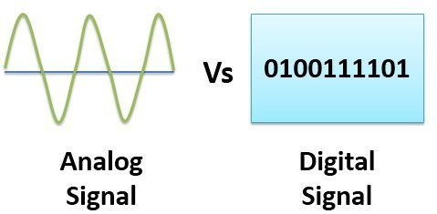
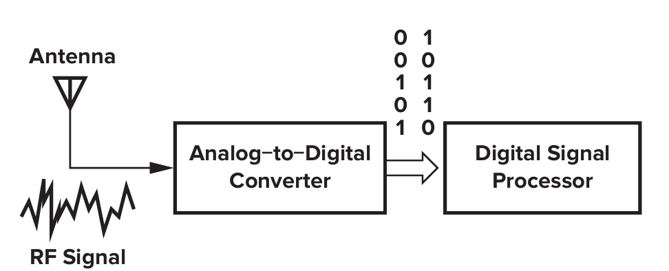
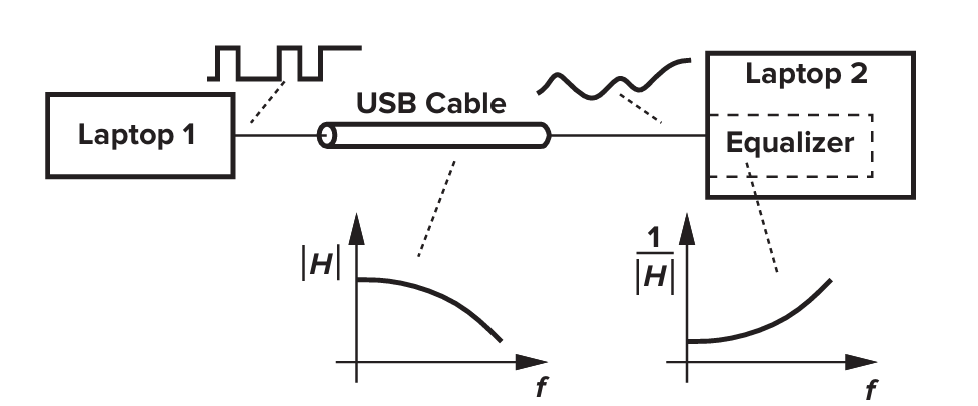
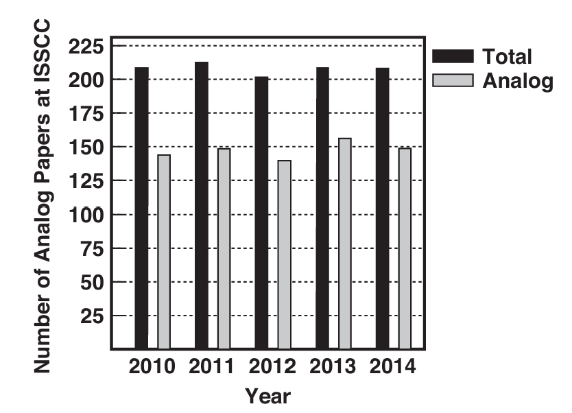
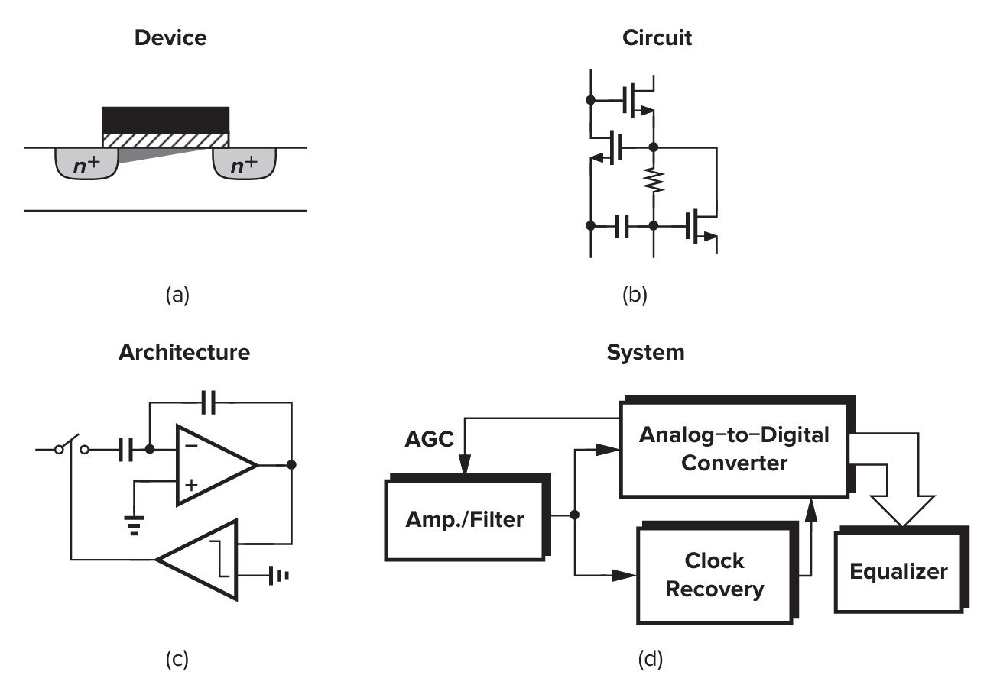

# Introduction to Analog Design

## Why Analog?

In this section, we will learn that analog design is still essential, relevant, and challenging and will remain so for decades to come.

### Sensing and Processing Signals

Many electronic systems perform two principal functions:

* they **sense (receive)** a signal and
* subsequently **process** and **extract** information from it

We know intuitively that the complex task of _processing_ is preferably carried out in the digital domain.

Analog vs. Digital Signal

Recall that analog signals are continuous and digital signals are discrete and most of the signals in real-world are analog by nature.

<figure><figcaption></figcaption></figure>

In fact, we may wonder whether we can directly digitize the signal and avoid any operations in the analog domain. This is totally possible if we add an [ADC](https://app.gitbook.com/s/o4X8QvQZjJ2YsPgYhJDb/studio/studio-8-adc-module) to digitize the analog signals into digital signals. Figure 1.1 shows an example where the RF signal received by the antenna is digitized by an analog-to-digital converter (ADC) and processed entirely in the digital domain.

<figure><figcaption>
Figure 1.1 Hypothetical RF receiver with direct signal digitization.
</figcaption></figure>

The key point offered by this example is that the sensing **interface** still demands high-performance analog design because an ADC that could digitize the minuscule RF signal would consume much more power than today's cell phone receivers.


In most of the low-activity systems, analog circuits tend to consume most of the power!


### When Digital Signals Become Analog

The use of analog circuits is not limited to analog signals. If a digital signal is so small and/or so **distorted** that a digital gate cannot interpret it correctly, then the analog designer must step in. For example, consider a long USB cable carrying data rate of hundreds of megabits per second between two laptops. As shown in Fig. 1.3, Laptop 1 delivers the data to the cable in the form of a sequence of ONEs and ZERO. Unfortunately, the cable exhibits a finite bandwidth, **attenuating high frequencies** and thus distorting the data as it reaches Laptop 2. This device must now perform sensing and processing, the former requiring an analog circuit (called an "equalizer") that corrects the distortion. For example, since the cable attenuates high frequencies, we may design the equalizer to amplify such frequencies, as shown conceptually by the $$1/|H|$$ plot in Fig. 1.3.

<figure><figcaption>
Figure 1.3 Equalization to compensate for high-frequency attenuation in a USB cable
</figcaption></figure>

To understand this graph, we need to look at two perspectives:

* **The USB Cable (Low-Pass Characteristic)**: Due to inherent parasitic capacitance and resistance, a physical copper cable acts as a low-pass filter. While low-frequency signals pass through with minimal loss, the high-frequency components — which are mathematically required to create the sharp, vertical edges of a digital square wave — are severely attenuated. This results in a distorted, rounded signal arriving at the destination.
* **The Analog Equalizer (High-Pass Compensation)**: To recover the digital data, the receiving device passes the distorted signal through an analog equalizer. This circuit functions as a high-pass amplifier specifically designed with a response that is the exact inverse of the cable's attenuation. By selectively boosting the lost high frequencies, the equalizer reconstructs the sharp edges of the original digital signal before it is interpreted by the digital logic gates.

The transfer function H

In Fig. 1.3 above, $$H$$ represents the **Transfer Function**, which defines exactly how a system (like a cable or a filter) alters an input signal to produce an output:

\text{Output}=\text{Input}\times H

When analyzing these systems graphically in the frequency domain, $$|H|$$ denotes the **Magnitude Response**, which illustrates how the system scales the signal's amplitude across different frequencies.

* If $$|H|=1$$: The signal passes through the system perfectly unchanged at that frequency.
* If $$|H|<1$$: The system **attenuates** (weakens) the signal at that frequency. In our USB cable graph, the curve drops well below 1 as frequency increases.
* If $$|H|>1$$: The system **amplifies** (boosts) the signal at that frequency. In our equalizer graph, the curve rises above 1 at higher frequencies.

The reader may wonder whether the task of equalization in Fig. 1.3 could be performed in the digital domain by using an ADC as mentioned [above](introduction-to-analog-design.md#sensing-and-processing-signals). That is, could we directly digitize the received distorted signal, digitally correct for the cable's limited bandwidth, and then carry out the standard USB signal processing? Indeed, this is possible if the ADC required here demands less power and less complexity than the analog equalizer.

Following a detailed analysis, the analog designer decides which approach to adopt, but we intuitively know that at very high data rates, e.g., tens of gigabits per second, an analog equalizer proves more efficient than an ADC. The above equalization task exemplifies a general trend in electronics:

* at **lower** speeds, it is more efficient to digitize the signal and perform the required function(s) in the **digital domain** by using an _interface_ like ADC.
* whereas at **higher** speeds, we implement the function(s) in the **analog domain**, by using an equalizer.

The speed boundary between these two paradigms depends on the nature of the problem, but it has risen over time.

### Analog Design is in Great Demand

At the time this book is written, Razavi has summarized a graph illustrating the number of Analog papers at ISSCC (the top 1 conference in the field of chip design) where "analog" is defined as a paper requiring the knowledge in this book.

<figure><figcaption>
Figure 1.4 Number of analog papers published at the ISSCC in recent years.
</figcaption></figure>

### Analog Design Challenges

Today's analog designers must deal with interesting and difficult problems. Our study of devices and circuits in this book will systematically illustrate various issues, but it is helpful to take a brief look at what lies ahead.

#### Transistor Imperfections

As a result of scaling, MOS transistors continue to become **faster**, but at the cost of their "analog" properties. For example, the maximum voltage gain that a transistor can provide declines with each new generation of CMOS technology. Moreover, a transistor's characteristics may depend on its surroundings, e.gg., the size, shape, and distance of other components around it on the chip.

A quick Recap of Voltage Gain

At its most basic level, voltage gain ($$A_v$$) is a measure of **amplification**. It is the ratio of the change in output voltage to the change in input voltage:

A_v = \frac{\Delta V_{\text{out}}}{\Delta V_{\text{in}}}

For example, if a transistor has a voltage gain of 10, a $$1\text{mV}$$ fluctuation at the input gate will produce a $$10\text{mV}$$ fluctuation at the output drain.

When an analog designer uses a single MOS transistor as a basic amplifier, the absolute maximum voltage gain that specific transistor can provide (assuming an ideal, infinite load) is its **intrinsic gain**, which is also the voltage gain that we are talking about in the text above. This is defined by the equation:

A_{v(\text{intrinsic})} = g_m \times r_o

* $$g_m$$**(Transconductance)**: How effectively the transistor converts a change in input gate voltage into a change in output drain current.
* $$r_o$$**(Output Resistance)**: The internal resistance looking into the drain of the transistor.

As technology scales (e.g., moving from a 65nm node to a 7nm node), the physical channel length of the transistor shrinks. A shorter channel severely exacerbates short-channel effects, specifically [Channel-Length Modulation (CLM)](https://app.gitbook.com/s/Sp0XaarBjbEX3JIMrRaR/part-2-lec-analog-design-flow/lec-1-mosfet-and-cmos-process#channel-length-modulation). As the channel length $$L$$ decreases, the output resistance $$r_o$$ decreases.

#### Declining Supply Voltages

As a result of device scaling, the supply voltage of CMOS circuits has inevitably fallen from about 12V in the 1970s to about 0.9V today. Many circuit configurations have not survived this supply reduction and have been discarded. We continue to seek new topologies that operate well at low voltages.

#### Power Consumption

The semiconductor industry, more than ever, is striving for low-power design. This effort applies both to portable devices — so as to increase their battery lifetime — and to larger systems — so as to reduce the cost of heat removal and ease their drag on the earth's resources.


MOS device scaling (e.g., moving from 65nm to 7nm) **directly** lowers the power consumption of digital circuits, but its effect on analog circuits is much more **complicated**.


#### Circuit Complexity

Today's analog circuits may contain tens of thousands of transistors, demanding long and tedious simulations. Indeed, modern analog designers must be as adept at SPICE as at higher level simulators such as MATLAB.

#### PVT Variations

Many device and circuit parameters vary with the fabrication process, supply voltage, and ambient temperature. We denote these effects by PVT (_process, voltage_ and _temperature_) and design circuits such that their performance is acceptable for a specified range of PVT variations. For example, the supply voltage may vary from 1V to 0.95V and the temperature from 0° to 80°. Robust analog design in CMOS technology is a challenging task because device parameters vary significantly across PVT.

## Why Integrated?

Driven primarily by the memory and microprocessor market, integrated-circuit technologies have also embraced analog design, affording a complexity, speed, and precision that would be impossible to achieve using **discrete** implementations. We can no longer build a discrete prototype to predict the behavior and performance of modern analog circuits.

What does "discrete" refer to here?

Here, "discrete" refers to **individual**, **separately packaged** electronic components — like a single transistor, a standalone resistor, or an individual capacitor that we would physically plug into a breadboard or solder onto a printed circuit board (PCB).

This is the exact opposite of an **integrated circuit (IC)**, where millions or billions of microscopic transistors, resistors, and capacitors are etched together onto a single, contiguous piece of silicon.

## Why CMOS?

CMOS technologies rapidly captured the digital market because of the following two reasons:

1. CMOS gates dissipated power only during switching and
2. required very few devices,

These two attributes make CMOS very different from their bipolar or GaAs counterparts. It was also soon discovered that the **dimensions** of MOS devices could be **scaled down** more easily than those of other types of transistors.

The next obvious step was to apply CMOS technology to analog design. The low cost of fabrication and the possibility of placing **both analog and digital circuits on the same chip** so as to improve the overall performance and/or reduce the cost of packaging made CMOS technology attractive. However, MOSFETs were slower and noisier than bipolar transistors, finding limited application.

In today's technology, CMOS circuits run from supplies around 1V and bipolar circuits around 2V. The lower supplies have permitted a smaller power consumption for complex integrated circuits.


We shall remember here that one of the purposes of this textbook mentioned by Razavi in the preface is to _apply the concepts learned in CMOS to bipolar circuits with little additional effort_.


## Why This Book?

Good analog design requires intuition, rigor, and creativity. As analog designers, we must

* wear our engineer's hat for a quick and intuitive understanding of a large circuit,
* our mathematician's hat for quantifying subtle, yet important effects in a circuit, and
* our artist's hat for inventing new circuit topologies.


The sentence above is a very very good quote from Razavi!


This book describes modern analog design from both intuitive and rigorous angles. It also fosters the reader's creativity by carefully guiding him or her through the **evolution of each circuit** and presenting the **thought process** that occurs during the development of new circuit techniques.

## Levels of Abstraction

Analysis and design of integrated circuits often require thinking at various levels of abstraction.


We've seen the elegance of using abstractions in digital design in [DDCA from NUS CG3207](https://app.gitbook.com/s/jTJFBPtKk6NwweAooH53/textbook/from-zero-to-one#abstraction) and [DICADP from NUS EE4415](https://app.gitbook.com/s/poTRQsFwJ5BwDDy8paeZ/dicadp/readme/issues-in-digital-ic-design)!


Depending on the effect or quantity of interest, we may study a complex circuit at device physics level, transistor level, architecture level, or system level.

<figure><figcaption>
Figure 1.5 Abstraction level in circuit design: (a) device level, (b) circuit level, (c) architecture level, (d) system level
</figcaption></figure>

* **Device physics Level**: In this level, we may consider the behavior of individual devices in terms of their internal electric fields and charge transport \[Fig. 1.5(a)]
* **Transistor Level**: In this level, we will consider the interaction of a group of devices according to their electrical characteristics \[Fig. 1.5(b)],
* **Architecture Level**: In this level, we may consider the function of several building blocks operating as a unit \[Fig. 1.5(c)],
* **System Level**: In this level, we will consider the performance of the system in terms of that of its constituent subsystems \[Fig. 1.5(d)].

Switching between levels of abstraction becomes necessary in both understanding the details of the operation and optimizing the overall performance. In fact, in today's IC industry, the interaction among all groups, from device physicists to system designers, is essential to achieving high performance and low cost. In this book, we begin with device physics and develop increasingly more complex circuit topologies.
