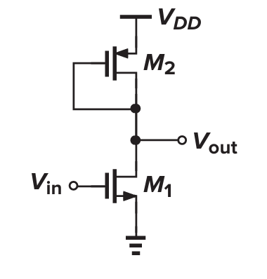
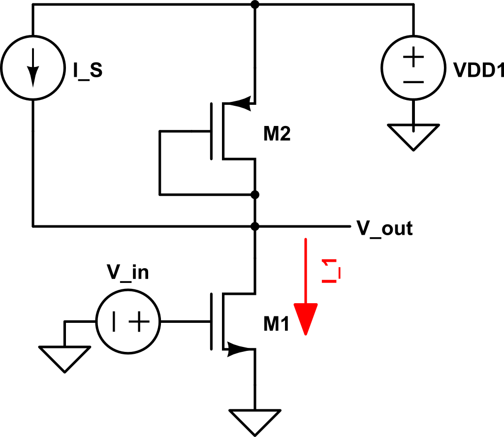

# Passive and Active Current Mirrors

In the chapter of [single-stage-amplifiers](../single-stage-amplifiers/ "mention"), we've already seen the wide usage of current sources. We also noted that MOS devices operating in saturation can act as a **voltage-controlled current source**. Now, we use one CS stage amplifier with diode-connected load as an example to see why current sources are **important** in the amplifier design.

In the previous notes, we've analyzed the voltage gain of a [CS stage amplifier with a PMOS diode-connected load](../single-stage-amplifiers/common-source-stage.md#cs-amplifier-with-a-pmos-diode-connected-load):

<figure><figcaption></figcaption></figure>

Since this circuit is free from body effect, the voltage gain is thus:

$$
A_v = -\sqrt{\frac{\mu_p (W/L)_2}{\mu_n (W/L)_1}}
$$

It is obvious that to increase the voltage gain, we can only change the size of the MOS devices, which is not ideal! But what if we connect a **current source** in parallel with the PMOS? Let's see what will happen:

<figure><figcaption></figcaption></figure>

Suppose that we define the current flowing through M1 transistor as $$I_{D1}=I_1$$, and our newly added current source $$I_S=\frac{3}{4}I_1$$, according to the KCL, the current flowing through M2 transistor should be $$I_{D2}=\frac{1}{4}I_1$$. Now by plugging $$I_{D1}$$ and $$I_{D2}$$ into Equation 3.27, we will have

$$
A_{v,\text{new}} = -\frac{\sqrt{2\mu_n C_{ox} (W/L)_1 I_{D1}}}{\sqrt{2\mu_p C_{ox} (W/L)_2 I_{D2}}}=-2\sqrt{\frac{\mu_p (W/L)_2}{\mu_n (W/L)_1}}=-2A_{v,\text{old}}
$$

Thus, adding a current source here can also help us **increase** the voltage gain!

In this section, we will start from a review of basic current mirrors, then study the cascode mirror operation. Next, we analyze active current mirrors and describe the properties of differential pairs using such circuits as loads.
