# Basic Current Mirrors

As we often say, a MOSFET operating in the **saturation region** can be treated as a current source. However, this is true only when we apply a more robust biasing scheme. In practice, the output current depends on **supply voltage, process variations, and temperature**. This leads to our crux of problem:

> How should a MOSFET be biased to operate as a stable current source?

To understand the problem, consider the simple resistive-biasing scheme shown in Figure 5.2.

<figure>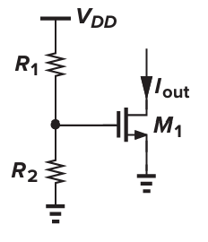<figcaption>
Figure 5.2: Definition of current by resistive divider
</figcaption></figure>

Assuming $$M_1$$ operates in saturation,

$$
I_{out}\approx \frac{1}{2}\mu_n C_{ox}\frac{W}{L} \left( \frac{R_2}{R_1+R_2}V_{DD}-V_{TH} \right)^2
$$

This expression clearly shows that $$I_{out}$$ depends on the **supply voltage, process parameters, and temperature**. For example, temperature changes both $$V_{TH}$$ and $$\mu_n$$, causing $$I_{out}$$ to vary. Therefore, the output current is **not truly constant**, making this a poor biasing scheme for a MOS current source. We therefore need to explore **more robust biasing techniques**.

Ideal Current Source/Sink

A **current source** or **current sink** provides a specified current to an external circuit. The distinction depends only on the **direction of current flow relative to the external circuit**:

* **Current source:** current flows **into** the external circuit.
* **Current sink:** current flows **out of** the external circuit.

In practice, both are often simply referred to as **current sources**.

<figure>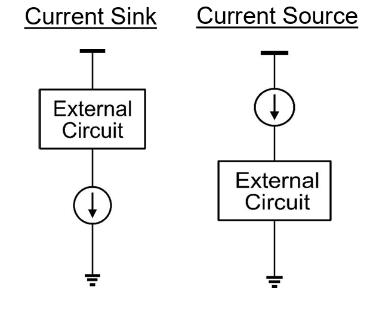<figcaption></figcaption></figure>

An **ideal current source/sink** maintains a constant output current $$I_0$$, regardless of the voltage $$V_{\text{out}}$$ across it:

I_{\text{out}} = I_0

Therefore, its $$I-V$$ characteristic is a **horizontal line**:

\frac{\Delta I_{\text{out}}}{\Delta V_{\text{out}}}=0

Since output resistance is

R_{\text{out}} = \frac{\Delta V_{\text{out}}}{\Delta I_{\text{out}}}

an ideal current source has

R_{\text{out}}=\infty

In other words, **changing the voltage across an ideal current source does not change the current it provides!**

<figure>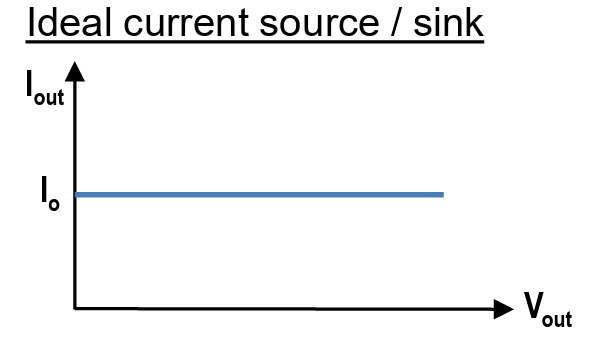<figcaption></figcaption></figure>

## Current Mirror

Actually, the design of current sources in analog circuits is based on "copying" currents from a **reference**, which is an **ideal** and **stable current source** generated by some relatively complex external circuits. This reference current, called $$I_{REF}$$ is then **copied** to many [current sources](#user-content-fn-1)[^1] in the system.

> How do we generate copies of a reference current?

For example, in Fig. 5.4, how do we guarantee $$I_{out}=I_{REF}$$?&#x20;

<figure>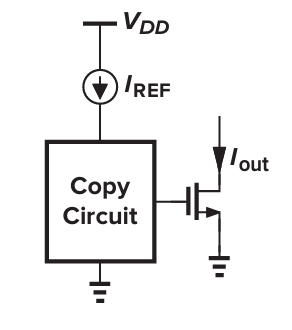<figcaption></figcaption></figure>

For a MOSFET, if $$I_D=f(V_{GS})$$, where $$f(\cdot)$$ denotes the functionality of $$I_D$$ versus $$V_{GS}$$, then $$V_{GS}=f^{-1}(I_D)$$. That is (attention here, below is a "magic moment"!):

> If a transistor is biased at $$I_{REF}$$, then it produces $$V_{GS}=f^{-1}(I_{REF})$$ (Fig 5.5(a)).

Thus, if this voltage is applied to the gate and source terminal of a **second MOSFET**, the resulting current is $$I_{out}=ff^{-1}(I_{REF})=I_{REF}$$ (Fig 5.5(b)).

<figure>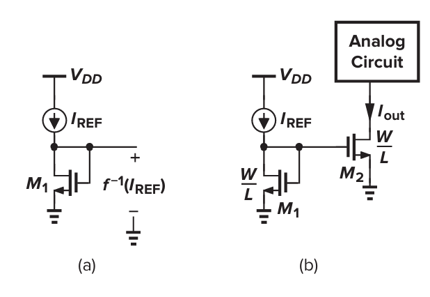<figcaption>
Figrue 5.5: (a) Diode-connected device providing inverse function, (b) basic current mirror
</figcaption></figure>


From another point of view, two **identical** MOS devices that have equal gate-source voltages and operate in **saturation** carry **equal** currents. (if $$\lambda=0$$, which is when we ignore the channel length modulation effect)


The structure consisting of $$M_1$$ and $$M_2$$ in Fig. 5.5(b) is called a **current mirror**. In the general case, the devices **need not** be identical but they must both operate in **saturation**. Neglecting channel-length modulation, we can write

$$
\begin{align}
I_{REF} &= \frac{1}{2}\mu_n C_{ox} \left(\frac{W}{L}\right)_1 (V_{GS} - V_{TH})^2 \tag{5.2} \\
I_{out} &= \frac{1}{2}\mu_n C_{ox} \left(\frac{W}{L}\right)_2 (V_{GS} - V_{TH})^2 \tag{5.3}
\end{align}
$$

obtaining,

$$
I_{out} = \frac{(W/L)_2}{(W/L)_1} I_{REF} \tag{5.4}
$$

The key property of this biasing scheme is that it allows **precise copying** of the current with **no dependence** on process and temperature. The ratio of $$I_{out}$$ and $$I_{REF}$$ is given by the **ratio** of device dimension, a quantity that can be controlled with reasonable accuracy.

PMOS Current Mirror

The example introduced above is called an NMOS current mirror, however, PMOS devices can also be used to build a current mirror. The circuit is shown below:

<figure>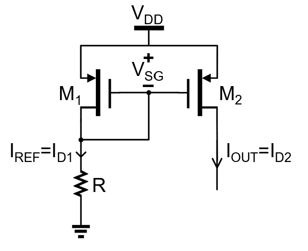<figcaption></figcaption></figure>

And its $$I_{out}$$ and $$I_{REF}$$ relationship remains the same as the NMOS current mirror, which is

I_{out} = \frac{(W/L)_2}{(W/L)_1} I_{REF} \tag{5.4}

### Current Mirror with Multiple Output Currents

A **current mirror** can be extended by adding more output transistors. Since all transistors share the same $$V_{GS}$$, each output transistor mirrors a current based on its **aspect ratio** $$W/L$$. For transistor $$M_x$$,

$$
I_{Dx} = \frac{(W/L)_x}{(W/L)_1}I_{\mathrm{REF}},  x=2,3,4,\dots
$$

Define the **current gain**

$$
\alpha_x = \frac{(W/L)_x}{(W/L)_1}
$$

so that

$$
I_{Dx}=\alpha_x I_{\mathrm{REF}}
$$

Thus, by choosing different $$W/L$$ ratios, **different output currents can be generated from the same reference current**.

<figure>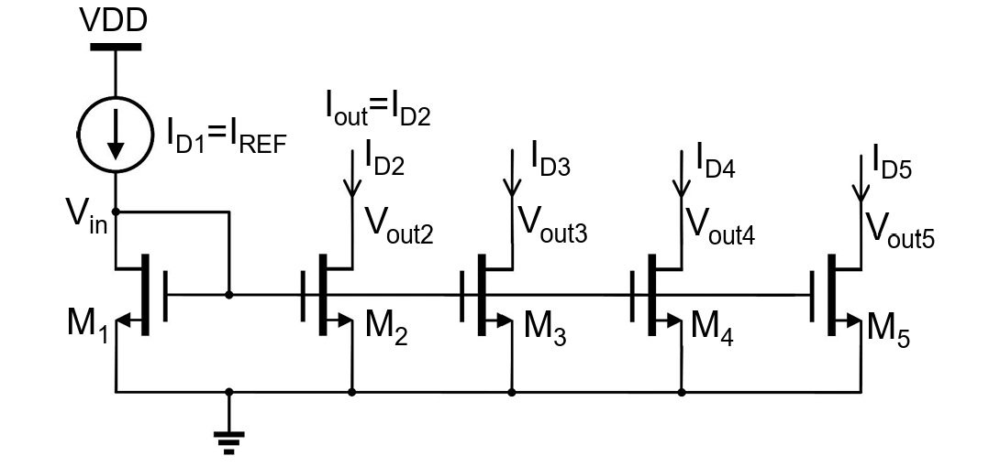<figcaption></figcaption></figure>

Another Way to View a Current Mirror

A basic current mirror can be viewed as an **I-to-V-to-I converter**:

I_{\mathrm{REF}} \;\xrightarrow{\text{I-to-V}}\; V_{GS} \;\xrightarrow{\text{V-to-I}}\; I_{\mathrm{out}}

1. The **diode-connected reference transistor** converts $$I_{\mathrm{REF}}$$ into the required $$V_{GS}$$.
2. The same $$V_{GS}$$ is applied to the **output transistor**, which converts it back into $$I_{\mathrm{out}}$$.

This viewpoint gives three important specifications of a current mirror:

\alpha=\frac{I_{\mathrm{out}}}{I_{\mathrm{REF}}}

where $$\alpha$$ is the **current gain**, together with:

* $$r_{\mathrm{out}}$$: **small-signal output resistance** — ideally as large as possible so $$I_{\mathrm{out}}$$ changes little with $$V_{\mathrm{out}}$$.
* $$V_{\mathrm{out,min}}$$: **minimum output voltage** required to keep the output transistor in saturation.

<figure>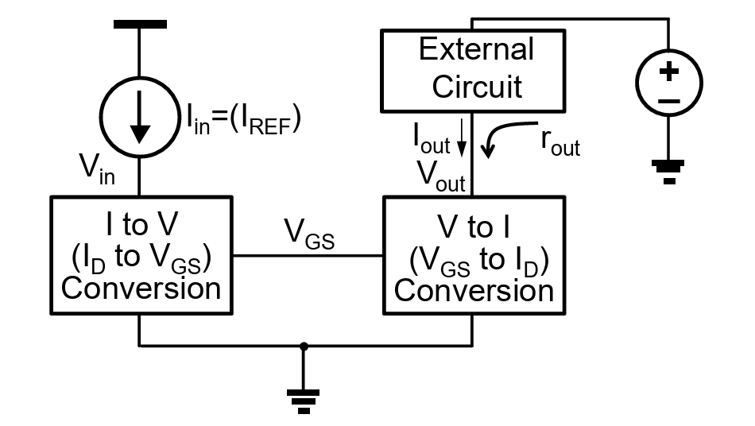<figcaption></figcaption></figure>

## Current Gain Errors

A practical current mirror is usually evaluated by three specifications:

* **High** $$r_{\mathrm{out}}$$ -> $$I_{\mathrm{out}}$$ is less dependent on $$V_{\mathrm{out}}$$
* **Low** $$V_{\mathrm{out,min}}$$ -> larger output voltage swing
* **Accurate current gain** $$\alpha$$ -> well-defined $$I_{\mathrm{out}}$$

The first two depend mainly on the chosen current-mirror structure and device design. The **current gain**, however, can also suffer from device imperfections. There are two main types of gain error:

* **Systematic error:** caused by the circuit structure or design, and is generally predictable.
* **Random error / mismatch:** caused by process variations, so matched devices may still have slightly different parameters.

### Systematic Gain Error

<figure>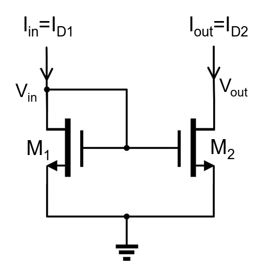<figcaption></figcaption></figure>

Even when $$M_1$$ and $$M_2$$ are perfectly matched, their drain voltages are generally different:

$$
V_{\mathrm{in}} \neq V_{\mathrm{out}}
$$

Because of **channel-length modulation**, the drain current depends slightly on $$V_{DS}$$:

$$
I_D \propto \left(1+\lambda V_{DS}\right)
$$

For matched $$\lambda_1=\lambda_2=\lambda$$,

$$
\begin{align*}
I_{\text{in}} &= \frac{1}{2} k_n' (W/L)_1 V_{OV}^2 (1 + \lambda V_{\text{in}}) \\
I_{\text{out}} &= \frac{1}{2} k_n' (W/L)_2 V_{OV}^2 (1 + \lambda V_{\text{out}})
\end{align*}
$$

Therefore,

$$
\frac{I_{\mathrm{out}}}{I_{\mathrm{in}}} = \frac{(W/L)_2}{(W/L)_1} \cdot\frac{1+\lambda V_{\mathrm{out}}} {1+\lambda V_{\mathrm{in}}}
$$

For the ideal current mirror,

$$
\left(\frac{I_{\mathrm{out}}}{I_{\mathrm{in}}}\right)_{\mathrm{ideal}} = \frac{(W/L)_2}{(W/L)_1}
$$

Hence, defining the systematic gain error as

$$
E_{rr} = \frac{I_{\mathrm{out}}-I_{\mathrm{out,ideal}}} {I_{\mathrm{out,ideal}}}
$$

we obtain

$$
\begin{align*}
E_{rr} &= \frac{1 + \lambda V_{\text{out}}}{1 + \lambda V_{\text{in}}} - 1 \\[10pt]
 &= \frac{\lambda}{1 + \lambda V_{\text{in}}} (V_{\text{out}} - V_{\text{in}})
\end{align*}
$$

When $$\lambda V_{\mathrm{in}}\ll1$$,

$$
E_{rr}\approx \lambda(V_{\mathrm{out}}-V_{\mathrm{in}})
$$

So the systematic error can be reduced by:

* using a **smaller** $$\lambda$$, i.e. a longer-channel device;
* making $$V_{\mathrm{out}}=V_{\mathrm{in}}$$

which completely eliminates this channel-length-modulation error.

### Random Error

**Matched devices** are designed to have identical parameters, but fabrication variations can make their actual parameters slightly different. Common causes include:

* **Geometry variation**: differences in $$W$$ and $$L$$
* **Material/process variation**: e.g. doping concentration
* **Pattern shift**: mask misalignment during fabrication

Thus,

$$
\text{designed to match} \neq \text{perfectly matched in practice}
$$

In these course, we focus on **geometry mismatch caused by process variation**.

#### Example: Current Mirror Mismatch

Suppose a current mirror is designed for

$$
\frac{I_{\mathrm{out}}}{I_{\mathrm{in}}}=2
$$

and assume

$$
V_{\mathrm{in}}=V_{\mathrm{out}}
$$

so that channel-length modulation does not contribute to the error. To implement such a current source, we can try the following 3 cases:



#### Scale the Channel Length

<figure>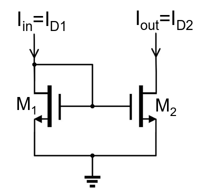<figcaption></figcaption></figure>

We keep the width unchanged and scale the length of the MOS devices.

$$
W_2=W_1, L_2=0.5L_1
$$

Ideally,

$$
\frac{I_{\mathrm{out}}}{I_{\mathrm{in}}} = \frac{W_2/L_2}{W_1/L_1}=2
$$

But if the process introduces a length-dependent mismatch, the actual ratio may deviate from $$2$$.


This is not ideal!




#### Scale the Width

> Figure is same as [step 1](basic-current-mirrors.md#scale-the-channel-length)'s figure.

We keep the length unchanged but scale the width of the MOS devices.

$$
W_2=2W_1, L_2=L_1
$$

Suppose fabrication introduces the same width and length variation $$\Delta W,\Delta L$$:

$$
\begin{align*}
W_1' &= W + \Delta W \\
W_2' &= 2W + \Delta W \\
L_1' &= L_2' = L + \Delta L
\end{align*}
$$

Then

$$
\frac{I_{\mathrm{out}}}{I_{\mathrm{in}}} = \frac{(2W+\Delta W)/(L+\Delta L)} {(W+\Delta W)/(L+\Delta L)}
$$

so

$$
\frac{I_{\mathrm{out}}}{I_{\mathrm{in}}} = \frac{2W+\Delta W}{W+\Delta W} \neq2
$$

The common variation does **not** cancel because the two devices have different nominal widths.


This is not ideal!




#### Use Identical Unit Transistors in Parallel

<figure>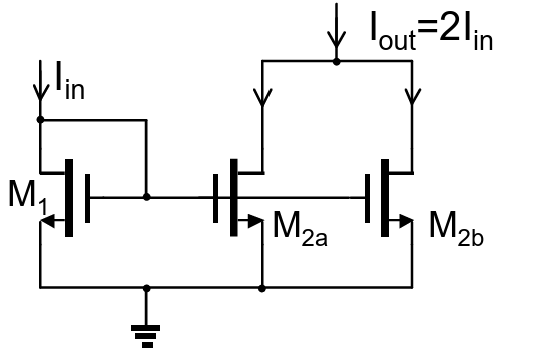<figcaption></figcaption></figure>

Instead of making one transistor twice as wide, use **two identical transistors in parallel**:

$$
W_{2a}=W_{2b}=W_1, L_{2a}=L_{2b}=L_1
$$

With the same process variation,

$$
W' = W+\Delta W,L'=L+\Delta L
$$

Thus,

$$
\begin{align*}
\frac{I_{\text{out}}}{I_{\text{in}}} &= \frac{2(W + \Delta W)/(L + \Delta L)}{(W + \Delta W)/(L + \Delta L)} \\
&= 2
\end{align*}
$$

So using **identical unit devices in parallel** can make the effect of common dimensional variations cancel.


This is ideal!




Quick Example: Simple Current Mirror

<figure>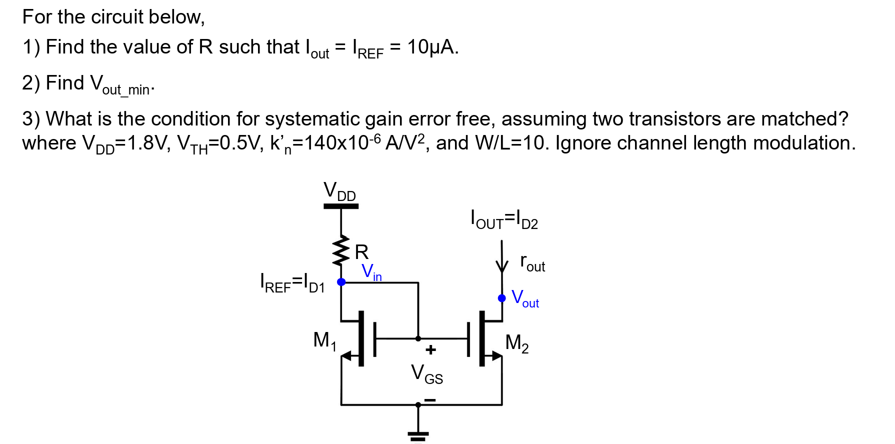<figcaption></figcaption></figure>

For the resistor-biased mirror in the figure above, we know that:

I_{\mathrm{out}}=I_{\mathrm{REF}}=10\,\mu\mathrm A,V_{DD}=1.8\,\mathrm V, V_{TH}=0.5\,\mathrm V

and

k_n'=140\times10^{-6}\,\mathrm{A/V^2}, W/L=10

then

I_D=\frac12k_n'(W/L)V_{OV}^2

gives

V_{OV}\approx0.12\,\mathrm V

so

V_{GS}=V_{TH}+V_{OV} \approx0.62\,\mathrm V

and

R = \frac{V_{DD}-V_{GS}}{I_{\mathrm{REF}}} \approx118\,\mathrm{k}\Omega

For the output transistor to remain in saturation,

V_{\mathrm{out,min}}=V_{OV}

so

V_{\mathrm{out,min}}\approx0.12\,\mathrm V

Finally, from the systematic-error result, zero gain error requires

V_{\mathrm{out}}=V_{\mathrm{in}}=V_{GS1}

thus

V_{\mathrm{out}}\approx0.62\,\mathrm V

[^1]: These are the MOS devices operating in saturation!
