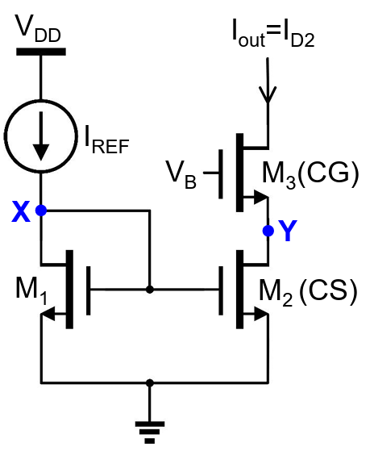
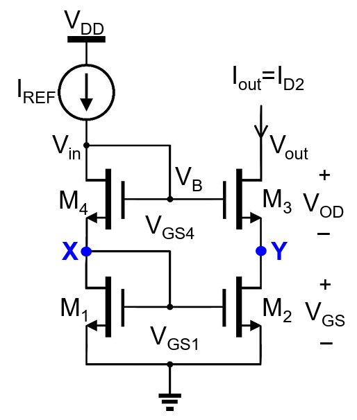
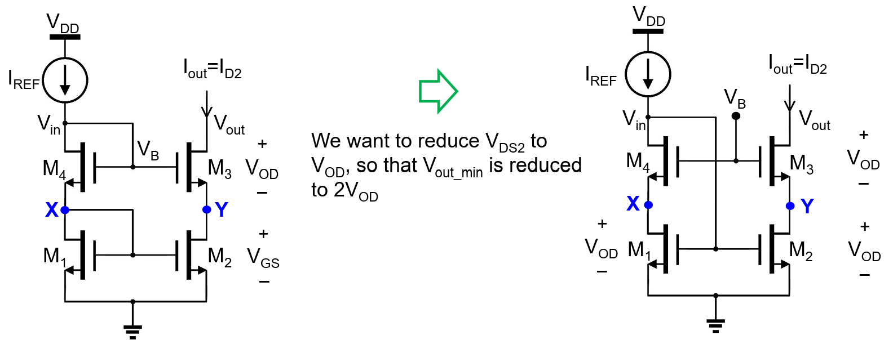
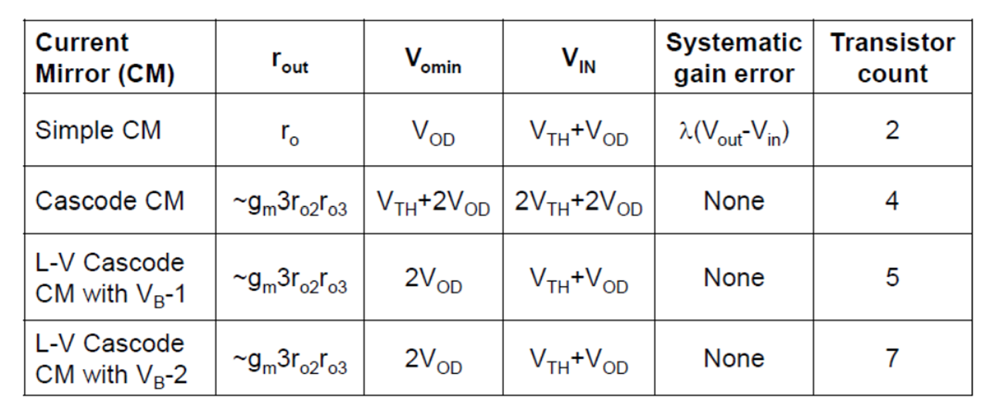

# Cascode Current Mirror

## Simple Cascode Current Mirror

A simple current mirror has finite output resistance $$r_o,$$ so $$I_{out}$$ still varies with $$V_{out}$$ due to channel-length modulation. To make the current mirror behave more like an **ideal current source**, we can add a common-gate transistor $$M_3$$ above $$M_2,$$ forming a **cascode output branch**.

<figure><figcaption></figcaption></figure>

The output resistance is greatly increased to approximately (can refer to the derivation of output resistance in the [cascode amplifier](../single-stage-amplifiers/cascode-stage.md#output-resistance)!)

$$
r_{out}\approx (1+g_{m3}r_{o2})r_{o3} \approx g_{m3}r_{o2}r_{o3}
$$

for $$g_mr_o\gg1$$. However, high $$r_{out}$$ alone is not enough. Since the actual mirroring occurs between $$M_1$$ and $$M_2$$, we also want

$$
V_{DS1}=V_{DS2}
$$

so that channel-length modulation affects both devices equally, eliminating the **systematic gain error**. Since $$V_{DS1}=V_X=V_{GS1}$$, we therefore require

$$
V_Y=V_X
$$

For $$M_3$$, $$V_Y=V_B-V_{GS3}$$. Hence, $$V_B-V_{GS3}=V_{GS1}$$ and $$V_B=V_{GS1}+V_{GS3}$$.

> How do we generate such body voltage to eliminate the system gain error in the cascode mirror?

### Generating $$V_B$$

A simple way to generate the required $$V_B$$ is to add a **diode-connected replica** $$M_4$$ of $$M_3$$ to the reference branch.

<figure><figcaption></figcaption></figure>

Assuming all transistors are matched and ignoring body effect,

$$
V_{GS1}=V_{GS2}=V_{GS3}=V_{GS4}
$$

The reference branch automatically generates

$$
V_B=V_{GS1}+V_{GS4}
$$

and therefore

$$
V_Y =V_B-V_{GS3} =V_{GS1} =V_X
$$

Thus,

$$
V_Y=V_X\Rightarrow \text{no systematic gain error}
$$

because $$M_1$$ and $$M_2$$ have the same $$V_{DS}$$.

#### **Voltage Headroom**

The drawback is the relatively large minimum output voltage. Fo $$M_1,M_2,M_4$$, they all operate in the saturation region because

$$
V_{DS}=V_{GS}>V_{GS}-V_{TH}
$$

The critical transistor is therefore $$M_3$$. For $$M_3$$ to remain in saturation,

$$
V_{DS3}\ge V_{OD}
$$

From the circuit,

$$
V_{DS3}=V_{out}-V_Y
$$

Since the biasing scheme makes $$V_Y=V_X=V_{GS}$$, we have

$$
V_{out}-V_{GS}\ge V_{OD}
$$

Therefore,

$$
V_{out}\ge V_{GS}+V_{OD}
$$

Using $$V_{GS}=V_{TH}+V_{OD}$$, we obtain

$$
V_{out,\min}=V_{TH}+2V_{OD}\tag{1}
$$

So, intuitively, $$M_2$$ forces node $$Y$$ to sit relatively high at $$V_{GS}$$. Then $$M_3$$ still needs at least another $$V_{OD}$$ across itself to stay in saturation. Hence,

$$
\underbrace{V_{out,\min}}_{\text{total required voltage}} = \underbrace{V_{GS}}_{\text{node }Y} + \underbrace{V_{OD}}_{\text{keep }M_3\text{ saturated}}\tag{2}
$$


Since $$V_{OD}=V_{GS}-V_{TH}$$, equation 1 and 2 are exactly the same!


On the **input side**, the bias voltage is

$$
V_B=V_{GS1}+V_{GS4}
$$

With matched devices $$V_{GS1}=V_{GS4}=V_{GS}$$, so

$$
V_{in}=V_B=2V_{GS}=2(V_{TH}+V_{OD})
$$

Thus, the simple cascode current mirror has

$$
V_{out,\min}=V_{TH}+2V_{OD}, V_{in}=2V_{TH}+2V_{OD}
$$

which can be too large when $$V_{DD}$$ is small. In other words, small $$V_{DD}$$ might not be able to supply enough voltage for $$V_{in}$$.

## Low-Voltage Cascode Current Mirror

The simple cascode current mirror uses more voltage headroom than necessary. Ideally, we only need both output transistors to remain at the edge of saturation:

$$
V_{DS2}=V_{OD}, V_{DS3}=V_{OD}
$$

<figure><figcaption></figcaption></figure>

Therefore, $$V_{out,\min}=2V_{OD}$$ instead of $$V_{TH}+2V_{OD}.$$ To achieve this, node $$Y$$ should be

$$
V_Y=V_{OD}
$$

Since

$$
V_Y=V_B-V_{GS3}
$$

the required bias becomes $$V_B=V_{GS}+V_{OD}$$. Using $$V_{GS}=V_{TH}+V_{OD}$$,

$$
V_B=V_{TH}+2V_{OD}
$$

Notice that $$V_B\neq2V_{GS}$$! At the same time,

$$
V_X=V_{OD}=V_Y
$$

so $$M_1$$ and $$M_2$$ still have equal $$V_{DS}$$. Therefore, the low-voltage design **retains no systematic gain error** while reducing the required headroom. The input voltage is now simply

$$
V_{in}=V_{GS}=V_{TH}+V_{OD}
$$

giving the two main improvements:

$$
\begin{align*}
V_{out,\text{min}} &: V_{TH} + 2V_{OD} \to 2V_{OD} \\
V_{in}             &: 2(V_{TH} + V_{OD}) \to V_{TH} + V_{OD}
\end{align*}
$$

All transistors still in saturation?

With the low-voltage bias,

V_B=V_{TH}+2V_{OD}, V_{in}=V_{GS}=V_{TH}+V_{OD}

For $$M_1,M_2,M_3$$, $$V_{DS}=V_{OD}$$, so they are at the **edge of saturation**. The remaining concern is $$M_4$$. For $$M_4$$ to remain in saturation,

V_{DS4}\ge V_{GS4}-V_{TH}

Since the source of $$M_4$$ is at $$V_X$$,

V_{DS4}=V_{in}-V_X, V_{GS4}=V_B-V_X

Therefore, $$V_{in} - V_X \ge V_B - V_X - V_{TH}$$. Simplifies this, we will obtain,

V_B - V_{in} \le V_{TH}

Substitute the required $$V_B$$ and $$V_{in}$$, we have $$(V_{TH}+2V_{OD})-(V_{TH}+V_{OD})\le V_{TH} VOD≤VTH$$, so

V_{OD}\le V_{TH}

Thus, we should design

V_{OD4}&#x3C;V_{TH}

to ensure $$M_4$$ remains in saturation.

### Generating the New $$V_B$$

We now need to generate

$$
V_B=V_{TH}+2V_{OD}
$$

This can be done by adding a diode-connected transistor $$M_B$$ carrying the same $$I_{REF}$$.

<figure><figcaption></figcaption></figure>

Since

$$
V_{GS,B}=V_B
$$

we want $$V_{GS,B}-V_{TH}=2V_{OD}$$. Using the saturation current equation,

$$
I_D= \frac12 k_n' \left(\frac WL\right)V_{OD}^2
$$

and since $$M_B$$ and $$M_1$$ carry the same current,

$$
\frac12 k_n' \left(\frac WL\right)_B (2V_{OD})^2 = \frac12 k_n' \left(\frac WL\right)_1 V_{OD}^2
$$

Canceling the common terms,

$$
4\left(\frac WL\right)_B = \left(\frac WL\right)_1
$$

so

$$
\left(\frac WL\right)_B = \frac14 \left(\frac WL\right)_1
$$

Thus, if the same $$L$$ is used,

$$
W_B=\frac14W_1
$$

So the intuition is that, for the same drain current, making $$M_B$$ four times narrower requires twice the overdrive voltage, giving the required $$V_B=V_{TH}+2V_{OD}$$.

### Comparison

<figure><figcaption></figcaption></figure>

So the overall progression is

$$
\text{Simple CM} \xrightarrow{\text{cascode}} \text{high }r_{out} \xrightarrow{\text{low-voltage design}} \text{high }r_{out}+\text{low headroom}
$$
