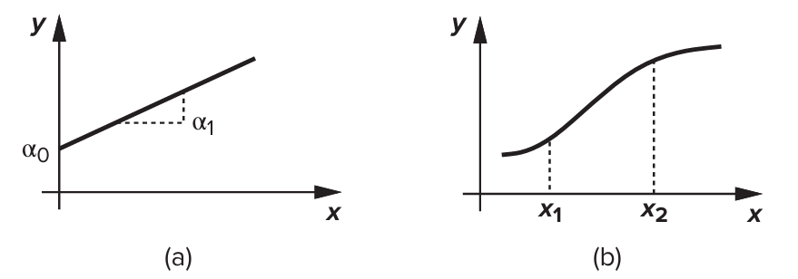
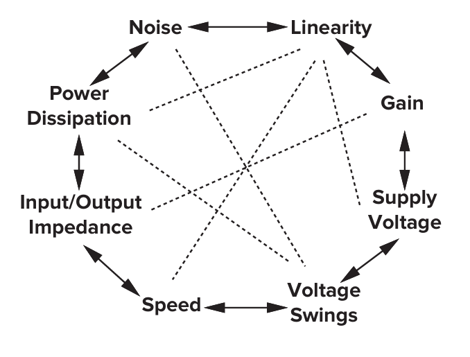
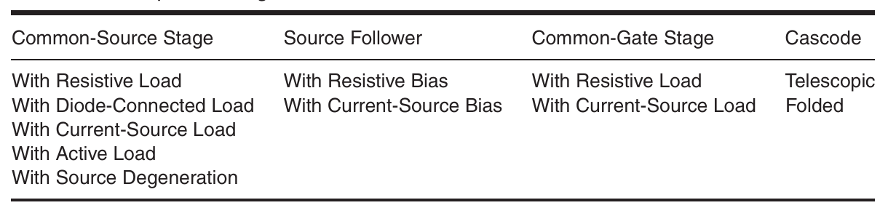
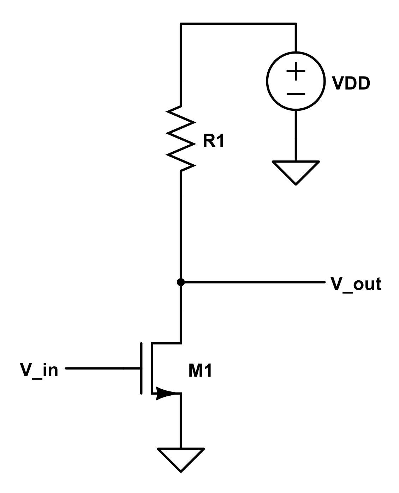
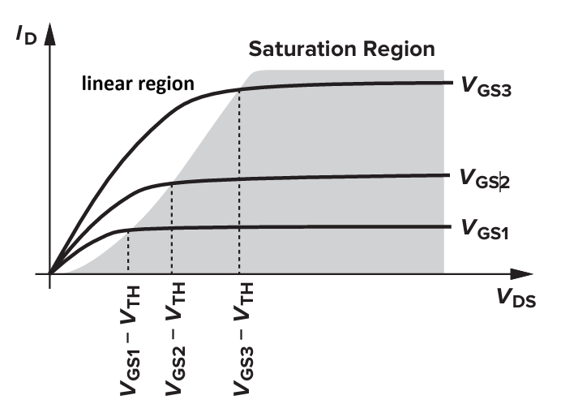
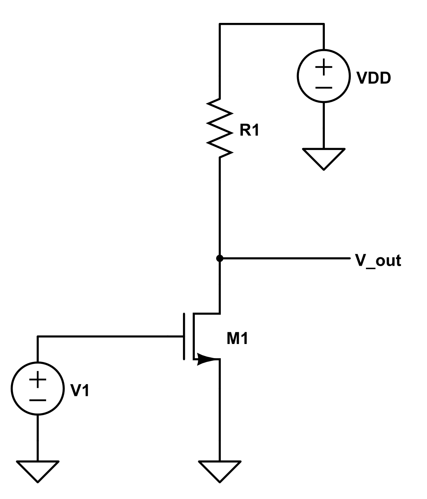
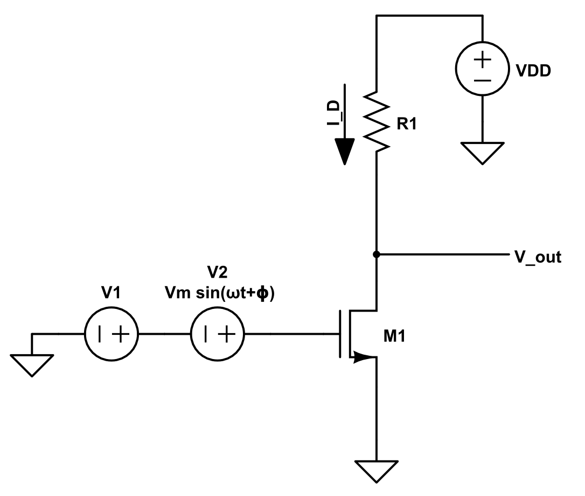
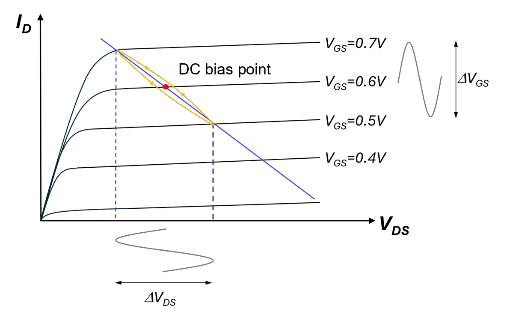

# Single-Stage Amplifiers

**Amplification** is an essential function in most analog (and many digital) circuits. We amplify an analog or digital signal because it may be too small to

1. drive a load,
2. overcome the noise of a subsequent stage,
3. or provide logical levels to a digital circuit.


Amplification also plays a critical role in **feedback systems** (later chapter).


Other Applications of Amplifiers

In **digital circuits**, amplifiers are generally less common. One possible application is to **restore degraded digital signals** after transmission. For example, a digital signal may become distorted, causing the rising and falling edges to become slower. An amplifier can **increase the signal amplitude and restore sharper transitions**, allowing the signal to reach the HIGH or LOW level more quickly.

Outside digital circuits, amplifiers are widely used in applications such as **biomedical instrumentation**, where very small signals such as **ECG signals** need to be amplified before further processing.

In this chapter, we study the **low-frequency** behavior of **single-stage** CMOS amplifiers. Analyzing both the **large-signal** and the **small-signal** characteristics of each circuit, we develop intuitive techniques and models that prove useful in understanding more complex systems. An important part of a designer's job is to use proper approximations so as to create a simple mental picture of a complicated circuit. The intuition thus gained makes it possible to formulate the behavior of most circuits by inspection rather than by lengthy calculations.


Awesome paragraph above which also aligns with the [preface.md](../preface.md "mention")!


Following a brief review of basic concepts, we describe in this chapter four types of amplifiers:

1. common-source
2. common-gate topologies,
3. source followers, and
4. cascode configurations.

In each case, we begin with a simple model and gradually add [second-order phenomena](../basic-mos-device-physics/second-order-effects.md) such as [channel-length modulation](../basic-mos-device-physics/second-order-effects.md#channel-length-modulation) and [body effect](../basic-mos-device-physics/second-order-effects.md#body-effect).

## Basic Concepts

An **ideal** amplifier generates an output, $$y(t)$$, that is a **linear** **replica** of the input, $$x(t)$$:

$$
y(t) = \alpha_1 x(t) \tag{3.1}
$$

where $$\alpha_1$$ denotes the **gain**. Since the output signal is in fact superimposed on a **bias** (dc operating) point, $$\alpha_0$$, we can write the overall output as:

$$
y(t) = \alpha_0 + \alpha_1 x(t)
$$

In this case, the input-output (large-signal) characteristic of the circuit is a straight line \[Fig. 3.2(a)]. However, as the signal excursions become larger and the bias point of the transistor(s) is disturbed substantially, the gain (the slope of the characteristic) begins to vary \[Fig. 3.2(b)]. We approximate this nonlinear characteristic by a polynomial:

$$
y(t) = \alpha_0 + \alpha_1 x(t) + \alpha_2 x^2(t) + \cdots + \alpha_n x^n(t) \tag{3.2}
$$

<figure><figcaption>
Figure 3.2: Input-output characteristic of a (a) linear and (b) nonlinear system
</figcaption></figure>

What aspects of the performance of an amplifier are important in addition to **gain** and **speed**? The answers are:

1. Some parameters like power dissipation, supply voltage, linearity, noise, or maximum voltage swings may be important.
2. Furthermore, the **input** and **output impedances** determine how the circuit interacts with the preceding and subsequent stages.

In practice, most of these parameters trade with each other, making the design a multidimensional optimization problem. Illustrated in the "analog design octagon" of Fig. 3.3, such **trade-offs** present many challenges in the design of high-performance amplifiers, requiring intuition and experience to arrive at an acceptable compromise.

<figure><figcaption>
Figure 3.3: Analog design octagon.
</figcaption></figure>


This **analog design octagon** also illustrates that there is **no single solution** to a given set of design requirements — like [digital design](https://app.gitbook.com/s/W45nwClYZdzz9MQG1dUb/micheli/readme/computer-aided-synthesis-and-optimization#pareto-point), analog design is all about **trade-offs**.


Table 3.1 gives a preview of the amplifier topologies studied in this chapter, indicating the much wider use of the common-source (CS) stage than other circuit configurations.

<figure><figcaption>
Table 3.1: Amplifier Categories
</figcaption></figure>

For these amplifiers, we must

1. set up proper **bias conditions** so that each transistor provides the necessary [transconductance](../basic-mos-device-physics/mos-i-v-characteristics.md#mos-transconductance) and [output resistance](../basic-mos-device-physics/mos-device-models.md#small-change-in-drain-voltage) with certain [quiescent currents and voltages](#user-content-fn-1)[^1], and
2. analyze the circuit's behavior as the input and output signals cause small or large departures from the bias input (small-signal and large-signal analyses, respectively).

We deal with the latter task here and defer the former to the next chapter. Before diving into the details, it's helpful to have a basic overview of the analysis procedure and a recap of the circuit analysis theorems that will be used in this chapter. In general, when analyzing a **single-stage amplifier**, we'll work through the following:

1. Static operating point
2. Small-signal analysis
3. Amplifier gain
4. Input and output resistance[^2]
5. Voltage swing

In the following sections, we will use a basic single-stage amplifier below as an example, but we will leave the actual analysis until the next section!

<figure><figcaption></figcaption></figure>

### Large Signal Analysis

> This part can also be called **static operating point** but large signal analysis is more widely used.

In the previous chapter, we learned that the MOSFET is a [four-terminal](../basic-mos-device-physics/general-considerations.md#mosfet-structure) device.


For simplicity, we'll ignore the **body terminal** for now and focus on the other three terminals: the **gate, source,** and **drain**.


We also studied how the voltages at these three terminals determine the **drain current** and the operating behavior of the MOSFET. In particular, a MOSFET can operate in the following three regions:

1. Cutoff
2. [Linear/Triode](../basic-mos-device-physics/mos-i-v-characteristics.md#triode-region)
3. [Saturation](../basic-mos-device-physics/mos-i-v-characteristics.md#saturation-region)

The MOSFET's operating region is largely determined by the voltages at its gate, source, and drain. We therefore refer to these terminal voltages as the **static operating voltages/DC bias voltages**. So, what exactly do we mean by the **static operating point/DC bias point**? You may remember the $$I_D-V_{DS}$$ plot below from the previous chapter.

<figure><figcaption>
NMOS IV Plot
</figcaption></figure>

Basically, a **static operating point** is any particular point on one of the black curves in the diagram above. Once we select an operating point, the voltages at the MOSFET' s three terminals — **gate, source, and drain** — are fixed, and therefore the drain current $$I_D$$​ is also fixed. In other words, the static operating point describes the MOSFET's **DC operating conditions**: it tells us where the device is biased and, consequently, which operating region it is in.


We can think of these fixed DC voltages and currents as the **baseline settings of the circuit** before any extra signal (usually small) is applied.


With this in mind, we can imagine a voltage source $$V_{in}$$ that biases the MOSFET to the desired **static operating point**, as shown below.&#x20;

<figure><figcaption></figcaption></figure>

This voltage source establishes the appropriate DC voltages at the MOSFET's gate terminal, thereby setting its operating condition.


In NUS EE3408C, we are not required to know how to derive the voltage gain from a large-signal model!


### Small-Signal Analysis

Now, in addition to the **DC bias voltage** $$V_1$$, suppose we add a small time-varying signal $$V_2$$, whose magnitude is much smaller than $$V_1$$. We can write this signal as

$$
V_2 = V_m\sin(\omega t+\phi)
$$

where $$V_m$$ is the **amplitude (peak value)** of the small signal, $$\omega$$ is its angular frequency, and $$\phi$$ is its phase. The resulting input can therefore be viewed as a **small AC signal** superimposed on a much larger DC bias voltage, as shown below.

<figure><figcaption></figcaption></figure>

The main goal of this chapter is to understand **how this newly added small signal is amplified** by the amplifier. We can have a glimpse of how the newly added voltage source $$V_2$$ **may** affect the operating region of the NMOS in the figure above.

As $$V_2$$ is sinusoidal, an increase in $$V_2$$ raises $$V_{GS}$$, which increases $$I_D$$. Consequently,

$$
V_{out}=V_{DD}-I_D R_1
$$

and it decreases, so $$V_{DS}$$ also decreases. If $$V_{DS}$$ becomes too small, the NMOS may leave saturation and enter the **linear region**, causing distortion. Similarly, a decrease in $$V_2$$ moves the operating point toward **cutoff**. Therefore, the instantaneous operating point swings around the **DC bias point (Q-point)** along the load line (the <mark style="color:$primary;">blue line</mark> in the plot below). We choose the Q-point to provide sufficient headroom for this swing in both directions. For approximately maximum symmetric output swing, we often choose

$$
V_{out,Q}=V_{DS,Q}\approx \frac{V_{DD}}{2}
$$

<figure><figcaption></figcaption></figure>


So, up until this point, before performing the **small-signal analysis**, we must first determine the MOSFET's [**static operating point**](./#static-operating-point). In other words, we need to know the DC voltages and currents and identify the region in which the MOSFET is operating.

Once the static operating point is known, we can proceed with the **small-signal analysis** by replacing the MOSFET with its **small-signal model**.


In small-signal analysis, we can usually calculate the voltage gain using two approaches:

1. Direct small-signal analysis
2. Black-box method

#### Direct Small-Signal Analysis

Draw the **full small-signal circuit** and derive the relationship between $$V_{out}$$ and $$V_{in}$$, typically using **KCL**.

#### Black-Box Method

This is a **modular approach**: treat the $$V_{in}$$-to-$$V_{out}$$ circuit as a **black box**, with the remaining circuit acting as its load.


In [Lec 08](https://app.gitbook.com/s/UBWYdYYwvkB8gDH5SdEC/lec/lec-8-differential-amplifiers#intuitive-small-signal-analysis), Prof. Jang has introduced a very powerful intuitive analysis which is similar to the method below, I would strongly suggest using Prof. Jang's method!




#### Find equivalent transconductance $$G_m$$

Set $$V_{out}$$ to **AC ground**, then calculate the small-signal current at the output node (Only the black-box portion needs to be considered when calculating $$i_{out}$$; the external circuit can be ignored because the same current flows through the output terminal.):

$$
G_m=\left|\frac{i_{out}}{V_{in}}\right|
$$


Here, the direction of $$i_{out}$$ doesn't matter since we will correct it later.




#### Find the equivalent resistance for the blackbox

Look into the black box from the output node and use the **Thevenin technique** to determine its equivalent resistance.



#### Find the equivalent load resistance

Reduce the load to its **Thevenin equivalent resistance**.



Finally, the voltage gain is&#x20;

$$
A_v=\pm G_m\left(R_{out,\text{black box}}\parallel R_{out,\text{load}}\right)
$$


Use $$-$$ for **inverting paths** (e.g., Common-Source, Cascode with CS input: $$V_{in}\uparrow \implies V_{out}\downarrow$$). Use $$+$$ for **non-inverting** paths (e.g., Common-Gate and source follower: $$V_{in}\uparrow \implies V_{out}\uparrow$$).


This method is especially useful for **large or multi-stage amplifiers**, where direct small-signal analysis becomes cumbersome.


An example of using this method is in [#small-signal-model-1](cascode-stage.md#small-signal-model-1 "mention")!


Useful Approximations

In the small-signal analysis as well as when we calculate the voltage gain of the amplifier, we will use some approximations very often. The table below summarises the approximations that we usually use:

| Parameter                                     | Typical Value           | Notes                                                                                                                                        |
| --------------------------------------------- | ----------------------- | -------------------------------------------------------------------------------------------------------------------------------------------- |
| $$g_m$$ (Transconductance)                    | 2 mS                    | $$1/g_m \approx 500\ \Omega$$. Scales as $$\sqrt{I_D}$$ (long-channel) or linearly with $$I_D$$ (velocity saturation/weak inversion).        |
| $$r_o$$ (Output resistance)                   | $$200\ \text{k}\Omega$$ | $$r_o = \frac{1}{\lambda I_D} \propto \frac{L}{I_D}$$. Driven by Channel-Length Modulation (CLM). Long channel lengths yield higher $$r_o$$. |
| $$R_D$$ (Resistive Load)                      | $$5\ \text{k}\Omega$$   | Rarely used in on-chip ICs due to silicon area and DC voltage headroom limits ($$I_D R_D$$ drop).                                            |
| $$R_{\text{load}}$$ (Active / Current Source) | $$100\ \text{k}\Omega$$ | PMOS current-source load. Matches NMOS output impedance order of magnitude.                                                                  |
| $$g_{mb}$$ (Body effect transconductance)     | 0.3 mS                  | Present whenever the source is not tied to the bulk/substrate ($$V_{SB} \neq 0$$).                                                           |

### Gain

Once the small-signal analysis is complete, our next goal is to determine the **gain** of the amplifier. More specifically, we are interested in the **voltage gain**, which describes how much the output voltage changes in response to a **small change in the input voltage**. Mathematically, the voltage gain can be written as

$$
A_v = \frac{\partial V_{\text{out}}}{\partial V_{\text{in}}}
$$

In other words, it tells us:

> if $$V_{\text{in}}$$ changes by a small amount due to the newly added AC signal, how much will $$V_{\text{out}}$$ change as a result?

Thus, the voltage gain gives us a direct measure of how effectively the amplifier amplifies the small input signal.

### Input & Output Resistance

For now, by **resistance**, we mean the **equivalent resistance seen when looking into the amplifier from a particular terminal**. We can find this resistance using basic circuit-analysis techniques, such as the [**Thévenin & Norton equivalent circuit**](../../resistive-circuits/thevenin-and-norton-equivalent-circuits.md) introduced in NUS CG1111A. The ideas of **input resistance** and **output resistance** are closely related:

> both describe the equivalent resistance of the same amplifier, but they are measured from **different sides** of the circuit.

Think of the amplifier as a box:

Source -> Amplifier -> Load

* **Input resistance (**$$R_{\text{in}}$$**)** is what the **source** sees looking into the amplifier
* **Output resistance (**$$R_{\text{out}}$$**)** is what the **load** sees looking back into the amplifier.

#### Output Resistance

In this chapter, we will mostly focus on the **output resistance**. To calculate the **output resistance** $$R_{out}$$:

1. Apply a **test voltage** $$V_X$$ at the output node and define the corresponding current $$I_X$$ flowing **into the circuit**.
2. Turn off all **independent sources**: voltage sources become **AC ground**, while dependent sources remain active.
3. Solve for the relationship between $$V_X$$ and $$I_X$$.

The output resistance is then

$$
R_{out}=\frac{V_X}{I_X}
$$


We will seen an example [later](source-follower.md#consider-clm-1)! However, in NUS EE3408C, we also introduced another way to calculate the output resistanc&#x65;**:** by treating the circuit as two branches separated by one same node and taking their equivalent resistances in parallel (See more explanation from [Tutorial 1](https://app.gitbook.com/s/UBWYdYYwvkB8gDH5SdEC/tut/tut-1-mosfet-and-single-stage-amplifier#id-2.-equivalent-resistance)).


#### Input Resistance

The reason we usually do not focus too much on the **input resistance** is that, in most amplifiers, the input signal is connected to the **MOSFET gate**. Since the gate draws ideally no current (open circuit),

$$
R_{\mathrm{in}}\approx\infty
$$


An important exception is the [common-gate (CG) amplifier](common-gate-stage.md), where the input signal is applied to the **source terminal**, rather than the gate. In this case, the input resistance is finite and can be calculated using the same **test-voltage method** used above to find an equivalent resistance.


### Voltage Swing

The **voltage swing** refers to the range over which the input signal can vary while the amplifier continues to operate in its intended linear region, producing an output with minimal distortion.


To keep the **amplifier** in its **linear region** (producing an undistorted signal), the **MOSFET** must be strictly kept in its **saturation region**.


In other words, the voltage swing tells us **how large the input signal can become before the amplifier can no longer amplify it linearly and the output begins to distort or clip**.


Remember that at the [start](./#basic-concepts) of this section, we mentioned that an **ideal** amplifier should generate an output which is a **linear replica** of its input.


## References

1. Behazrd Razavi's Design of Analog CMOS Integrated Circuits 2nd edition Chapter 3.
2. Allan R. Hambley's Electrical Engineering — Principles and Applications 7th edition Chapter 2.6.

[^1]: These are just the **static/bias** currents and voltages for the MOSFET to operate under either off, or linear or saturation region.

[^2]: This can also be understood as **impedances**.
