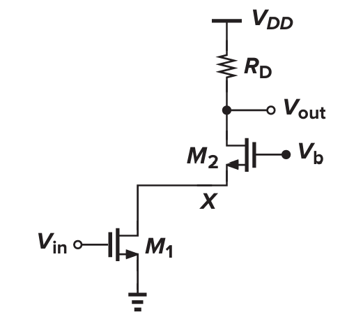
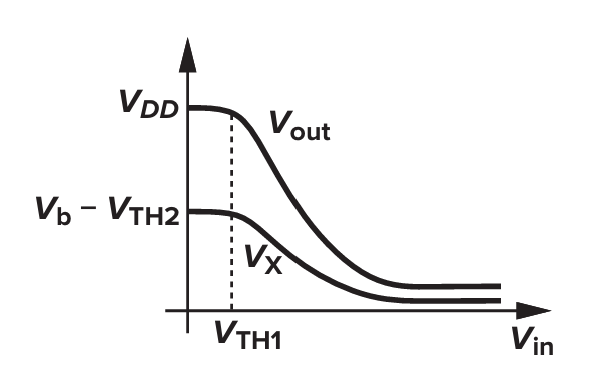
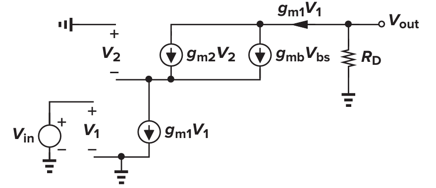
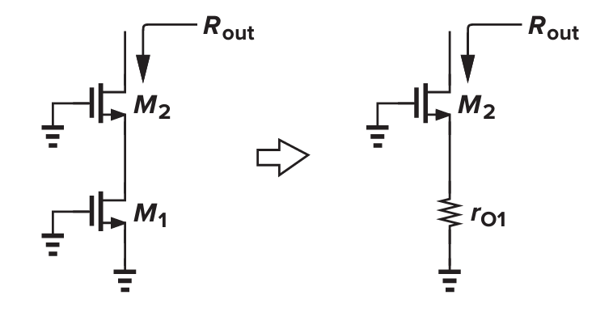
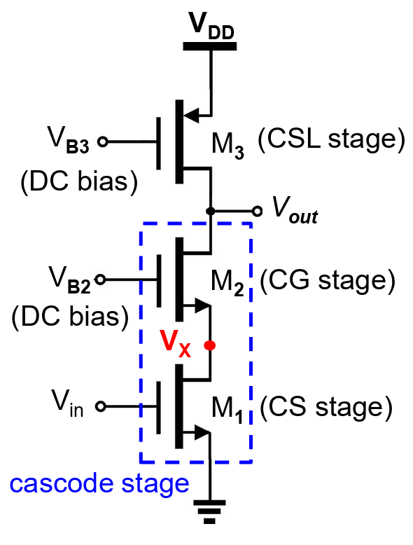
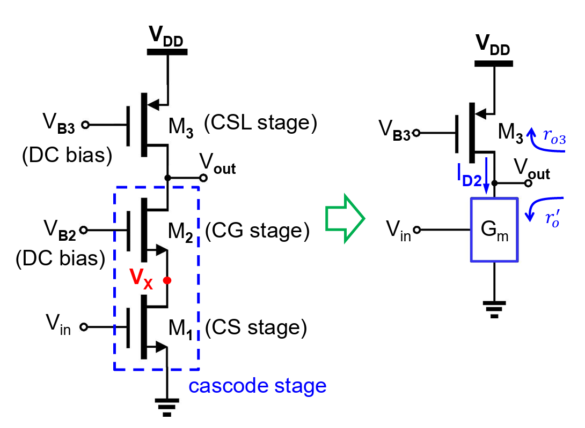
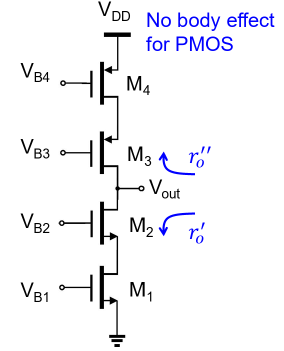

# Cascode Stage

In this section, we introduce the final amplifier configuration: the **cascode amplifier**, formed by cascading a **CS stage** with a **CG stage**, as shown in **Figure 3.59**. The **input** is applied to the gate of $$M_1$$, while the **output** is taken from the drain of $$M_2$$.

<figure><figcaption>
Figrue 3.59: Cascode Stage with Resistive Load
</figcaption></figure>


$$M_1$$ and $$M_2$$ carries **equal** currents.


## Cascode Stage with Resistive Load

As usual, we start from Cascode Stage with resistive load first and we will conduct the analysis as follows:

1. Large Signal Analysis
2. Voltage Swing
3. Small Signal Analysis together with Voltage Gain calculation
4. Input & Output resistance

### Large Signal Analysis

We will examine how the **operating regions of** $$M_1$$ **and** $$M_2$$ change as $$V_{in}$$ sweeps from 0 to $$V_{DD}$$.

#### Cutoff Region

For $$V_{in}<V_{TH1}$$, $$M_1$$ and $$M_2$$ are **off**, so

$$
\begin{align*}
  V_{out} &= V_{DD} \\
  V_X &\approx V_b - V_{TH2}
\end{align*}
$$


The reason $$V_X\approx V_b-V_{TH2}$$ is that, if $$V_X$$ starts near 0, $$M_2$$ will initially turn **ON** and charge node X, making $$V_X$$ slowly increase. This continues until $$M_2$$ turns **OFF**, which occurs when $$V_X=V_b-V_{TH2}$$.


#### Saturation

As $$V_{in}$$ exceeds $$V_{TH1}$$, $$M_1$$ turns **ON** and begins to draw current, causing $$V_{out}$$ to decrease ($$V_{out} = V_{DD} - I_D R_D$$). Since $$M_1$$ and $$M_2$$ carry the same current, as $$I_{D1}$$ increases, $$I_{D2}$$ must also increase. Therefore, $$V_{GS2}$$ must increase, and since

$$
V_{GS2}=V_b-V_X
$$

$$V_X$$ must decrease. As $$V_{out}$$ and $$V_X$$ begin to decrease, both $$M_1$$ and $$M_2$$ initially remain in the **saturation region**, provided that the following conditions are satisfied:

* $$M_1$$ **in saturation:**

$$
V_{DS1}\ge V_{GS1}-V_{TH1} \Rightarrow V_X\ge V_{in}-V_{TH1}
$$

* $$M_2$$ **in saturation:**

$$
\begin{align*}
  V_{DS2} &\ge V_{GS2} - V_{TH2} \\
  V_{out} - V_X \ge (V_b - V_X) - V_{TH2} &\Rightarrow V_{out} \ge V_b - V_{TH2}
\end{align*}
$$

Thus, both $$M_1$$ and $$M_2$$ operate in saturation as long as these conditions hold.


Our bias condition is to set both $$M_1$$ and $$M_2$$ under **saturation**!


#### Linear Region

As $$V_{in}$$ becomes sufficiently large, either of the following may occur first:

1. $$M_1$$ **enters the linear region** when

$$
V_X<V_{in}-V_{TH1}
$$

2. $$M_2$$ **enters the linear region** when

$$
V_{out}<V_b-V_{TH2}
$$

Which transistor enters the linear region first depends on the **transistor dimensions,** $$R_D$$**, and** $$V_b$$. For example, if $$V_b$$ is relatively low, $$M_1$$ may enter the linear region first.

### Voltage Swing

From the **large-signal analysis** above, we can roughly obtain the **input-output characteristic** of the cascode amplifier with a resistive load.

<figure><figcaption></figcaption></figure>

The maximum output voltage is simply $$V_{out,\max}=V_{DD}$$. To calculate the minimum output voltage, we just add these two conditions for $$M_1$$ and $$M_2$$ to operate under saturation region together,

$$
V_{out}=V_{DS1}+V_{DS2} \ge (V_{GS1}-V_{TH1})+(V_{GS2}-V_{TH2}).
$$

Thus, the **cascode amplifier has a smaller output voltage swing** because it must provide enough voltage headroom for **two transistors to remain in saturation**, rather than just one.

### Small Signal Model

If we **ignore channel-length modulation (CLM)** for both transistors, the small-signal model of the cascode amplifier in **Figure 3.59** can be drawn as shown below.

<figure><figcaption>
Figure 3.59: Small Signal equivalent circuit of cascode stage.
</figcaption></figure>

Using **superposition**, the small-signal output current is simply the current generated by $$M_1$$. Therefore, the voltage gain is

$$
A_v=\frac{V_{out}}{V_{in}}=-g_{m1}R_D
$$

which is **exactly the same as that of a common-source stage with a resistive load**. Interestingly, this result is **independent of transconductance and the body effect of** $$M_2$$.

### Input & Output Resistance

#### Output Resistance

To calculate the lower branch **output resistance** of the cascode amplifier, we can view the circuit in **Figure 3.58** as a **common-source stage with a degeneration resistor** $$r_{O1}$$, as shown in **Figure 3.65**.

<figure><figcaption></figcaption></figure>

Thus, by using the results there, we have the output resistance of our cascode amplifier to be:

$$
R_{out,lower} = [1 + (g_{m2} + g_{mb2})r_{O2}]r_{O1} + r_{O2}
$$

The key takeaway is that $$M_2$$ **boosts the lower branch output resistance** contributed by $$M_1$$ by approximately a factor of $$(g_{m2}+g_{mb2})r_{O2}$$.

## Cascode Stage with Current Source Load

The circuit that we will work on in this part is shown as follows.

<figure><figcaption></figcaption></figure>

### Small-Signal Model

To calculate the voltage gain, we will use the black-box method! So, the black-box is formed as follows:

<figure><figcaption></figcaption></figure>

Since the output node is set to **AC ground**,

$$
V_2=V_{gs2}=-V_X,V_1=V_{gs1}=V_{in}
$$

and, because the bulk of $$M_2$$ is also at AC ground,

$$
V_{bs2}=V_2
$$

Using **KCL at the drain of** $$M_2$$,

$$
I_{D2}=(g_{m2}+g_{mb2})V_2+\frac{V_2}{r_{o2}}
$$

so

$$
I_{D2}=\left(g_{m2}+g_{mb2}+\frac{1}{r_{o2}}\right)V_2 \tag{1}
$$

Using **KCL at node** $$X$$,

$$
I_{D2}=g_{m1}V_1+\frac{V_X}{r_{o1}}
$$

Since $$V_1=V_{in}$$ and $$V_X=-V_2$$,

$$
I_{D2}=g_{m1}V_{in}-\frac{V_2}{r_{o1}}\tag{2}
$$

Combining (1) and (2),

$$
\left(g_{m2}+g_{mb2}+\frac{1}{r_{o2}}+\frac{1}{r_{o1}}\right)V_2 =g_{m1}V_{in}
$$

Thus,

$$
\frac{V_2}{V_{in}} = \frac{g_{m1}} {g_{m2}+g_{mb2}+\frac{1}{r_{o2}}+\frac{1}{r_{o1}}}
$$

Finally,

$$
G_m=\frac{I_{D2}}{V_{in}} = \frac{ \left(g_{m2}+g_{mb2}+\frac{1}{r_{o2}}\right)g_{m1}r_{o1} }{ 1+\left(g_{m2}+g_{mb2}+\frac{1}{r_{o2}}\right)r_{o1} }
$$

Now, let's do some approximations. Under $$g_{m2}+g_{mb2}\gg\frac{1}{r_{o2}}, (g_{m2}+g_{mb2})r_{o1}\gg1$$, we get

$$
G_m\approx g_{m1}
$$

So the **cascode transistor** $$M_2$$ **does not significantly change the equivalent** $$G_m$$; it mainly increases the output resistance. Lastly, since this is an **inverting path**, the voltage gain is

$$
A_v\approx-g_{m1}\left(r_{O3}\parallel r'_O\right)
$$

where $$r'_O$$ is the **Thevenin-equivalent output resistance** calculated [above](cascode-stage.md#output-resistance).

## Cascode Stage with stacked Current Source Load

The gain of a **cascode stage with a current-source load (CSL)** can be further increased by replacing the simple CSL with a **cascode current-source load**. For example, adding a PMOS device $$M_4$$ above $$M_3$$ increases the load's output resistance and thus the overall voltage gain.

<figure><figcaption></figcaption></figure>


Since this part won't be tested in NUS EE3408C and thus is an FYI part, I will leave the voltage gain and output resistance calculation for the interested readers!


The key takeaway is that a **cascode amplifier with a cascode current-source load** provides:

* **Very high voltage gain**
* **Very high output resistance**
* **Reduced output voltage swing** due to the additional stacked transistors.
