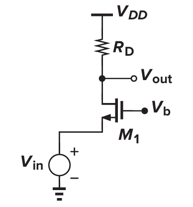
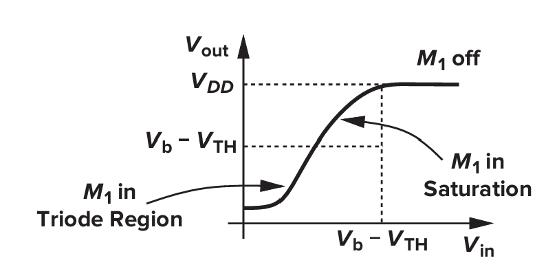
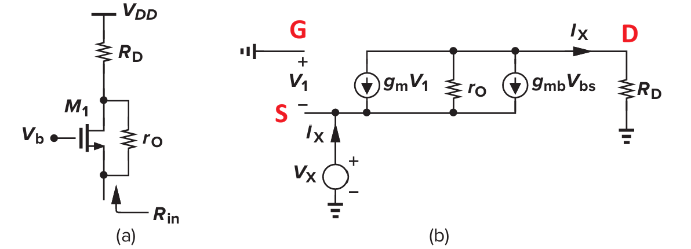
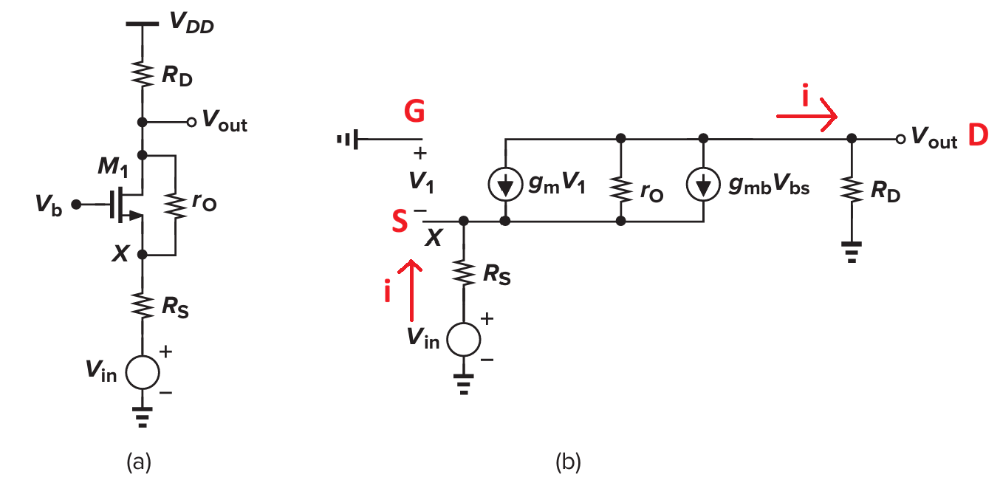
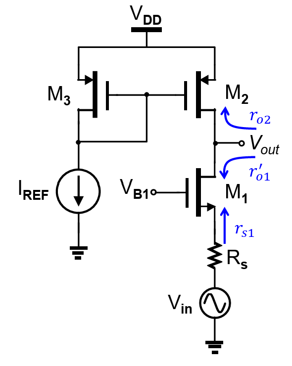

# Common-Gate Stage

In the previous sections, we saw that the **gate voltage** can serve as the input, with the **drain or source voltage** as the output. In this section, we introduce the third amplifier configuration, the **common-gate amplifier**. Here, the **gate is fixed at a constant voltage**, the **input is applied to the source**, and the **output is taken from the drain**.

## CG Stage with Resistive Load

A **simplified common-gate (CG) stage with a resistive load** is shown below. We will use this circuit for:

1. Large-signal analysis
2. Input and output resistance analysis
3. Voltage swing analysis

<figure><figcaption>
Figure 3.48(a): Common-gate stage circuit
</figcaption></figure>

For **small-signal analysis**, we will use a more general version of the circuit that includes an **input resistance** at the voltage source. We will see it soon.

### Large Signal Analysis

In this section, we analyse the conditions for the **common-gate (CG) amplifier** to operate in:

1. Cutoff region
2. Saturation region
3. Linear region

For the **saturation region**, we will also derive the **voltage gain**.

#### Cutoff Region

In the circuit shown in **Figure 3.48(a)**, we have:

$$
\begin{align*}
  V_{GS} &= V_b - V_{in} \\
  V_{DS} &= V_{out} - V_{in}
\end{align*}
$$

For the NMOS to operate in the **cutoff region**: $$V_{GS}<V_{TH}$$. Therefore,

$$
V_b-V_{in}<V_{TH} \Rightarrow V_{in}>V_b-V_{TH}
$$

Thus, as $$V_{in}$$ **decreases** from a high voltage, the NMOS initially operates in **cutoff**. Since the NMOS is **OFF**, no current flows through it, so the drain voltage $$V_{out}$$ is pulled up to $$V_{DD}$$.

#### Saturation Region

Following the cutoff region is the **saturation region**. For the NMOS to operate in saturation:

$$
\begin{align*}
  V_{GS} &> V_{TH} \\
  V_b - V_{in} > V_{TH} &\Rightarrow V_{in} < V_b - V_{TH}
\end{align*}
$$

and

$$
\begin{align*}
  V_{DS} &> V_{GS} - V_{TH} \\
  V_{out} - V_{in} > V_b - V_{in} - V_{TH} &\Rightarrow V_{out} > V_b - V_{TH}
\end{align*}
$$

Therefore, as $$V_{in}$$ decreases from a high voltage, the circuit first leaves the **cutoff region** and enters the **saturation region**. This makes sense because $$V_{out}$$ starts from $$V_{DD}$$ and gradually decreases, while initially remaining above $$V_b-V_{TH}$$.

***

Now, we derive the **voltage gain** of the CG amplifier with a resistive load using **large-signal analysis**, which is essentially finding the **partial derivative** of $$V_{out}$$ with respect to $$V_{in}$$. Since $$M_1$$ is operating in the **saturation region**, we can express the output voltage as:

$$
V_{out} = V_{DD} - I_D R_D = V_{DD} - \frac{1}{2} \mu_n C_{ox} \frac{W}{L} (V_b - V_{in} - V_{TH})^2 R_D \tag{3.104}
$$

obtaining a small-signal gain of:

$$
\frac{\partial V_{out}}{\partial V_{in}} = -\mu_n C_{ox} \frac{W}{L} (V_b - V_{in} - V_{TH}) \left( -1 - \frac{\partial V_{TH}}{\partial V_{in}} \right) R_D
$$

Since $$\partial V_{TH}/\partial V_{in} = \partial V_{TH}/\partial V_{SB} = \eta$$ ([notes are here](../basic-mos-device-physics/mos-device-models.md#small-change-in-the-body-voltage)), we have

$$
\begin{align*}
  \frac{\partial V_{out}}{\partial V_{in}} &= \mu_n C_{ox} \frac{W}{L} R_D (V_b - V_{in} - V_{TH})(1 + \eta) \\
  &= g_m (1 + \eta) R_D
\end{align*}
$$

The interesting observation is that the body effect $$\eta$$  increases the equivalent transconductance of the stage and thus increases the voltage gain of the amplifier.

#### Linear Region

The **linear region** follows the saturation region as $$V_{in}$$ continues to decrease, causing $$V_{out}$$ to fall below $$V_b-V_{TH}$$. To find the exact $$V_{in}$$ at this **boundary point**, we can use **Equation 3.104** and set:

$$
V_{DD} - \frac{1}{2} \mu_n C_{ox} \frac{W}{L} (V_b - V_{in} - V_{TH})^2 R_D=V_b-V_{TH}
$$

Thus, we can solve for $$V_{in}$$ and this gives us the input voltage at which the NMOS transitions from **saturation to the linear region**.

### Voltage Swing

Using the **large-signal analysis** above, we can obtain the $$V_{out}$$-$$V_{in}$$ **characteristic** of the CG amplifier, as shown below:

<figure><figcaption>
Figure 3.49: Common-gate input-output characteristic.
</figcaption></figure>

The **maximum output voltage swing** is determined by the saturation-region boundaries:

$$
V_{\text{out,swing}}=V_{DD}-(V_b-V_{TH})
$$

Similarly, the **input voltage swing** can be obtained using the boundary value of $$V_{in}$$ derived in the [linear-region analysis](common-gate-stage.md#linear-region) above. However, the **usable output swing around the Q-point** also depends on $$R_D$$, since

$$
V_{out,Q}=V_{DD}-I_{D,Q}R_D
$$

Changing $$R_D$$ shifts the **Q-point** within the available output range. If the Q-point is not centered between the two output limits, the output will reach one boundary earlier than the other, resulting in a **smaller maximum symmetric output swing**.


We can mitigate this issue by changing the resistive load $$R_D$$ with a current source! We will see it soon!


### Input & Output Resistance

Now, we continue using Figure 3.48(a) to analyse the input and output resistance of the CG stage amplifier with resistive load.

#### Input Resistance

The **input resistance** of the CG amplifier is measured by **looking into the amplifier from the source terminal**, as illustrated in **Figure 3.53(a)**. Based on this, we can construct the corresponding **small-signal model** utilising the Thevenin equivalent technique, as shown in **Figure 3.53(b)**.

<figure><figcaption></figcaption></figure>

The obvious conditions that we can observe from the circuit is that:

$$
\begin{align*}
  V_1 &= -V_X \\
  V_{bs} &= -V_X
\end{align*}
$$

By using KCL at the source node to get the current flowing through the output resistor $$r_O$$ (it's the same direction as the $$I_X$$), we have:

$$
I_{rO} = I_X + g_m V_1 + g_{mb} V_{bs} = I_X - (g_m + g_{mb}) V_X
$$

By using KVL in the loop formed by $$V_X$$, $$r_O$$ and $$R_D$$, we have

$$
\begin{align*}
  V_X &= I_{rO} r_O + I_X R_D \\
      &= R_D I_X + r_O [I_X - (g_m + g_{mb}) V_X]
\end{align*}
$$

Thus, by rearranging it, we will obtain the first equation. And if we assume that $$(g_m+g_{mb})r_O\gg1$$, we can obtain the second equation.

$$
\begin{align*}
  \frac{V_X}{I_X} &= \frac{R_D + r_O}{1 + (g_m + g_{mb})r_O} \\
  &\approx \frac{R_D}{(g_m + g_{mb})r_O} + \frac{1}{g_m + g_{mb}}
\end{align*}
$$

This again shows that the **body effect reduces the input resistance**. Without the body effect, $$g_{mb}=0$$, resulting in a higher input resistance.

#### Output Resistance

The output resistance is simply

$$
R_{out}=r_O\parallel R_D\approx R_D
$$

### Small-Signal Model

In this section, we consider a **more general CG amplifier with a resistive load**, where a **source resistance** RSR\_S is added to the input voltage source, as shown in **Figure 3.51(a)**. The corresponding **small-signal model** is shown in **Figure 3.51(b)**, with the assumed **positive current direction** indicated by the <mark style="color:$danger;">red arrow</mark>.

<figure><figcaption>
Figure 3.51: (a) CG stage with finite transistor output resistance; (b) small-signal equivalent circuit.
</figcaption></figure>

The obvious conditions in this circuit is

$$
V_X=-V_{bs}=-V_1
$$

By using the superposition principle, we note that the current flowing through $$R_D$$ is **equal** to the current flowing through $$R_S$$, giving us

$$
\begin{align*}
  \frac{V_{in} - V_X}{R_S} &= \frac{V_{out}}{R_D} \\
  \frac{V_{in} + V_1}{R_S} &= \frac{V_{out}}{R_D} \\
  V_1 &= \frac{V_{out}}{R_D}R_S - V_{in} \tag{3.101}
\end{align*}
$$

Now, we use KCL at the source node (node X) to calculate the current flowing through the output resistor $$r_O$$:

$$
\begin{align*}
  I_{rO} &= \frac{V_{out}}{R_D} + g_m V_1 + g_{mb} V_{bs} \\
         &= \frac{V_{out}}{R_D} + g_m V_1 + g_{mb} V_1
\end{align*}
$$

Now, we use KVL in the loop formed by $$V_{in}$$, $$R_S$$, $$r_O$$ and $$R_D$$,


Instead of using KVL, we can also use KCL at node X to get the final voltage gain!


$$
V_{in} = \frac{V_{out}}{R_D} R_S + \left[ \frac{V_{out}}{R_D} + (g_m + g_{mb}) V_1 \right] r_O + V_{out}
$$

Now substitue $$V_1$$ with Equation 3.101, we have

$$
V_{in} = \frac{V_{out}}{R_D} R_S + \left[ \frac{V_{out}}{R_D} + (g_m + g_{mb}) \left( \frac{V_{out}}{R_D} R_S - V_{in} \right) \right] r_O + V_{out}
$$

Rearrange it, we will obtain our **voltage gain** as follows:

$$
\frac{V_{out}}{V_{in}} = \frac{(g_m + g_{mb})r_O + 1}{r_O + (g_m + g_{mb})r_O R_S + R_S + R_D} R_D \tag{3.102}
$$


This equation aligns with our [#large-signal-analysis](common-gate-stage.md#large-signal-analysis "mention") result if we ignore CLM, meaning that $$r_O=+\infty$$ and treat $$R_S=0$$.


## CG Stage with Current Source Load

### Small-Signal Model

For CG stage with CSL, suppose our circuit diagram is as follows:

<figure><figcaption></figcaption></figure>

we just need to change the load resistance in equation 3.102 to $$r_{O2}$$, so the voltage gain will be:

$$
A_v = \frac{(g_{m1} + g_{mb1})r_{O1} + 1}{r_{O1} + (g_{m1} + g_{mb1})r_{O1} R_S + R_S + r_{O2}} r_{O2} \tag{3.103}
$$

In this case, we are more interested in the **approximations** that we can apply to simplify the voltage gain. Suppose we assume that $$R_S$$ is small such that $$RS\ll\frac{1}{g_{m1}+g_{mb1}}$$, our denominator can be simplified to $$r_{O1}+r_{O2}$$. And since we can easily ignore the 1 in the nominator, we will get

$$
A_v\approx(g_{m1}+g_{mb1})\cdot(r_{O1}\parallel r_{O2})
$$
