# Common-Source Stage


Here, we'll omit the "CS stage" to refer to "Common-source stage" to save space and keep the notes neat and concise.


As we saw in Table 3.1 on the previous page, the **common-source amplifier** is one of the most widely used amplifier configurations. Given its importance, we will spend a significant amount of time studying it in this section! For each type of amplifier, we will analyze it from the same five perspectives introduced on the previous page:

1. **Large-Signal Analysis (Static Operating Point)**
2. **Small-Signal Analysis**
3. **Gain** (usually discussed as part of the large- and small-signal analyses above)
4. **Voltage Swing**
5. **Input and Output Resistance** (with a greater emphasis on output resistance)

## CS Stage with Resistive Load

This is the first type of common-source amplifier. As its name suggests, it uses a **resistor** as its load, and its circuit typically looks like the one shown below.

<figure>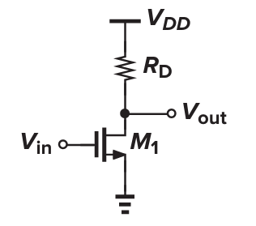<figcaption>
Figure 3.4(a): Common-source stage
</figcaption></figure>

The reason it is called a **common-source** amplifier is that the amplifier's input comes from the NMOS's **gate** terminal and the output comes from the NMOS's **drain** terminal, making the **source terminal a common terminal**. Hence, it is called a **common-source amplifier**.

### Large Signal Analysis

Before discussing the different operating regions of the CS stage with a resistive load, we should first understand the **current path** through the amplifier. The current flows from:

> $$V_{DD}$$ **->** $$R_D$$ **-> the channel formed in the NMOS -> DC ground**

This current path is shown below.

<figure>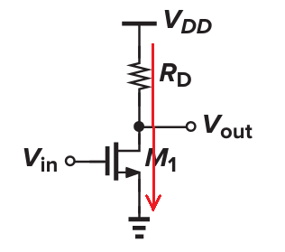<figcaption></figcaption></figure>

The initial conditions are:

* $$V_{\text{out}} = V_{DD}$$
* $$V_{\text{in}} = 0$$

We will then **gradually increase** $$V_{\text{in}}$$ and observe how the circuit behaves as the NMOS moves through its different operating regions.

#### Cutoff Region

The amplifier operates in cutoff region when $$V_{GS}<V_{TH}$$, which is equivalent as

$$
V_{\text{in}}<V_{TH}
$$

In this region, there is no current flowing through the current path and the NMOS is treated as an open circuit. Thus,

$$
V_{\text{out}}=V_{DD}
$$

So, fow now, if we draw the $$V_{\text{out}}$$-$$V_{\text{in}}$$ plot, it may look like below:

<figure>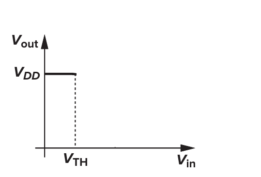<figcaption></figcaption></figure>

#### Linear Region


Intuitively, we might expect the region immediately after **cutoff** to be the **linear region**. However, as we will soon see, this is **not the case for a common-source amplifier**.


The conditions for an NMOS to operate in the **linear region** are: $$V_{GS}>V_{TH}$$ and $$V_{DS}<V_{GS}-V_{TH}$$. For our common-source amplifier, we can express these conditions in terms of $$V_{\text{in}}$$​ and $$V_{\text{out}}$$​. Therefore, the **linear-region operating conditions** for our amplifier are:

$$
V_{\text{in}}>V_{TH}\text{, }V_{\text{out}}<V_{\text{in}}-V_{TH}
$$

As we have studied in the previous chapter, under the linear region, the drain current expression is as follows:

$$
I_D = \mu_n C_{ox} \frac{W}{L} \left[ (V_{GS} - V_{TH})V_{DS} - \frac{1}{2}V_{DS}^2 \right]
$$

Once current begins to flow through the circuit, we can use basic circuit analysis (specifically the **voltage-divider principle**) to express $$V_{\text{out}}$$ as follows:

$$
\begin{align*}
V_{\text{out}} &= V_{DD} - I_D \cdot R_D \\
 &= V_{DD} - R_D \cdot \mu_n C_{ox} \frac{W}{L} \left[ (V_{\text{in}} - V_{TH})V_{\text{out}} - \frac{1}{2} V_{\text{out}}^2 \right]
\end{align*}
$$

As mentioned earlier, we will gradually increase $$V_{\text{in}}$$, which causes $$V_{\text{out}}$$ to decrease accordingly from the initial $$V_{DD}$$. However, the $$V_{\text{out}}$$ condition derived earlier requires $$V_{\text{out}}$$ to be relatively small. Therefore, we can see that the region immediately after **cutoff** cannot be the **linear region**. Instead, the NMOS enters the **saturation region** first, as illustrated in the following plot.

<figure>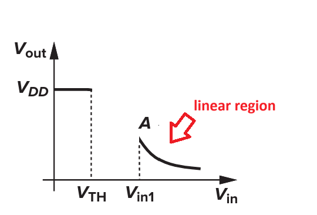<figcaption></figcaption></figure>

Thus, the flow of the NMOS operating region change is actually:

> cutoff -> saturation -> linear

#### Saturation Region

In the saturation region, the NMOS should satisfy: $$V_{GS}>V_{TH}$$ and $$V_{DS}>V_{GS}-V_{TH}$$. For our common-source amplifier, these conditions will become:

$$
V_{\text{in}}>V_{TH}\text{, }V_{\text{out}}>V_{\text{in}}-V_{TH}
$$

Also, from the previous chapter, we learned that the **drain current** in the saturation region is given by:

$$
I_D = \frac{1}{2}\mu_n C_{ox}\frac{W}{L}(V_{GS}-V_{TH})^2
$$

Plug it into this experssion $$V_{\text{out}}=V_{DD}-R_D\cdot I_D$$ which is derived from the voltage divider circuit analysis technique, we will have:

$$
V_{\text{out}} = V_{DD} - R_D \cdot \frac{1}{2} \mu_n C_{ox} \frac{W}{L} (V_{\text{in}} - V_{TH})^2
$$

Now, we can calculate the [**gain**](./#gain) of our ampilifer,

$$
\begin{align*}
A_v &= \frac{\partial V_{\text{out}}}{\partial V_{\text{in}}} \\
&= -R_D \mu_n C_{ox} \frac{W}{L} (V_{\text{in}} - V_{TH}) \\
&= -g_m R_D \tag{3.10}
\end{align*}
$$

The significance of the gain here gives us a basic but important understanding of how a **common-source amplifier with a resistive load** works:

> By virtue of the MOSFET's transconductance, a MOSFET converts variations in its gate-source voltage to a small-signal drain current, which can pass through a resistor to generate an output voltage.


The negative sign indicates that this common-source amplifier is **inverting**. Thus, a small positive change in $$V_{in}$$ increases $$I_D$$, which increases the voltage drop across the load and consequently causes the output voltage to **decrease** from $$V_{DD}$$.


In other words, the signal is transformed in three stages:

$$
\Delta V_{\text{in}} \rightarrow \Delta I_D \rightarrow \Delta V_{\text{out}}~(\text{with the help of the load resistor})
$$


This is the amplifier gain that we calculate using the **large-signal analysis**, and later we will see that using the small-signal model will give us the exact same result.


Now, we can complete our $$V_{\text{out}}$$-$$V_{\text{in}}$$ plot:

<figure>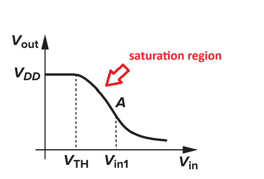<figcaption></figcaption></figure>

How does the transconductance g_m change when we increase V_{\text{in}}?

In the previous chapter, we've learned two very important formulas on how to calculate the transconductance $$g_m$$ under linear and saturation region, and use $$V_{\text{in}}$$ and $$V_{\text{out}}$$ to replace $$V_{GS}$$ and $$V_{DS}$$ respectively, we will get:

1. Linear region: $$g_m= \mu_n C_{ox} \frac{W}{L} V_{\text{out}}$$
2. Saturation region: $$g_m = \mu_n C_{ox} \frac{W}{L} (V_{\text{in}} - V_{TH})$$

If we assume $$V_{\text{in}}$$ is increased linearly, in saturation region, we will see $$g_m$$ increases linearly but in linear region, as $$V_{\text{out}}$$ drops non-linearly, we will see $$g_m$$ also drops non-linearly. This is shown in the following graph.

<figure>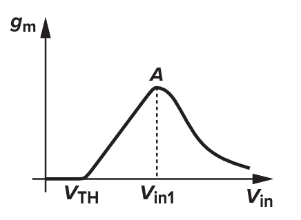<figcaption></figcaption></figure>

And the peak point is reached exactly when $$V_{\text{out}}=V_{\text{in}}-V_{TH}$$, which is also the edge point between the linear and saturation region.

### Small-Signal Model

Now, suppose the NMOS is operating in the **saturation region**. We can proceed to derive the **small-signal model** of our amplifier. The derivation can be divided into two cases:

1. Ignoring channel-length modulation
2. Considering channel-length modulation

In between these two cases, we will also talk about how to **maximize** the voltage gain of our amplifier.

#### Ignore CLM

If we ignore the CLM, the small-signal model for our common-source amplifier with a resistive load can be shown as follows:

<figure>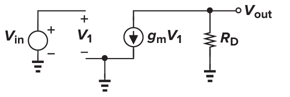<figcaption>
Figrue 3.4(d): small-signal model for the saturation region
</figcaption></figure>

where $$V_{\text{in}},V_1,V_{\text{out}}$$ denote **small-signal quantities**.

DC Ground and AC Ground

In Figure 3.4(d), some readers may wonder why the load resistor $$R_D$$ is connected to **ground** instead of $$V_{DD}$$. The reason is that, in **small-signal analysis**, we are only concerned with the AC variations in the circuit.

> From an AC perspective, **any DC voltage source is equivalent to AC ground**.

Since $$V_{DD}$$ is a constant DC voltage and does not vary with the signal, it is treated as **AC ground** in the small-signal model. Therefore, $$R_D$$ can be connected to ground instead of $$V_{DD}$$.

Similarly, the **DC ground**, denoted by GND, is simply the circuit's ordinary ground reference.

To derive the **voltage gain** of our amplifier, we first need to express the small-signal output voltage $$v_{\text{out}}$$. Based on the direction of the small-signal drain current shown in the figure below,

<figure>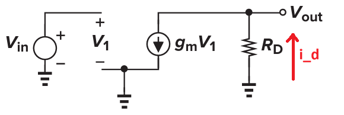<figcaption></figcaption></figure>

we have $$v_{\text{out}}=-i_d\cdot R_D$$. Therefore, the voltage gain of the amplifier can be expressed as:

$$
\begin{align*}
A_v&=\frac{\partial v_{\text{out}}}{\partial v_{\text{in}}}\\
&=-\frac{R_D\cdot i_d}{V_1}\\
&=-\frac{R_D\cdot g_mV_1}{V_1}\\
&=-g_mR_D
\end{align*}
$$


This is the same as the voltage gain that we derive in the large signal analysis.


How to maxmize the voltage gain A_v?

Since both the **large-signal analysis** and the **small-signal model without channel-length modulation (CLM)** give us the same voltage gain, we can now consider how to **maximize the voltage gain**.

We can rewrite the voltage gain as

A_v=-\sqrt{2\mu_n C_{ox}\frac{W}{L}I_D}\cdot R_D=-\frac{V_{RD}}{\sqrt{I_D}}\sqrt{2\mu_n C_{ox}\frac{W}{L}}

From this expression, we can see that the voltage gain can be increased by:

* **Increasing** $$W/L$$
* **Increasing** $$V_{RD}$$ (or increase $$R_D$$)
* **Decreasing** $$I_D$$

However, these parameters are not independent, and increasing one often comes with a corresponding **trade-off in other circuit characteristics**. Therefore, maximizing the voltage gain is not as simple as maximizing each parameter individually.

> TODO: Ask prof gao, why are we choosing to use the square root expansion of gm to analyze the trade-off here?

#### Consider CLM

With larger values of $$R_D$$, the effect of channel length modulation in the NMOS becomes significant. Thus, we need to modify our small-signal model to take into account the output resistance $$r_O$$.

<figure>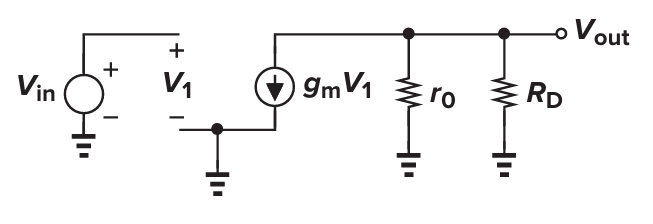<figcaption>
Figure 3.7: Small-signal model of CS stage including the transistor output resistance
</figcaption></figure>


The reason $$r_O$$ is connected to **ground** is that, technically, it is connected to the **source terminal**. Since the source is connected to **DC ground**, it can be treated as ground in the small-signal model.


To derive the new voltage gain $$A_v$$, we simply need to recognize that $$V_{\text{out}}$$ is now the voltage across the **parallel combination of the output resistance** $$r_O$$ **and the load resistor** $$R_D$$.

<figure>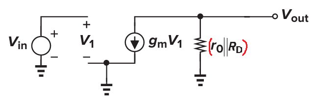<figcaption></figcaption></figure>

Thus, the voltage gain $$A_v$$ can be easily expressed as:

$$
A_v = -g_m \frac{r_O R_D}{r_O + R_D}
$$


In reality, $$R_D\ll r_O$$, thus $$(r_O\parallel R_D)\approx R_D$$.


### Voltage Swing

Let's bring back the $$V_{\text{out}}$$-$$V_{\text{in}}$$ plot we derived earlier. Looking at the saturation region of the curve (between $$V_{TH}$$ and $$V_{\text{in1}}$$), the total allowable **input range** is defined by the horizontal (x-axis) width of the segment, while the total allowable **output swing** is defined by its vertical (y-axis) height.

<figure>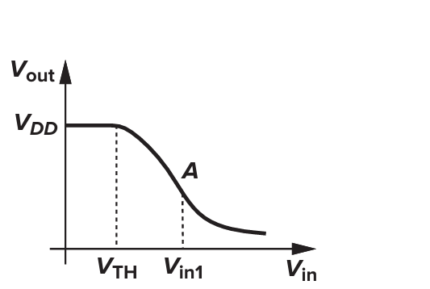<figcaption></figcaption></figure>

#### Input Voltage Range

The total allowable input window to keep the NMOS in saturation is defined as the difference between the linear boundary and the cutoff boundary:

$$
\text{Total Input Range} = V_{\text{in1}} - V_{TH}
$$

However, for a specific DC operating point ($$V_{\text{in, DC}}$$), the actual amount of small-signal input voltage that can be superimposed without clipping depends on where that bias point sits within the window. To avoid pushing the transistor into cutoff or the linear region, the maximum input signal amplitude is limited by whichever boundary is closer:

$$
\text{Max Input Amplitude} = \min(V_{\text{in, DC}} - V_{TH}, \;\; V_{\text{in1}} - V_{\text{in, DC}})
$$

#### Output Voltage Swing

Similarly, the total allowable output swing is bounded by the maximum and minimum voltages the drain node can reach while the transistor remains in saturation:

* Maximum (Cutoff Boundary): $$V_{DD}$$
* Minimum (Linear Boundary): $$V_{\text{in1}} - V_{TH}$$

For a chosen DC output bias point ($$V_{\text{out, DC}}$$), the maximum symmetric AC output amplitude before the wave begins to clip is:

$$
\text{Max Output Amplitude} = \min(V_{DD} - V_{\text{out, DC}}, \;\; V_{\text{out, DC}} - (V_{\text{in1}} - V_{TH}))
$$

Thus, the exact optimal $$V_{\text{out}}$$ to maximize the output voltage swing is:

$$
V_{\text{out, optimal}} = \frac{V_{DD} + (V_{\text{in1}} - V_{TH})}{2}
$$

However, in reality, $$V_{\text{in1}} - V_{TH}$$ is usually quite small so we usually set [DC bias point](common-source-stage.md#static-operating-point) for the drain terminal, prior to the addition of any small-signal components, to $$\frac{V_{DD}}{2}$$, which is also equivalent to $$V_{\text{out}}=\frac{V_{DD}}{2}$$ so that the output voltage swing is maximized.

Derive the Exact Boundary (V_{\text{in1}})

To calculate these specific amplitudes, we need the exact value of $$V_{\text{in1}}$$. This is the precise intersection point between the linear and saturation regions (Point A on the graph above).

At this boundary, the condition is $$V_{\text{out}} = V_{\text{in1}} - V_{TH} = V_{DD} - R_D I_D$$. By substituting the saturation current equation, we can solve for $$V_{\text{in1}}$$ using the following equality:

V_{\text{in1}} - V_{TH} = V_{DD} - R_D \frac{1}{2} \mu_n C_{ox} \frac{W}{L} (V_{\text{in1}} - V_{TH})^2

Trade-off between Gain and Output Swing

From the voltage gain equation above, there are two ways to increase the voltage gain:

1. Increase $$R_D$$
2. Increase $$g_m$$

In amplifier design, as we discussed above, we typically set $$V_{out}=\frac{V_{DD}}{2}$$ to maximize the output voltage swing.



#### Increase $$R_D$$

However, increasing $$R_D$$ is generally not preferred because it increases the DC voltage drop across $$R_D$$, which lowers the available $$V_{DS}$$ and can reduce the output swing, as shown below.

<figure>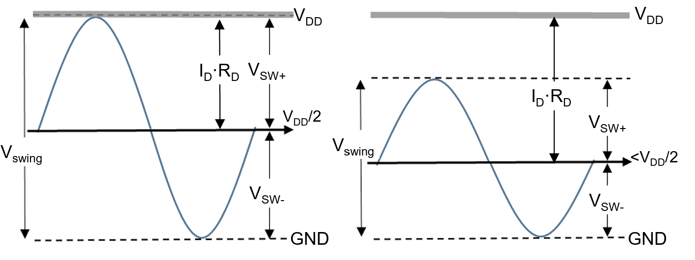<figcaption></figcaption></figure>

We will discuss how to address this limitation later in the amplifier design section.



#### Increase gm

This is the preferred way to increase the voltage gain. We've already seen the three equivalent expressions for $$g_m$$ in saturation in the [previous notes](../basic-mos-device-physics/mos-i-v-characteristics.md#mos-transconductance), the practical way to increase $$g_m$$ here is to increase $$W/L$$, e.g., **increase the transistor size**, which is not cost-effective. Thus, we've seen one more trade-off here!



### Input & Ouput Resistance

The output resistance is simply&#x20;

$$
r_o\parallel R_D
$$

And since the input is connected to the gate, so the input resistance is simply $$+\infty$$.

A real CS Stage with Resistive Load design example

Design a single-stage CS amplifier in $$0.18\text{-}\mu\text{m}$$ CMOS technology for the following specifications:

* Voltage gain $$> 20\text{ dB}$$
* $$I_D = 100\ \mu\text{A}$$
* Output DC bias point: $$V_{out} = V_{DD} / 2$$
* Current through $$R_1$$ and $$R_2$$ is no more than $$10\%$$ of $$I_D$$
* Given: $$V_{DD} = 1.8\text{ V}$$, $$V_{THN} = 0.4\text{ V}$$, $$k'_n = 180\ \mu\text{A/V}^2$$, $$C_1 = 10\ \mu\text{F}$$

***

To design such an amplifier, we can follow the steps below:



#### Draw the basic schemetic

The basic schemetic should look like as follows:

<figure>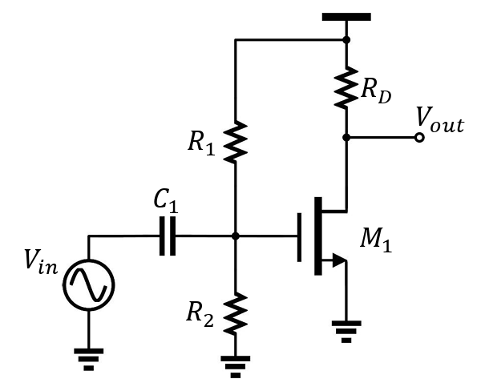<figcaption></figcaption></figure>

The key point is that $$V_{in}$$ is a small-signal input, while $$R_1$$ and $$R_2$$ set the DC bias voltage at the gate by using the **voltage divider**. Since $$I_D$$ is given, we can also calculate $$R_D$$ to establish the desired DC bias point at the drain.


Be careful here! We cannot connect another **DC voltage source** directly to the NMOS gate. For AC analysis, an ideal DC voltage source is treated as AC ground, which would short our small-signal input to ground instead of allowing it to pass through the amplifier.




#### Set an arbitrary gate voltage

At this point, we only know $$R_D$$. We can choose an arbitrary overdrive voltage $$V_{OV}=V_{GS}-V_{TH}$$ to determine suitable values for $$R_1$$ and $$R_2$$. Since the drain current $$I_D$$ is also known, we can use

$$
I_D=\frac{1}{2}k_n'\frac{W}{L}(V_{GS}-V_{TH})^2
$$

to determine the required $$W/L$$ ratio. This gives us a $$W/L$$ ratio of approximately 111.



#### Run the Cadence Simulation

Once we have determined all the required values, we can build the same circuit in Cadence, plug in our calculated component values, and run the simulation.

<figure>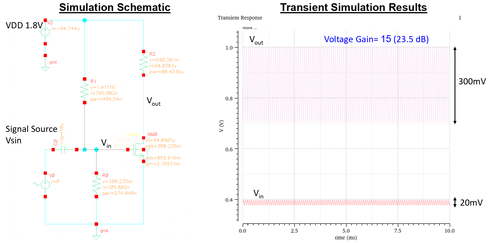<figcaption></figcaption></figure>


However, we still need to tune the amplifier to maximize its gain while keeping the drain DC bias point at $$V_{DD}/2$$. To increase the gain, we can **increase the NMOS width**, which increases $$g_m$$ and, consequently, the voltage gain.




## CS Stage with Diode-Connected Load

In many CMOS technologies, it is difficult to fabricate resistors with tightly-controlled values or a reasonable physical size. Consequently, it is desirable to replace $$R_D$$ in the [previous section](common-source-stage.md#cs-stage-with-resistive-load) with a MOS transistor. A MOSFET can operate as a **small-signal resistor** if its gate and drain are shorted (Figure 3.10(a)).

<figure>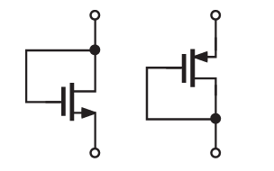<figcaption>
Figure 3.10(a): Diode-connected NMOS (left) and PMOS (right)
</figcaption></figure>

By short-circuiting the gate and drain terminals, we effectively expose only **two** terminals to the external circuit: the **drain and source** (technically three terminals if we include the body). This makes the MOSFET behave similarly to a **two-terminal resistor**.


As we have seen in [NUS EE3408C Workshop 1](https://app.gitbook.com/s/UBWYdYYwvkB8gDH5SdEC/cadence/workshop-1-simple-device-characterization#nmos-device-characterization), when the gate and drain terminals are connected together, the MOSFET will always operate in the **saturation region whenever it is turned on.**


### Output Resistance

To calculate the output resistance of a **diode-connected load** (the same analysis applies to both NMOS and PMOS devices), we will use **Thévenin equivalent circuit analysis**. However, unlike the [previous example](../../resistive-circuits/thevenin-and-norton-equivalent-circuits.md#with-dependent-sources), we are now treating the MOSFET as a **load**. Therefore, we will use a slightly different approach known as the **test-source method**.

#### Ignore Body Effect

Before applying the test-source method, let us first examine the small-signal model of a diode-connected MOSFET, as shown below:

<figure>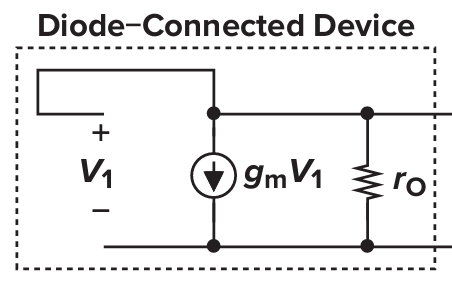<figcaption></figcaption></figure>


Here, $$V_1$$ is simply the small-signal gate-to-source voltage $$V_{GS}$$.


To determine the resistance of this small-signal circuit, we inject energy into the otherwise source-free circuit using a test voltage source,$$V_x$$. Since the circuit is treated as a passive load that absorbs power, we follow the **passive sign convention**. Therefore, the test current $$I_x$$ is defined as **flowing into** the positive terminal of the circuit. The resulting circuit used to determine the equivalent resistance is shown below:

<figure>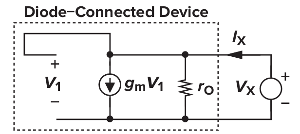<figcaption>
Figure 3.10(b): small-signal equivalent circuit for diode-connected MOSFET
</figcaption></figure>

From the circuit, we can immediately observe that

$$
V_x = V_1 = V_{GS}
$$

The test current is the sum of the currents flowing through the dependent current source and the output resistance $$r_O$$: $$I_x = g_m V_x + \frac{V_x}{r_O}.$$ Factoring out $$V_x$$ gives

$$
I_x = V_x\left(g_m+\frac{1}{r_O}\right)
$$

Using Ohm's law, the Thévenin equivalent resistance seen looking into the diode-connected MOSFET is therefore

$$
R_t=\frac{V_x}{I_x} =\frac{1}{g_m+\frac{1}{r_O}}
$$

Notice that this expression can also be written as $$R_t=\frac{1}{g_m}\parallel r_O$$.


If we have two arbitrary resistors, $$R_A$$, $$R_B$$ and $$R_C$$, in parallel, their equivalent resistance can be written as:

R_{A} \parallel R_{B} \parallel R_C = \frac{1}{\frac{1}{R_A} + \frac{1}{R_B} + \frac{1}{R_C}}



Thus, the small-signal resistance of a diode-connected MOSFET is equivalent to the **parallel combination** of $$1/g_m$$ and $$r_O$$. However, in most practical cases, $$r_O \gg \frac{1}{g_m}$$. And for two resistances connected in parallel, the equivalent resistance is **dominated** by the smaller resistance. Therefore,

$$
R_t \approx \frac{1}{g_m}
$$

#### Consider Body Effect

When the body effect is present, we must include the additional body-effect transconductance, $$g_{mb}$$, in the small-signal model. The resulting circuit can then be used to determine the equivalent resistance seen looking into the source terminal.

<figure>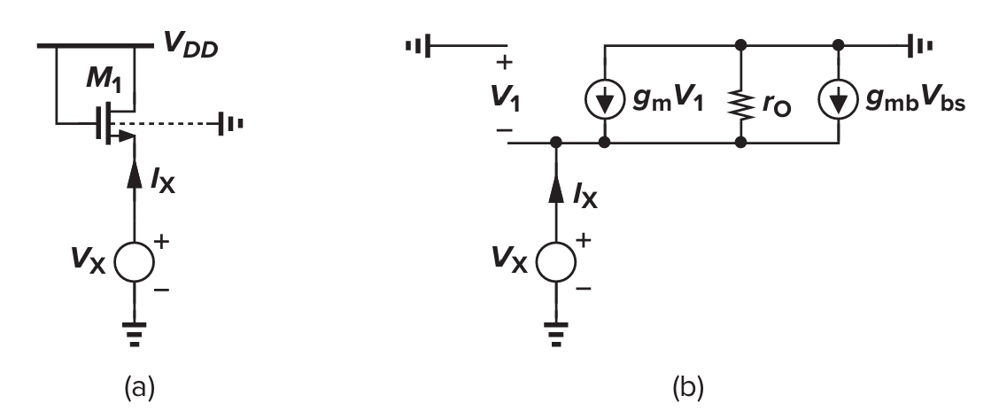<figcaption></figcaption></figure>


The reason the test voltage source $$V_x$$ is applied at a different location is that we are now interested in the impedance looking into the **source**, rather than the drain/gate terminal.


From the small-signal circuit, we have $$V_1=-V_x$$ and $$V_{bs}=-V_x$$. Applying KCL to the source node of the circuit gives

$$
\frac{V_x}{r_O} = g_mV_1+g_{mb}V_{bs}+I_x
$$

Substituting and rearranging this equation, we will have

$$
I_x = \frac{V_x}{r_O}+g_mV_x+g_{mb}V_x
$$

Hence, the equivalent resistance seen looking into the source terminal is

$$
R_t = \frac{V_x}{I_x} = \frac{1}{g_m+g_{mb}+\frac{1}{r_O}}
$$

Equivalently, this can be written as $$R_t = \frac{1}{g_m} \parallel \frac{1}{g_{mb}} \parallel r_O$$. Since $$r_O$$ is typically [much larger](#user-content-fn-1)[^1] than $$1/g_m$$ and $$1/g_{mb}$$, its effect on the parallel combination is relatively small. Therefore, we can approximate the resistance as

$$
R_t\approx \frac{1}{g_m} \parallel \frac{1}{g_{mb}} = \frac{1}{g_m+g_{mb}}\tag{3.24}
$$


This method is essentially the same approach we use to analyze the **output resistance of a common-source (CS) amplifier with a diode-connected load**. Once we understand this method, it can also be easily extended to analyze the **output resistance of a CS amplifier with a resistive load**.


> TODO: think about the intuitive explanation of why body effect of M1 will make impedance smaller.


In the following sections, we will first examine the behavior of an **NMOS transistor used as a diode-connected load**. We will then extend our discussion to the **PMOS diode-connected load** at the end of this section.


### Small-Signal Model

We now consider a **common-source (CS) stage with a diode-connected load**, as shown in Fig. 3.13.

<figure>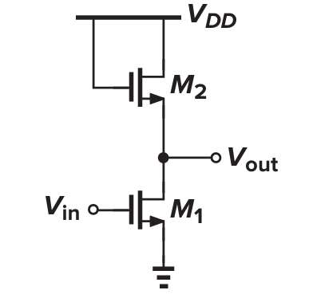<figcaption>
Figure 3.13: CS stage with diode-connected load
</figcaption></figure>

Assuming **channel-length modulation (CLM) is negligible**, we can substitute the small-signal resistance of the diode-connected load derived in **Equation 3.24** into the load impedance term in **Equation 3.10**. Since we have already analyzed the corresponding small-signal model above, this substitution directly yields:

$$
\begin{align*} A_v &= -g_{m1} \frac{1}{g_{m2} + g_{mb2}} \\ &= -\frac{g_{m1}}{g_{m2}} \frac{1}{1 + \eta} \end{align*}
$$

where $$\eta=g_{mb2}/g_{m2}$$. Expressing $$g_{m1}$$ and $$g_{m2}$$ in terms of device dimensions and bias currents (using the knowledge we've learned in the [transconductance](../basic-mos-device-physics/mos-i-v-characteristics.md#mos-transconductance) section), we have

$$
A_v = -\frac{\sqrt{2\mu_n C_{ox}(W/L)_1 I_{D1}}}{\sqrt{2\mu_n C_{ox}(W/L)_2 I_{D2}}} \frac{1}{1 + \eta} \tag{3.27}
$$

and, since $$I_{D1}=I_{D2}$$,

$$
A_v = -\sqrt{\frac{(W/L)_1}{(W/L)_2}} \frac{1}{1 + \eta} \tag{3.28}
$$

The key significance of this result is that, if we **neglect the variation of** $$\eta$$ **with the output voltage**, the voltage gain of this amplifier remains approximately **constant**, regardless of changes in the output voltage.

### Large Signal Analysis

In this section, we aim to verify that **Equation 3.28 also holds under large-signal analysis**. To do so, we will use the fact that the currents flowing through transistors $$M_1$$ and $$M_2$$ are equal. Since both transistors operate in the **saturation region**, we can apply the saturation-region current equation to both devices, giving us:

$$
\frac{1}{2} \mu_n C_{ox} \left(\frac{W}{L}\right)_1 (V_{in} - V_{TH1})^2 = \frac{1}{2} \mu_n C_{ox} \left(\frac{W}{L}\right)_2 (V_{DD} - V_{out} - V_{TH2})^2 \tag{3.31}
$$

Hence, by **canceling the common terms on both sides** of the equation and then **taking the square root of both sides**, we obtain:

$$
\sqrt{\left(\frac{W}{L}\right)_1} (V_{in} - V_{TH1}) = \sqrt{\left(\frac{W}{L}\right)_2} (V_{DD} - V_{out} - V_{TH2})
$$

Thus, if the variation of $$V_{TH2}$$ with $$V_{\text{out}}$$ is small, the circuit exhibits a **linear** input-output characteristics.


$$V_{TH1}$$ remains **constant** because, for transistor $$M_1$$, both the **body and source terminals are connected to ground**. Therefore, there is no source-to-body voltage difference and hence no body effect to cause $$V_{TH1}$$ to vary.


The small-signal gain can thus be computed by differentiating both sides with respect to $$V_{\text{in}}$$:

$$
\sqrt{\left(\frac{W}{L}\right)_1} = \sqrt{\left(\frac{W}{L}\right)_2} \left(-\frac{\partial V_{out}}{\partial V_{in}} - \frac{\partial V_{TH2}}{\partial V_{in}}\right)
$$

which, upon application of the chain rule $$\partial V_{TH2}/\partial V_{in} = (\partial V_{TH2}/\partial V_{out})(\partial V_{out}/\partial V_{in}) = \eta (\partial V_{out}/\partial V_{in})$$:

$$
\frac{\partial V_{out}}{\partial V_{in}} = -\sqrt{\frac{(W/L)_1}{(W/L)_2}} \frac{1}{1 + \eta}
$$

CS amplifier with a PMOS diode-connected load

Obviously, a **diode-connected load can also be implemented using a PMOS transistor**, as shown in Figure 3.16.

<figure>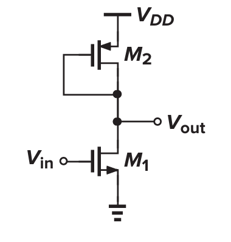<figcaption>
Figure 3.16: CS stage with diode-connected PMOS device.
</figcaption></figure>

This configuration is **free from body effect** because both the **source and body terminals of the PMOS are connected to** $$V_{DD}$$. As a result, the threshold voltage remains constant, giving a small-signal voltage gain of (by using Equation 3.27):

A_v = -\sqrt{\frac{\mu_n (W/L)_1}{\mu_p (W/L)_2}}

Up to this point, we have derived the **voltage gain of a common-source (CS) stage with a diode-connected load**. We can now ask an important design question:

> how can we maximize the voltage gain?

From the derived equations, the main parameter we can control is the transistor aspect ratio, $$W/L$$. In other words, we need a **strong input transistor** $$M_1$$ and a **weak load transistor**.

However, this approach results in **highly disproportionate transistor sizes**. For example, if we want to achieve a $$10\times$$ **increase in voltage gain**, the required change in $$W/L$$ may force the width of the input transistor to increase to around $$100\times$$ its original value. This quickly leads to impractically large and mismatched transistor dimensions.

### Voltage Swing

Now, let us consider the **output voltage swing** of this amplifier. From our [previous discussion](common-source-stage.md#voltage-swing), the output voltage can swing as long as the input NMOS transistor remains in the **saturation region**.

At the **upper limit** of the output swing, the load transistor must be at least **turned on**. As we have established, once the diode-connected load is on, it will always operate in the saturation region. Therefore, we require

$$
V_{GS2}=V_{DD}-V_{out}>V_{TH2}
$$

Rearranging this inequality gives the **upper bound on the output voltage**:

$$
V_{out}<V_{DD}-V_{TH2}
$$

Thus, the upper edge of the output swing is determined by the condition that the diode-connected load remains turned on. The **lower bound** of the output swing remains the same as that of a common-source (CS) amplifier with a resistive load, which is

$$
V_{out}=V_{in}-V_{TH1}
$$

<figure>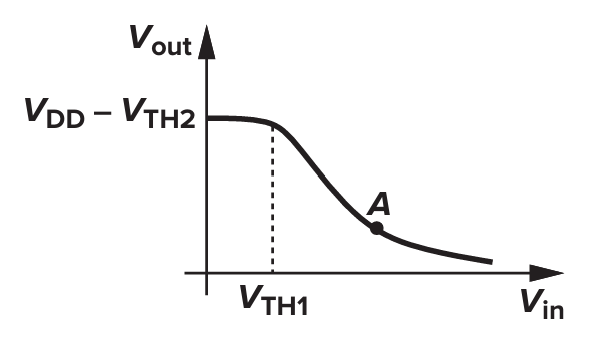<figcaption>
Figure 3.15: Input-output characteristic of a CS stage with diode-connected load.
</figcaption></figure>

## CS Stage with Current-Source Load

In a **CS stage with a diode-connected load**, we have seen that the voltage gain is relatively fixed. In contrast, for a **CS amplifier with a resistive load**, the voltage gain can be increased by increasing the load resistance. However, this approach comes with an important drawback: a larger resistance also produces a larger DC voltage drop at the output, since

$$
V_{out}=V_{DD}-I_DR_D
$$

As a result, the available **output voltage swing is reduced**.

Ideally, we would like to have a load that provides a **large AC resistance** $$r_O$$ while maintaining a [**small DC resistance**](#user-content-fn-2)[^2], so that we can achieve high voltage gain without sacrificing output swing. Is there such a device?

> Yes! A **current source** has exactly this desirable property. As we have seen in the [previous notes](../basic-mos-device-physics/mos-i-v-characteristics.md#saturated-mosfets-as-current-source), a MOSFET operating in the **saturation region** behaves approximately like a current source (more specifically a **voltage-controlled current source**), providing a large small-signal output resistance while maintaining a relatively well-defined DC current.

Therefore, we can replace the resistive load with a **MOSFET current-source load**, giving us the following circuit:

<figure>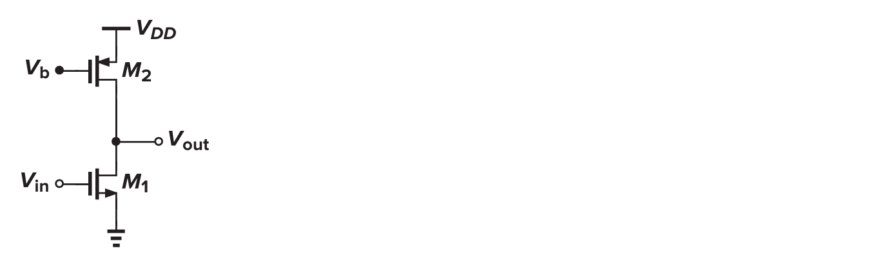<figcaption>
Figure 3.18 (a): CS stage with current-source load
</figcaption></figure>

Here, $$V_b$$ is a **constant DC bias voltage** used to ensure that the transistor operates in the **saturation region**.

AC and DC resistance for a MOSFET current source

For a MOSFET operating in saturation, we can model it as a voltage-controlled current source. Using the small-signal model and the Thevenin equivalent circuit, we can derive its AC and DC resistances:

1. **AC resistance:** $$r_o=\frac{1}{\lambda I_D}$$
2. **DC resistance:** $$R_{DC}=\frac{V_{DS}}{I_D}$$

For example, if $$I_D=0.5\,\text{mA}$$, $$V_{DS}=1.5\,\text{V}$$, and $$\lambda=0.1\,\text{V}^{-1}$$, then

R_{DC}=3\,\text{k}\Omega, r_o=20\,\text{k}\Omega


Therefore, the DC resistance and AC resistance are not the same!


### Small-Signal Model

The small-signal model of Figure 3.18(a) can be drawn as follows.

<figure>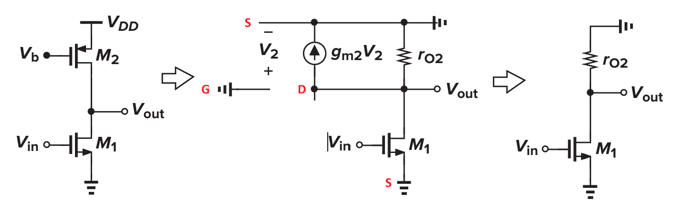<figcaption></figcaption></figure>


Since $$V_b$$ is a constant DC bias voltage, its small-signal variation is zero. Therefore, $$V_{GS2}$$ remains constant, meaning that the corresponding small-signal current through the controlled current source of $$M_2$$ is zero. We can thus ignore this current source in the small-signal model.


The resulting circuit is similar to a **CS amplifier with a resistive load**, except that the load resistance is now provided by the output resistance of $$M_2$$. Hence, the voltage gain can be written directly as

$$
A_v=-g_{m1}(r_{O1}\parallel r_{O2})
$$

### Output resistance

The output resistance seen looking into the **drain terminal** is simply the parallel combination of the output resistances of the two transistors:

$$
R_{out}=r_{O1}\parallel r_{O2}
$$

### Large Signal Analysis

The large signal analysis of this circuit is left as an exercise for the readers. It will give the same result as the small-signal model.

### Voltage Swing

To determine the **output voltage swing**, we first consider the upper bound, which is set by the saturation condition of the PMOS load transistor $$M_2$$. For $$M_2$$ to remain in the saturation region,

$$
V_{SD2}>V_{SG2}-|V_{THP}|
$$

which is,

$$
V_{DD}-V_{out}>V_{SG2}-|V_{THP}|
$$

Rearranging gives us the **upper bound** of the output voltage swing:

$$
V_{out}<V_{DD}-\left(V_{SG2}-|V_{THP}|\right)
$$

The **lower bound** remains the same as that of a CS amplifier with either a **resistive load** or a **diode-connected load**.

$$
V_{out}>V_{in}-V_{TH1}
$$

Tuning V_{\text{out}} to be exactly around V_{DD}/2

In a CS-stage amplifier with a current-source load, the DC bias voltage at the drain can be affected by several factors, including the overdrive voltages, transistor aspect ratios, and the specific MOSFETs used.

The key requirement is that $$I_{D1}=I_{D2}$$ and the DC bias voltage at the drain terminal might change to meet this requirement. For example, if the overdrive voltage of $$M_1$$ increases, $$M_1$$ will sink more current. To maintain $$I_{D1}=I_{D2}$$, $$M_2$$ must also provide more current. Assuming the overdrive voltage of $$M_2$$ remains unchanged, this requires a larger $$V_{SD}$$ across the PMOS (due to channel-length modulation). Thus, the drain voltage $$V_D$$ must therefore decrease to increase $$V_{SD}$$ and allow $$M_2$$ to supply the required current.

So, assuming we are not changing anything for $$M_1$$, to fine tune the $$V_{\text{out}}$$, we can fine tune the follwoing parts of $$M_2$$ to achieve an ideal $$V_{\text{out}}=V_{DD}/2$$

1. $$V_{GS2}$$
2. $$\lambda$$



#### Tuning $$V_{GS}$$ for $$V_{\text{out}}$$

We can determine this using the following formulas. Assuming we set $$V_{out}=V_{DD}/2$$, $$V_{out}$$ becomes a known value, so we only need to adjust $$V_{SG2}$$ for $$M_2$$ to achieve the desired bias point.

$$
\frac{V_{SG2} - |V_{TH2}|}{V_{GS1} - V_{TH1}} = \frac{\left(\frac{W}{L}\right)_n^{1/2}}{\left(\frac{W}{L}\right)_p^{1/2}} \left[ \frac{\frac{k'_n}{2}(1 + \lambda_n V_{out})}{\frac{k'_p}{2}(1 + \lambda_p V_{out})} \right]^{1/2} \tag{1.1}
$$

This tuning process can be visualized as the following graph, where the <mark style="color:$primary;">blue point</mark> is our ideal $$V_{\text{out}}$$

<figure>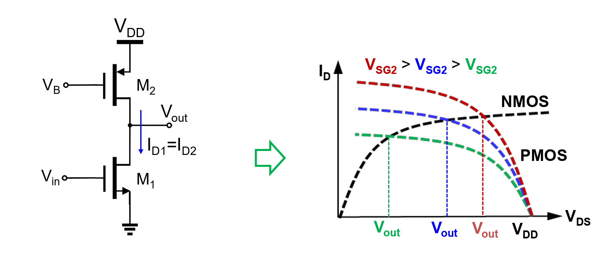<figcaption></figcaption></figure>


This tuning process is suitable for **large** $$V_{\text{out}}$$ variation from the ideal point.




#### Fine tune $$\lambda_p$$ for $$V_{\text{out}}$$

In this case, we still use Equation 1.1 from above, but assume that the left-hand side is fixed and already known. Therefore, we can tune $$\lambda_p$$ on the right-hand side to achieve the desired result. This tuning process can be visualized in the following graph:

<figure>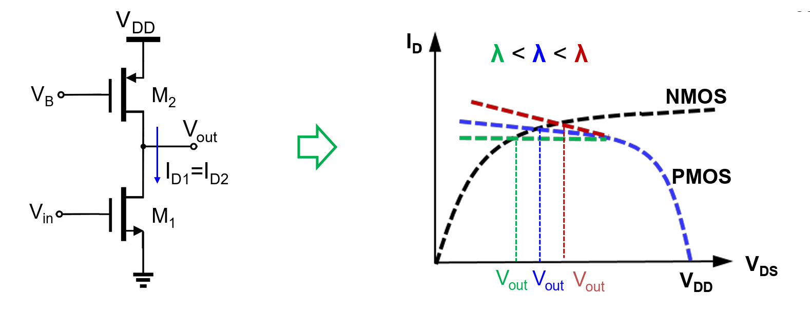<figcaption></figcaption></figure>


This tuning process is suitable for **small** $$V_{\text{out}}$$ variation from the ideal point.




### Use Current Mirror as Current Source

In the [later chapters](../passive-and-active-current-mirrors/basic-current-mirrors.md), we will see that in real analog design, it is desirable to use **current mirrors** as an ideal current source. For example, if we use the PMOS current mirror as our current source, our amplifier will become as follows:

<figure>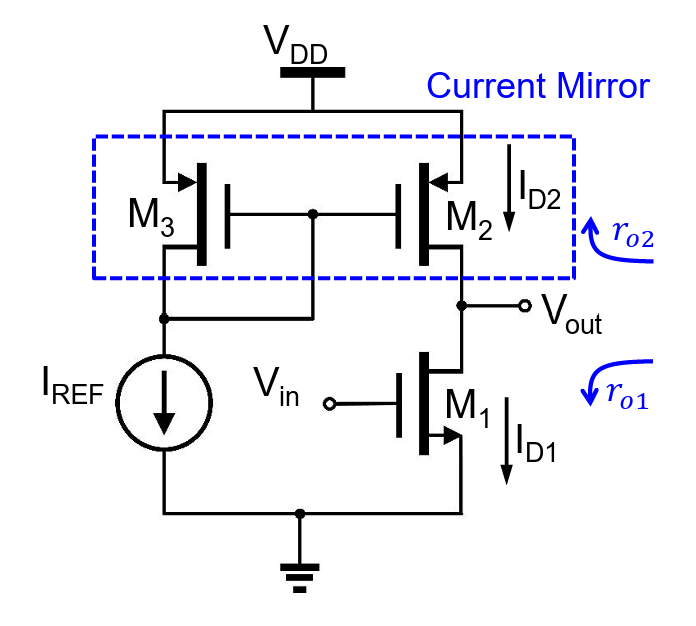<figcaption></figcaption></figure>

Based on the basics of current source as well as that $$I_{D1}=I_{D2}$$, we will have

$$
I_{D1} = I_{D2} = \frac{(W/L)_2}{(W/L)_3} I_{REF}
$$

And doing the similar small-signal analysis as we've [seen](common-source-stage.md#small-signal-model-2) above, we can get:

<figure>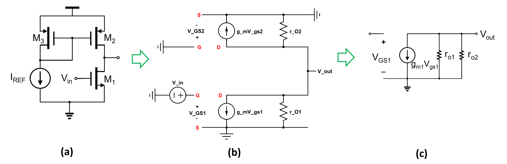<figcaption></figcaption></figure>

From (a) -> (b), we are ignoring $$M_3$$ because it acts exclusively as a DC biasing component for $$M_2$$ and carries no AC signal. And from (b) -> (c), as both the gate and source terminal of $$M_2$$ are connected to **AC Ground**, we can omit the current source above. By rearranging the circuit a bit, we can get the final (c) circuit. This will give us the same results as we derived in a normal CS stage amplifier with current-source as a load:

$$
\begin{align*}
A_V &= \frac{V_{out}}{V_{in}} = -g_{m1}(r_{o1} \parallel r_{o2}) \\
r_{out} &= r_{o1} \parallel r_{o2}
\end{align*}
$$

## CS Stage with Source Degeneration

> TODO: Add notes for this once got time!

[^1]: where the former is usually in **low mega ohms** range while the later is usually in **kilo ohms** range.

[^2]: This means that the **voltage drop** across the device is **small**.
