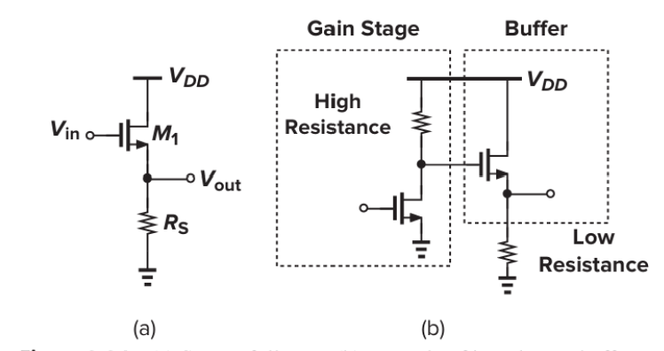
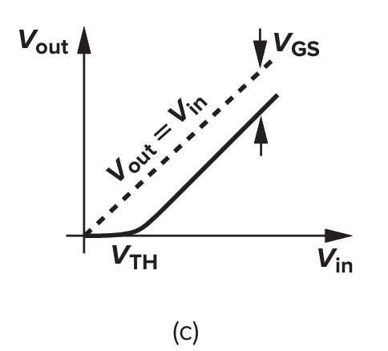
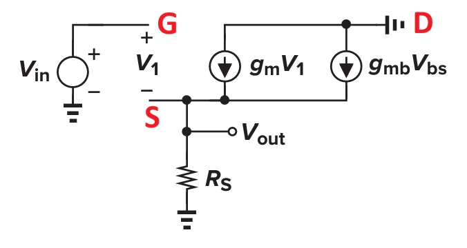
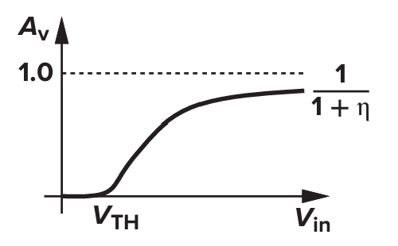
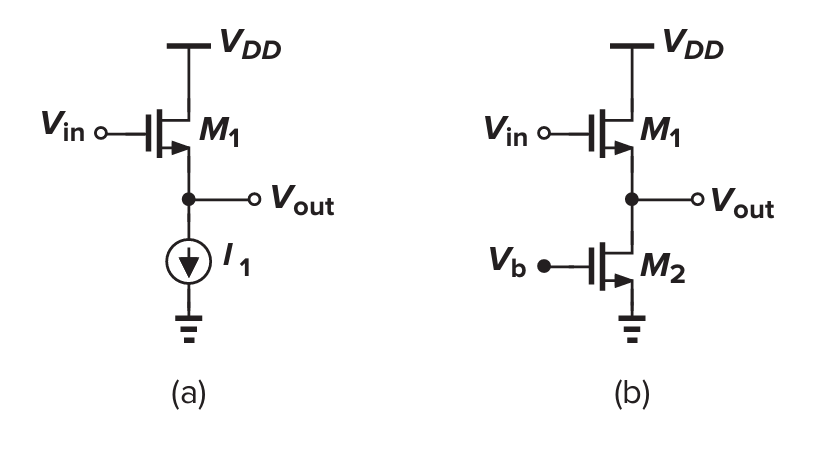
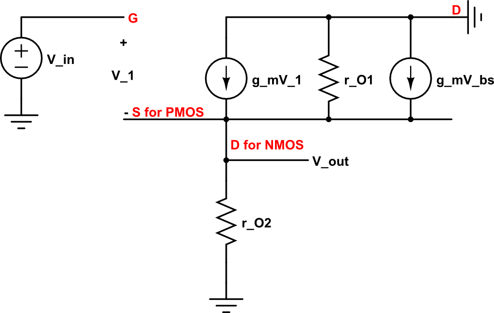
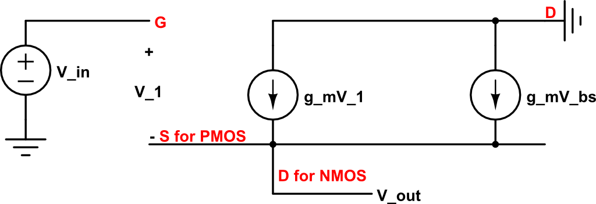
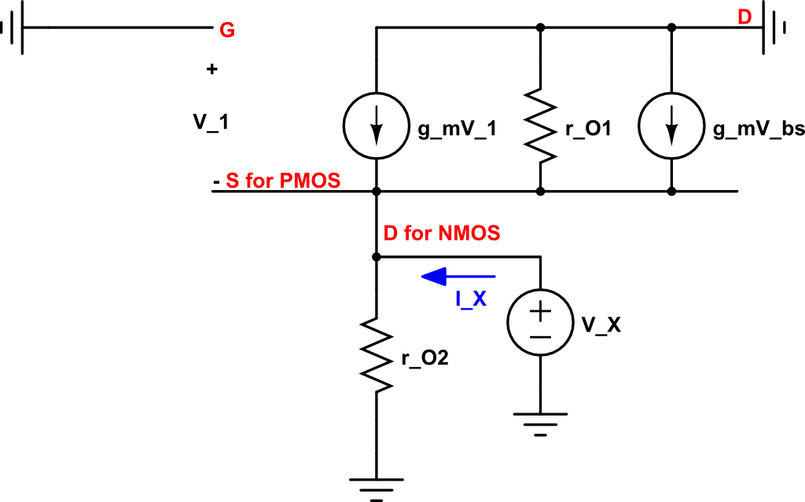

# Source Follower

A **source follower**, also known as a **common-drain amplifier** (shown in Figure 3.34(a)), is named because the **source voltage follows the gate voltage**. Here, the gate is the input, the source is the output, and the **drain terminal is common** to both the input and output. However, the source follower is not an ideal voltage amplifier. In practical analog design, it is therefore commonly used as a **buffer** after a common-source (CS) amplifier.

> Why do we need buffering?

In a CS amplifier, we usually increase the load resistance to achieve higher voltage gain. Ideally, a current-source load provides an extremely large resistance. However, a low-resistance load would significantly reduce the voltage gain.

To drive a **low-resistance load** without significantly decreasing the voltage gain at the CS stage, we can cascade a **source follower** after the CS amplifier. Figure 3.34(b) depicts how the circuit can be used to drive a low resistance without degrading the voltage gain of a CS stage amplifier.

<figure><figcaption>
Figure 3.34: (a) Source follower, (b) example of its role as a buffer
</figcaption></figure>

The idea is that, when driving a **low-resistance load**, we can use a **large-resistance load** for the CS stage to obtain a high voltage gain, then place a **source follower** after it to drive the actual low resistance load. Intuitively, the **CS stage amplifies the input signal**, while the **source follower passes the amplified voltage to the low-resistance load with little voltage-gain loss**.

## Source Follower with Resistive Load

### Large Signal Analysis

#### Cutoff Region

When $$V_{in}<V_{TH}$$, $$M_1$$ works under the cutoff region, thus $$V_{out}$$ is shorted to the DC ground.

$$
V_{out}=0
$$

#### Saturation Region

As $$V_{in}$$ exceeds $$V_{TH}$$, $$M_1$$ turns on in **saturation**. This is because $$V_{DS}=V_{DD}-V_{out}$$ and $$V_{GS}=V_{in}-V_{out}$$, and

$$
V_{DS}-(V_{GS}-V_{TH})=V_{DD}-(V_{in}-V_{TH})
$$

As $$V_{in}$$ doesn't increase above $$V_{DD}+V_{TH}$$, the equation above is always **bigger than 0**. As $$V_{in}$$ increases further, $$V_{out}$$ follows the input with a difference (level shift) equal to $$V_{GS}$$, giving us an **approximate** input-output characteristic as follows:

<figure><figcaption></figcaption></figure>

Now, let's do the rigorous input-output characteristic analysis by using the **large signal model**. Using the basic circuit analysis knowledge and the fact that $$M_1$$ operates in saturation region now, we have

$$
V_{out}=R_S\cdot I_D= R_S\cdot\frac{1}{2} \mu_n C_{ox} \frac{W}{L} (V_{in} - V_{TH} - V_{out})^2 \tag{3.82}
$$

where channel length modulation is ignored. Let's calculate the **small signal gain** of the circuit by differentiating both sides of (3.82) w.r.t. $$V_{in}$$

$$
\frac{\partial V_{out}}{\partial V_{in}}=\frac{1}{2} \mu_n C_{ox} \frac{W}{L} 2(V_{in} - V_{TH} - V_{out}) \left( 1 - \frac{\partial V_{TH}}{\partial V_{in}} - \frac{\partial V_{out}}{\partial V_{in}} \right) R_S \tag{3.83}
$$


Note that in the source follower circuit shown in Figure 3.34(a), the body terminal of $$M_1$$ is connected to DC ground but the source terminal is connected to $$V_{out}$$ which is obviously not 0 when $$V_{in}>V_{TH}$$. Thus, the **body effect** definitely exists!


Since $$\frac{\partial V_{TH}}{\partial V_{in}} = \left(\frac{\partial V_{TH}}{\partial V_{SB}}\right)\left(\frac{\partial V_{SB}}{\partial V_{in}}\right) = \eta \frac{\partial V_{out}}{\partial V_{in}}$$ (as we've seen in the [previous notes](../basic-mos-device-physics/mos-device-models.md#small-change-in-the-body-voltage)), and $$g_m=\mu_n C_{ox} \frac{W}{L} (V_{in} - V_{TH} - V_{out})$$, we have

$$
\frac{\partial V_{out}}{\partial V_{in}} = g_m \left[ 1 - (1 + \eta) \frac{\partial V_{out}}{\partial V_{in}} \right] R_S
$$

Rearrange it, we will have

$$
\frac{\partial V_{out}}{\partial V_{in}} = \frac{g_m R_S}{1 + (1 + \eta) g_m R_S}=\frac{g_m R_S}{1 + (g_m + g_{mb}) R_S}\tag{3.86}
$$

The significance of (3.86) is that the voltage gain is **always** smaller than 1, aligning with our statement at the beginning of this section that "source follower is not an **ideal amplifier**."

### Small Signal Model

Now let's practice our small signal analysis to see if we can get the same result as (3.86). The small signal circuit of the source follower shown in Figure 3.34(a) is shown below:

<figure><figcaption></figcaption></figure>


Attention here that $$V_{GS}$$ is $$V_1$$ (a new variable) instead of just $$V_{in}$$!


In this circuit, we have $$V_1=V_{in}-V_{out}$$ and $$V_{bs}=0-V_{out}=-V_{out}$$. As $$V_{out}=i_d\cdot R_S$$, by using KCL, we have

$$
\begin{aligned}
g_m (V_{in} - V_{out}) + g_{mb} (-V_{out}) &= \frac{V_{out}}{R_S} \\
g_m V_{in} - g_m V_{out} - g_{mb} V_{out} &= \frac{V_{out}}{R_S} \\
g_m V_{in} &= \left( \frac{1}{R_S} + g_m + g_{mb} \right) V_{out} \\
g_m V_{in} &= \left( \frac{1 + (g_m + g_{mb})R_S}{R_S} \right) V_{out} \\
\frac{V_{out}}{V_{in}} &= \frac{g_m R_S}{1 + (g_m + g_{mb})R_S}
\end{aligned}
$$

So, how will the voltage gain change if we keep increasing $$V_{in}$$ but not exceed $$V_{DD}+V_{TH}$$? By playing around with (3.82), we can ignore the 1 in the denominator as it is much smaller compare to the $$g_m$$ and $$g_{mb}$$, thus

$$
A_v\approx\frac{g_mR_S}{g_mR_S+g_{mb}R_S}=\frac{1}{1+\eta}
$$

So, the $$A_v$$-$$V_{in}$$ curve is shown as follows:

<figure><figcaption></figcaption></figure>

### Input & Output Resistance

The output resistance for a source follower like what is discussed in this section is just

$$
R_{out}=\frac{1}{g_m+g_{mb}}\parallel R_S
$$

### Voltage Swing

> TODO: Add when got time

## Source Follower with Current Source Load

Similar to a **CS amplifier with a resistive load**, a **source follower with a resistive load** also faces a trade-off between **voltage gain (load resistance)** and **output voltage swing**.

To mitigate this trade-off, similarly, we can replace the resistive load with a **current-source load**, which provides a **large small-signal (AC) resistance**.


Another motivation for replacing the resistive load with a current source is to alleviate the **non-linearity** issue between $$V_{out}$$ and $$V_{in}$$ [caused by](source-follower.md#small-signal-model) the non-linearity between $$A_v$$ and $$V_{in}$$.


The example circuit is shown as follows:

<figure><figcaption>
Figure 3.37: Source follower using (a) an ideal current source, and (b) an NMOS transistor as a current source
</figcaption></figure>

### Input & Output Resistance

In this part, we are more interested in using the small-signal model to calculate the input and output resistance of the circuit shown in Figure 3.37(b). The small signal model that consider CLM and ignore CLM is shown as follows:



In $$M_2$$ as there is no body effect and the gate voltage is a constant dc voltage, there is only the imaginary output resistance.

<figure><figcaption></figcaption></figure>



<figure><figcaption></figcaption></figure>



#### Output Resistance

The output resistance is measured when looking from the source terminal into the source follower with current source load, and we will divide into two cases:

1. Ignore CLM
2. Consider CLM

And then we will use the **Thevenin Equivalent** technique to analyze the circuit:



#### Consider CLM

To find the thevenin equivalent resistance, we construct the circuit below by ignoring the independent AC voltage source and apply a test voltage source at the source terminal.

<figure><figcaption></figcaption></figure>

In this circuit, notice that $$V_1=V_{bs}=-V_X$$, we can use KCL at the source terminal node to write the following equation

$$
I_X=\frac{V_X}{r_{O2}}+\frac{V_X}{r_{O1}}+g_{mb}V_X+g_mV_X
$$

This will give us:

$$
R_{out} = \frac{V_X}{I_X} = \frac{1}{\frac{1}{r_{O1}} + \frac{1}{r_{O2}} + g_m + g_{mb}}
$$

which is nothing but $$\frac{1}{g_m} \parallel \frac{1}{g_{mb}} \parallel r_{O1} \parallel r_{O2}$$. Approximately, this is just

$$
\frac{1}{g_m+g_{mb}}
$$



#### Ignore CLM

If we ignore CLM, the thevenin circuit will become much simpler and the equivalent resistance is thus:

$$
R_{out}=\frac{1}{g_m+g_{mb}}
$$



#### Input Resistance

The input resistance is measured when we look into the gate terminal of the source follower. In this case, as this is an open circuit so the input resistance is actually $$+\infty$$.

### Large Signal Analysis

> TODO: Add when got time

### Small Signal Analysis

Using the intuitive analysis, the voltage gain should still be approximately 1 as this is a source follower!

### Voltage Swing

> TODO: Add when got time
