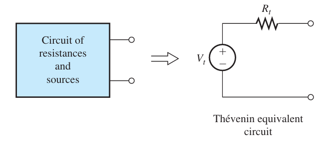
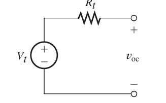
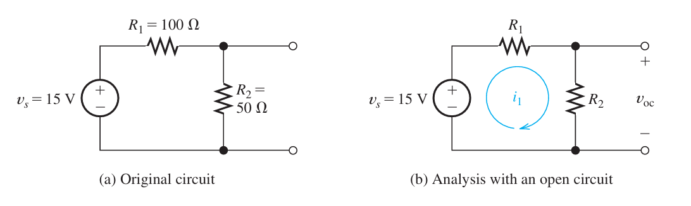
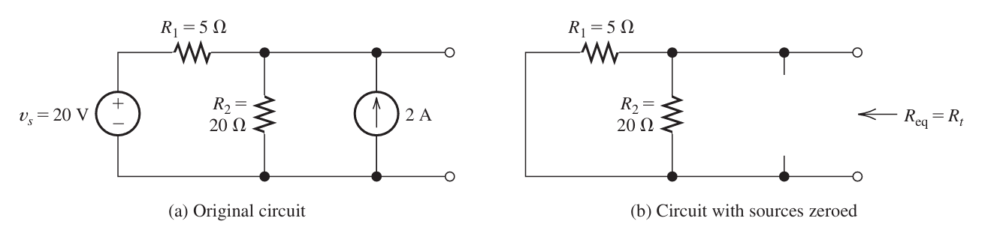
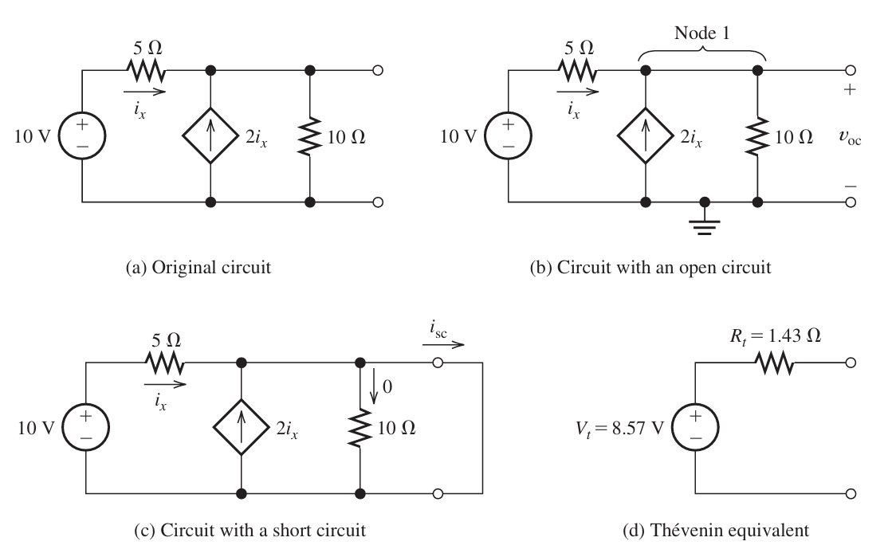

# Thévenin and Norton Equivalent Circuits

In this section, we learn how to replace **two-terminal circuits** containing resistances and sources by simple equivalent circuits.


By a two-terminal circuit, we mean that the original circuit has only **two points** that can be connected to other circuits.


The original circuit can be any complex interconnection of resistances and sources. However, a restriction is that the controlling variables for any controlled sources must appear inside the original circuit.

## **Thévenin Equivalent Circuits**

One type of equivalent circuit is the **Thévenin equivalent**, which consists of **an independent voltage source** in series with a **resistance**. This is illustrated in the following figure:

<figure><figcaption></figcaption></figure>

In the **Thévenin equivalent**, there are two things that we must know how to calculate:

1. the **Thévenin voltage** $$V_t$$
2. the **Thévenin resistance** $$R_t$$: there are two ways to find this depending on whether there are dependent sources in the original network or not.

### **Thévenin Voltage**

For $$V_t$$, consider the Thévenin equivalent with open-circuited terminals as shown in the following figure.

<figure><figcaption></figcaption></figure>

By definition, no current can flow through an open circuit. Therefore, no current flows through the Thévenin resistance, and the voltage across the resistance is zero. Applying KVL, we conclude that:

$$
V_t=v_{oc}
$$

Example to find the thévenin voltage

For example, find the Thévenin voltage for the circuit shown below.

<figure><figcaption></figcaption></figure>

**Sol**. First, we analyze the circuit with open-circuited terminals. This is shown in the (b) figure above. The resistances $$R_1$$ and $$R_2$$ are in series and have an equivalent resistance of $$R_1+R_2$$. Therefore, the current circulating is

i_1 = \frac{v_s}{R_1 + R_2} = \frac{15}{100 + 50} = 0.10A

The open-circuit voltage is the voltage across $$R_2$$:

v_{oc} = R_2 \cdot i_1 = 50 \times 0.10 = 5V

Thus, the Thévenin voltage is $$V_t=5V$$.

### **Thévenin Resistance**

There are two methods for finding the Thévenin resistance:

1. **Short-circuit current method:** This method can be used for any circuit, including circuits with dependent sources.
2. **Visual inspection method:** This method can only be used for circuits that do not contain dependent sources. (a.k.a, with only independent sources)

#### With Independent Sources

If a network[^1] contains **no dependent sources**, there is a faster way to find the Thévenin resistance. First, we zero the sources in the network.

1. In zeroing a **voltage source**, we reduce its voltage to zero. **A voltage source with zero voltage is equivalent to a short circuit**.
2. In zeroing a **current source**, we reduce its current to zero. By definition, an element that always carries zero current is an open circuit.

Thus, to zero the independent sources, we **replace voltage sources with short circuits** and **replace current sources with open circuits**. After zeroing the **independent sources**, we look back into the terminals and we can see the **Thévenin resistance**.

Example to find thévenin resistance using visual inspection method

For example, find the Thévenin resistance for the circuit shown in the following figure by zeroing the sources.

<figure><figcaption></figcaption></figure>

**Sol**. As seen in the (b) figure, the Thévenin resistance can be simply calculated as

R_t=\frac{R_1\cdot R_2}{R_1+R_2}=\frac{20\cdot5}{20+5}=4\Omega

#### With Dependent Sources


As in our small-signal analysis, there is always a **dependent source**, so in most cases, we will use this method to calculate the Thévenin resistance!


Before delving into this part, let's first have a quick recap on what is a **dependant source**. There are basically two types of **dependant sources**:

1. **Dependent voltage sources**: The voltage maintained by a dependent voltage source is equal to a **constant** times a **current flowing through flowing through some other element in the circuit** or a **voltage elsewhere in the circuit**.
   1. Voltage-controlled voltage sources
   2. Current-controlled voltage sources
2. **Dependent current sources**: The current flowing through a dependent current source is determined by a **current** or **voltage** elsewhere in the circuit.
   1. Voltage-controlled current sources
   2. Current-controlled current sources

Now let's use an example to see how to find the Thévenin resistance with a dependent source. Find the Thévenin equivalent for the circuit shown below.


Attention, the following example treats the circuit as a **source** and if we want to treat the circuit as a **load**, can go to the my notes on common-source amplifier with diode-connected load!


<figure><figcaption></figcaption></figure>


If a circuit contains a **dependent source**, we cannot find the Thévenin resistance by zeroing the sources and combining resistances in series and parallel. We must use the approach to find the **short circuit** current $$i_{sc}$$ first and then determine the Thévenin resistance!!!


**Sol**. Because this circuit contains a dependent source, we cannot find the Thévenin resistance by zeroing the sources and combining resistances in series and parallel. Thus, we must analyze the circuit to find the open-circuit voltage and the short-circuit current.

We start with the open-circuit voltage. Consider Figure (b). We use **node-voltage analysis**, picking the reference node at the bottom of the circuit. Then, $$v_{oc}$$ is the unknown node-voltage variable. First, we write a current equation at node 1:

$$
i_x + 2i_x = \frac{v_{oc}}{10} \tag{2.75}
$$

Next, we write an expression for the controlling variable $$i_x$$ in terms of the node voltage $$v_{oc}$$:

$$
i_x = \frac{10 - v_{oc}}{5}
$$

Substituting this into Equation 2.75, we have:

$$
3\left(\frac{10 - v_{oc}}{5}\right) = \frac{v_{oc}}{10}
$$

Solving, we find that $$v_{oc} = 8.57\text{ V}$$. Now, we consider short-circuit conditions as shown in Figure (c). In this case, the current through the $$10\ \Omega$$ resistance is zero. Furthermore, we get:

$$
i_x = \frac{10\text{ V}}{5\ \Omega} = 2\text{ A}
$$

and

$$
i_{sc} = 3i_x = 6\text{ A}
$$

Next, we use Equation 2.74 to compute the Thévenin resistance:

$$
R_t = \frac{v_{oc}}{i_{sc}} = \frac{8.57\text{ V}}{6\text{ A}} = 1.43\ \Omega
$$

Finally, the Thévenin equivalent circuit is shown in Figure (d).


Note that the short-circuit current is the current that flows through the **wire**!!!


[^1]: This is just another fancy way of saying "circuit".
